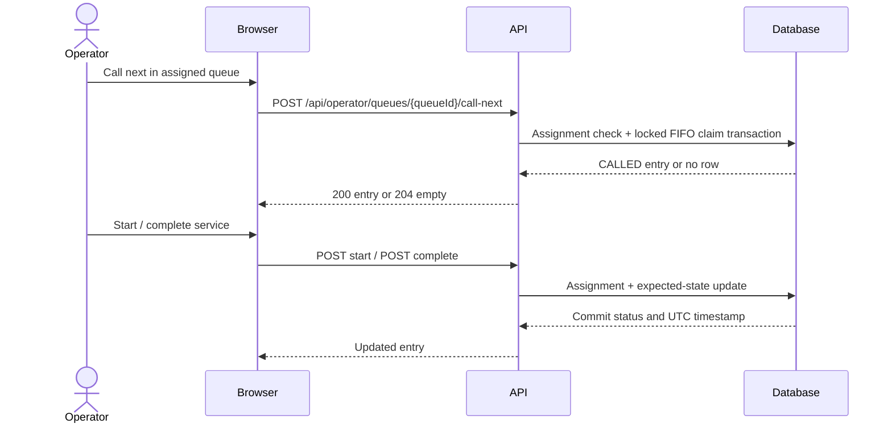

# Feature SDS: Sprint 1 Core Queue

## Purpose, scope and dependencies

Customers join an available queue and privately track their own entry; assigned operators process entries FIFO. Actors: CUSTOMER and OPERATOR. Preconditions: active authenticated user; OPEN queue; operator assignment for management. Dependencies: #2 foundation/data access, #3 authentication/RBAC, #4 queue and numbering, #5 customer flow, #6 operator flow, #7 integration. IDs and decision approvals are governed by `../specification.md`.

## Customer workflow

1. Login; receive current user ID and role.
2. Load open queue catalog and choose a queue.
3. Submit one join request; disable duplicate submit while pending.
4. API validates and transactionally allocates a number and inserts WAITING entry.
5. Show persisted number/status; dashboard and detail refresh from API, never infer state locally.

```mermaid
sequenceDiagram
  actor C as Customer
  participant UI as Browser
  participant API
  participant DB as Database
  C->>UI: Select open queue
  UI->>API: POST /api/queues/{queueId}/entries
  API->>API: Authenticate CUSTOMER; validate
  API->>DB: Transaction: lock queue, duplicate check, allocate, insert
  DB-->>API: Commit WAITING entry
  API-->>UI: 201 entry ID/number/status
  UI-->>C: Show assigned number
  C->>UI: View own entry
  UI->>API: GET /api/me/queue-entries/{entryId}
  API->>DB: Verify owner and read
  API-->>UI: Private detail
```

## Operator workflow

1. Login and load assigned queues.
2. Select queue and inspect entries in `(joinedAt,id)` order, with minimum service display data.
3. Call Next; API atomically claims oldest WAITING entry or returns empty.
4. Start CALLED entry; complete SERVING entry. Refresh state from persisted response.



## Lifecycle and business logic

Only transitions: new→WAITING on customer join; WAITING→CALLED on Call Next; CALLED→SERVING on Start; SERVING→COMPLETED on Complete. Only an assigned operator may manage entries. Reject WAITING→SERVING, WAITING→COMPLETED, CALLED→COMPLETED, any transition out of COMPLETED and repeated transitions with `409 INVALID_STATE_TRANSITION`; status and timestamp are atomic.

FIFO order is `(joinedAt ASC,id ASC)`; eligible status is exactly WAITING. Number scope, format and reset use approved BR-02–04; do not silently choose them. At most one active entry (WAITING/CALLED/SERVING) per customer/queue; COMPLETED permits rejoin. Whether a customer may join different queues simultaneously is BR-06 pending approval. Queue join and Call Next require transactions plus uniqueness/serialization and row locking/equivalent. Frontend checks are convenience only.

## Validation and error handling

Malformed identifiers/body: `400 INVALID_ARGUMENT`; well-formed but unknown resource: `404 RESOURCE_NOT_FOUND`; closed queue: `409 QUEUE_NOT_AVAILABLE`; duplicate active join: `409 DUPLICATE_ACTIVE_ENTRY`; wrong state/repeat: `409 INVALID_STATE_TRANSITION`; stale concurrent mutation: `409 CONCURRENT_MODIFICATION`; empty Call Next: `204` no body; unauthenticated: 401; wrong role: 403; cross-customer detail: 404; unassigned operator queue: 403; unexpected failure: generic 500 `INTERNAL_ERROR` with request ID, no database details.

## Permission matrix

| Operation | Anonymous | CUSTOMER | OPERATOR |
|---|---|---|---|
| Login | Allow | Allow | Allow |
| Open queue catalog | Allow only if endpoint configured public | Allow | Allow |
| Join | Deny | Own request | Deny |
| Entry detail | Deny | Own only | Deny through customer endpoint |
| Assigned queue/entry list | Deny | Deny | Assigned queues only |
| Call/start/complete | Deny | Deny | Assigned queue only |
| Other customer's detail | Deny | 404 | Only minimum service data in assigned queue view; no account/contact data |

## Issue responsibilities

#2 provides persistence and setup (FR-12/13 support); #3 FR-01–03; #4 FR-04–06 and safe allocation; #5 FR-04–07/13; #6 FR-03, FR-08–12; #7 validates FR-01–13. Approve BR-02–06, BR-08, BR-10–11 before dependent behavior is implemented.
