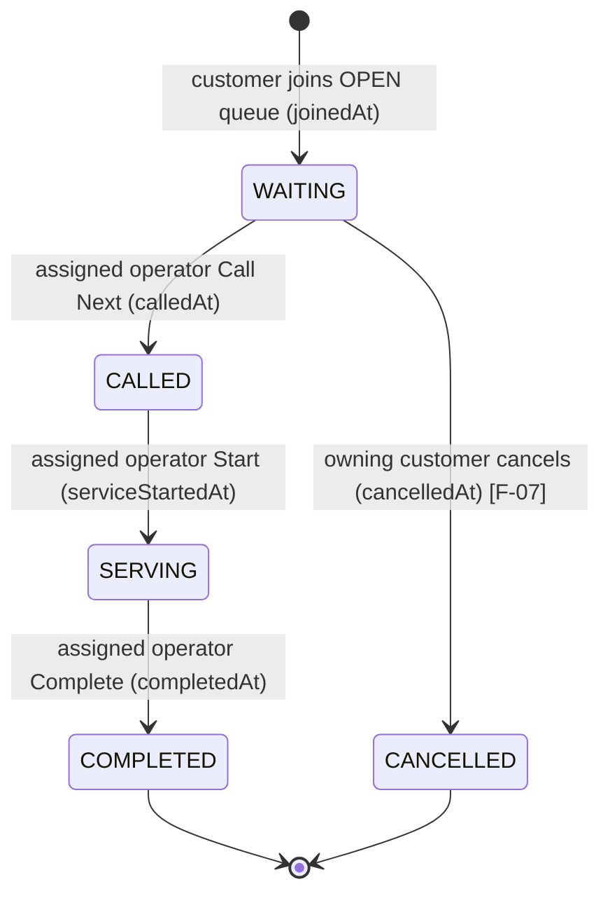

# Feature SDS: F-07 Customer Cancellation and Queue Withdrawal

| Item | Value |
|---|---|
| Feature | F-07 Customer cancellation and queue withdrawal |
| Sprint | 2 (Deliverable 2, Part B) |
| Issue | #40 |
| Contract version | v1 (2026-11-27) |
| Status | Implemented and verified locally at `61e9daf` (contract review by @Khwanklao pending in PR #56; not yet released) |
| Author / reviewer | @TeekhathatTT / @Khwanklao |
| Governing documents | [SRS](../srs.md) v2.0, [System SDS](../system-sds.md) §13, [Sprint 2 API spec](../sprints/sprint-2/api-spec.md), [Sprint 2 UI spec](../sprints/sprint-2/ui-spec.md), [Sprint 2 test spec](../sprints/sprint-2/tests.md) |

## 1. Purpose and scope

A customer who no longer wants to wait can leave a queue they joined. Today (Sprint 1) a `WAITING` entry stays in the line until an operator calls it. That wastes a call, makes everyone behind look further back than they are, and stops the customer from joining the same queue again (BR-05).

F-07 adds one customer action: **cancel my own `WAITING` entry**. The entry moves to a new terminal status `CANCELLED`, the cancel time is recorded, and the row is kept for history.

In scope:
- the `CANCELLED` status, the `cancelledAt` timestamp and their migration
- `POST /api/me/queue-entries/{entryId}/cancel`
- the "Leave queue" control on the customer entry detail page
- the effect on BR-05 (rejoin), Call Next eligibility, the operator entry list and the customer `aheadCount`

Out of scope:
- leaving a `CALLED` or `SERVING` entry (no-show handling is F-08; ending service is an operator action)
- operator-initiated cancellation or removal
- reinstating a cancelled entry (a customer rejoins and gets a new number instead)
- any change to queue-number allocation, the queue catalog, authentication or the operator transitions

## 2. Linked requirements

| Type | IDs | Notes |
|---|---|---|
| Functional | FR-14 (new) | Customer cancels own `WAITING` entry |
| Functional (unchanged, affected) | FR-07, FR-08, FR-09, FR-12, FR-13 | Own-entry reads return cancelled history; operator list and Call Next ignore `CANCELLED`; error contract reused; timestamps server-generated |
| Business rules | BR-13 (new), BR-14 (new), BR-05 (rev 2.0), BR-09 (rev 2.0) | See [SRS §5](../srs.md#5-business-rules-and-decisions) |
| Business rules (unchanged, verified) | BR-01, BR-02, BR-04, BR-07, BR-10, BR-11, BR-12 | |
| Non-functional | NFR-02, NFR-03, NFR-04, NFR-05, NFR-06, NFR-08 | No new NFR. NFR-04 applies to the cancel mutation and is measured by PERF-S2-001 (rev. 2026-11-27, see §15) |
| Acceptance criteria | AC-17 – AC-24 | [SRS §10](../srs.md#10-acceptance-criteria-sprint-2-f-07) |

## 3. Workflow

1. The customer signs in and opens one of their entries at `/customer/entries/:id`.
2. If the entry is `WAITING`, the page shows a **Leave queue** button.
3. The customer selects it. An inline confirmation appears: "Leave General Inquiry Desk? Queue number 7 will not be called, and if you join again you will get a new number." with **Yes, leave queue** and **Keep my place**.
4. On **Yes, leave queue** the client sends `POST /api/me/queue-entries/{id}/cancel` with the CSRF header. The button shows "Leaving queue..." and is disabled.
5. On `200` the page shows the status **Cancelled**, the message "You left this queue.", and a "Cancelled:" timestamp. Polling stops.
6. On an error the page shows a message next to the control (see §8) and re-reads the entry.
7. The customer may go back to Available Queues and join the same queue again. They receive a new, larger queue number.

## 4. State model

The Sprint 1 transitions are unchanged. F-07 adds one edge out of `WAITING`.



| Status | Active (BR-05)? | Eligible for Call Next? | Shown in operator entry list? | Terminal? |
|---|---|---|---|---|
| `WAITING` | yes | yes | yes | no |
| `CALLED` | yes | no | yes | no |
| `SERVING` | yes | no | yes | no |
| `COMPLETED` | no | no | yes | yes |
| `CANCELLED` (new) | no | no | **no** | yes |

## 5. Design decisions

| # | Decision | Rationale |
|---|---|---|
| D-1 | **Only `WAITING` is cancellable.** `CALLED`, `SERVING`, `COMPLETED` and `CANCELLED` return `409 INVALID_STATE_TRANSITION`. A repeated cancel of an already `CANCELLED` entry is **not** an idempotent `200`; it is `409 INVALID_STATE_TRANSITION`. | A called customer who walks away is a no-show (F-08 owns that). Leaving a `SERVING` entry is an operator action. Returning `409` on a repeat keeps the rule "every successful response is exactly one transition" and matches FLOW-007 (repeated complete is rejected). |
| D-2 | **New terminal status `CANCELLED` and nullable `cancelledAt timestamptz`.** The timestamp is taken from the database clock (`clock_timestamp()`, UTC) in the same statement that sets the status (BR-11). Cancelled rows are never deleted. | Same pattern as `calledAt` / `serviceStartedAt` / `completedAt` (System SDS §12 D-1/D-2). Keeping the row preserves history (FR-13) and the queue number stays used (BR-02/BR-04). |
| D-3 | **Endpoint `POST /api/me/queue-entries/{entryId}/cancel`, no body.** Requires session and `X-CSRF-Token`. `entryId` is validated as UUIDv4 by the existing `validateUuidParam`. Success is `200 OK` with `{ "data": { "entry": QueueEntry } }`: the same shape as `GET /api/me/queue-entries/{entryId}`, including `aheadCount` (`0`) and the new `cancelledAt`. | The customer's own entries already live under `/api/me/queue-entries` (api-spec §7.3–§7.4). Action sub-resources follow the operator convention `/queue-entries/{entryId}/start`. `POST` rather than `DELETE` because the row is not deleted. |
| D-4 | **Permissions.** Role `CUSTOMER` only; any other role gets `403 FORBIDDEN`. A customer who does not own the entry gets `404 RESOURCE_NOT_FOUND`, identical to an unknown id. No session gets `401 UNAUTHORIZED`. Missing or wrong CSRF token gets the existing `403 FORBIDDEN` from `requireCsrf`. | Consistent with BR-07, AD-07 and api-spec §7.4. A `403` for a non-owner would reveal that the entry exists. |
| D-5 | **Queue availability does not matter.** Cancelling is allowed when the entry's queue is `CLOSED`. | A customer must always be able to leave. `CLOSED` only blocks new joins (BR-08, AD-05). |
| D-6 | **BR-05 effect.** `CANCELLED` is not an active state, so after cancelling the customer may join the same queue again. The new entry receives the next number from the queue counter, which is always larger than the cancelled one. Numbers are never reused (BR-02/BR-04 unchanged). BR-05 is revised in SRS v2.0 because its Sprint 1 text said "no cancellation/no-show behavior is in scope". | The partial unique index `QueueEntry_active_customer_queue_uidx` already lists only `WAITING`, `CALLED`, `SERVING`, so the database allows the rejoin with **no index change**. |
| D-7 | **Ordering and operators.** Call Next eligibility stays `status = 'WAITING'` (BR-01), so a `CANCELLED` entry is never called. The FIFO order `(joinedAt ASC, id ASC)` of the remaining `WAITING` entries is unchanged; `aheadCount` of later customers drops by one automatically because it counts only `WAITING` rows. `GET /api/operator/queues/{queueId}/entries` **excludes** `CANCELLED` entries (hidden from the operator, kept in the database). | Operators need only entries they may act on or have served (FR-08, minimum data). Hiding them server-side keeps the Sprint 1 operator UI unchanged. Operator-facing cancellation history is left to F-11 analytics. |
| D-8 | **Concurrency: one conditional update inside a transaction.** See §10. A cancel that loses a race returns `409`; a Call Next that loses a race never claims the cancelled entry (it returns `200` with the next eligible entry or `204`). Exactly one transition is applied to the entry. | Call Next uses `FOR UPDATE SKIP LOCKED` and returns `204` rather than an error when no unlocked `WAITING` row exists (BR-10, System SDS §12 D-1). So the "loser" of a race is always the cancel request or a Call Next that simply does not see the row. |
| D-9 | **No change** to the queue catalog (FR-04), queue-number allocation (FR-06), authentication and session handling, or the operator transitions Start and Complete (FR-10/FR-11). Call Next (FR-09) needs no code change; only the eligibility note in D-7 applies. | Keeps the change small and the Sprint 1 regression suite valid without edits. |
| D-10 | **Response field `cancelledAt` is added to every `QueueEntry` payload** (`null` unless cancelled). The client treats it as optional. | One schema for all entry responses; additive, so existing clients and `toMatchObject` assertions are unaffected. |

## 6. UI definition

Full definition: [Sprint 2 UI spec](../sprints/sprint-2/ui-spec.md). Summary:

- Screen: `/customer/entries/:id` (`client/src/pages/EntryDetailPage.tsx`).
- **Leave queue** button, shown only when the entry is `WAITING`. Not rendered for `CALLED`, `SERVING`, `COMPLETED` or `CANCELLED`.
- Inline confirmation step (no browser `confirm()`), focus moves to **Keep my place**; `Escape` closes it.
- Busy state: "Leaving queue..." with the buttons disabled; an in-flight guard prevents a second request.
- Success: status badge **Cancelled**, message "You left this queue.", timestamp row "Cancelled:", footer "You left this queue. This entry no longer updates."; polling stops; a polite live-region announcement.
- Errors shown next to the control (`role="alert"`): see §8.
- New status label `CANCELLED` → "Cancelled" with its own icon (not colour alone). My Active Tickets shows cancelled entries labelled "Cancelled", like completed ones.
- Keyboard-only operation; no page-level horizontal scroll at 360 px and 1280 px (NFR-06).

## 7. API definition

Full definition: [Sprint 2 API spec](../sprints/sprint-2/api-spec.md) §3.

| Item | Value |
|---|---|
| Method and path | `POST /api/me/queue-entries/{entryId}/cancel` |
| Auth | Session cookie (`qms_session`) + `X-CSRF-Token` |
| Role | `CUSTOMER` |
| Request body | None |
| Success | `200 OK`, `{ "data": { "entry": QueueEntry } }` with `status: "CANCELLED"`, `cancelledAt` set, `aheadCount: 0` |

| HTTP | Code | When | Side effect |
|---|---|---|---|
| 400 | `INVALID_ARGUMENT` | `entryId` is not a UUIDv4 | none |
| 401 | `UNAUTHORIZED` | no, invalid or expired session | none |
| 403 | `FORBIDDEN` | role is not `CUSTOMER`; or CSRF header missing/wrong | none |
| 404 | `RESOURCE_NOT_FOUND` | no such entry, or the entry belongs to another customer | none |
| 409 | `INVALID_STATE_TRANSITION` | entry status is `CALLED`, `SERVING`, `COMPLETED` or `CANCELLED` when read | none |
| 409 | `CONCURRENT_MODIFICATION` | entry was `WAITING` when read but changed before the conditional update (e.g. a Call Next committed first) | none |
| 500 | `INTERNAL_ERROR` | unexpected failure; the transaction rolls back | none |

No new error code is added.

## 8. UI error mapping

| Response | Message near the control | Follow-up |
|---|---|---|
| `409` (either code) | "You can no longer leave this queue because your status has changed." | Re-read the entry; the Leave queue button disappears if the entry is no longer `WAITING` |
| `404` / `400` | "We couldn't find that queue entry." | Re-read; the page shows the existing not-found state |
| `403` | "We couldn't verify this request. Please refresh the page or sign in again." | None (same text as join, System SDS §11 D-7) |
| `401` | Existing global session-expired banner | Global handler |
| other / network | "Something went wrong. Please try again." | Control re-enabled |

## 9. Data definition

| Item | Definition |
|---|---|
| Enum | `QueueStatus` gains `CANCELLED` (`WAITING | CALLED | SERVING | COMPLETED | CANCELLED`) |
| Column | `QueueEntry.cancelledAt timestamptz NULL` (Prisma `DateTime? @db.Timestamptz`) |
| Migration | `server/prisma/migrations/20261127090000_f07_queue_entry_cancelled/migration.sql`: `ALTER TYPE "QueueStatus" ADD VALUE 'CANCELLED';` and `ALTER TABLE "QueueEntry" ADD COLUMN "cancelledAt" TIMESTAMPTZ;` |
| Index `QueueEntry_active_customer_queue_uidx` | **Unchanged** (`WHERE "status" IN ('WAITING','CALLED','SERVING')`) |
| Other indexes and constraints | Unchanged |
| Row invariant (asserted by tests, not a DB constraint) | `status = 'CANCELLED'` ⇔ `cancelledAt IS NOT NULL`; a `CANCELLED` row has `calledAt`, `serviceStartedAt`, `completedAt` all `NULL` |
| Seed | No change |

Migration safety:
- PostgreSQL allows `ALTER TYPE ... ADD VALUE` inside a transaction (PG 12+) as long as the new value is not used in that same transaction. The migration does not use `'CANCELLED'`, so one migration file is safe. A `CHECK` constraint on the invariant above would have to use the new value and is therefore **not** added in this migration (review note R-6).
- The change is additive. The running v1.1 revision keeps working against the migrated schema, so the migration is applied to the deployed database **before** the new revision serves traffic.
- Rollback caveat: once a `CANCELLED` row exists, an older revision whose Prisma client does not know `CANCELLED` fails when it reads that row. Rolling back below this release needs those rows handled first.

## 10. Concurrency design

`cancelEntry(customerId, entryId)` in `server/src/services/queueService.ts`, one `prisma.$transaction`:

1. Read the entry by id (no lock).
2. Not found, or `customerId` differs → `404 RESOURCE_NOT_FOUND`.
3. Status is not `WAITING` → `409 INVALID_STATE_TRANSITION`.
4. Conditional update:
   ```sql
   UPDATE "QueueEntry"
   SET "status" = 'CANCELLED', "cancelledAt" = clock_timestamp()
   WHERE "id" = $entryId AND "customerId" = $customerId AND "status" = 'WAITING'
   RETURNING *;
   ```
5. Zero rows updated → the status changed between step 1 and step 4 → `409 CONCURRENT_MODIFICATION`.
6. Commit, then return `200` with the updated row (NFR-05: success only after commit).

Why this is race-safe under PostgreSQL `READ COMMITTED`:
- If a Call Next transaction has locked the row (`FOR UPDATE SKIP LOCKED`) and set it to `CALLED`, the `UPDATE` in step 4 waits for that lock, then re-evaluates `status = 'WAITING'` on the committed row, matches nothing, and the cancel returns `409`.
- If the cancel's `UPDATE` holds the row lock first, a concurrent Call Next skips that row (`SKIP LOCKED`) and claims the next `WAITING` entry or returns `204`. After the cancel commits, the row is `CANCELLED` and is never eligible again.
- Two cancels of the same entry: the second `UPDATE` waits, re-evaluates, matches nothing, and returns `409`.

| Race | Possible outcomes (both are valid) | Never happens |
|---|---|---|
| cancel vs Call Next on the same entry | (a) cancel `200` + entry `CANCELLED`; Call Next `200` with another entry or `204`. (b) Call Next `200` with this entry + entry `CALLED`; cancel `409` | entry both called and cancelled; both requests report success on this entry; a lost update |
| cancel vs cancel (same owner) | one `200`, one `409` | two `200`s |

Known limitation (same as System SDS §12 D-1): if a cancel transaction locks the row and then rolls back after a Call Next skipped it, that Call Next calls a later entry first. The skipped entry stays `WAITING` and is called next.

## 11. Validation, boundaries and permissions

Request processing order on the route: `validateUuidParam` (router param) → `requireAuth` → `requireRole(CUSTOMER)` → `requireCsrf` → `cancelEntry`. This is the order already used by `POST /api/queues/{queueId}/entries` and `GET /api/me/queue-entries/{entryId}`.

| Caller | Ownership | Entry status | Queue availability | Result |
|---|---|---|---|---|
| anonymous | — | any | any | `401 UNAUTHORIZED` |
| OPERATOR (any assignment) | — | any | any | `403 FORBIDDEN` |
| CUSTOMER, bad/missing CSRF | any | any | any | `403 FORBIDDEN`, no change |
| CUSTOMER | not owner | any | any | `404 RESOURCE_NOT_FOUND`, no change |
| CUSTOMER | — (id unknown) | — | — | `404 RESOURCE_NOT_FOUND` |
| CUSTOMER | — (id malformed) | — | — | `400 INVALID_ARGUMENT` |
| CUSTOMER | owner | `WAITING` | `OPEN` | `200`, `CANCELLED` |
| CUSTOMER | owner | `WAITING` | `CLOSED` | `200`, `CANCELLED` |
| CUSTOMER | owner | `CALLED` / `SERVING` / `COMPLETED` / `CANCELLED` | any | `409 INVALID_STATE_TRANSITION`, no change |
| CUSTOMER | owner | `WAITING` at read, changed before update | any | `409 CONCURRENT_MODIFICATION`, no change by this request |

## 12. Layers with no change

- Queue catalog `GET /api/queues` (FR-04): unchanged.
- Queue-number allocation and join (FR-05, FR-06, BR-02–BR-04): unchanged code; the rejoin works because of the existing partial index.
- Authentication, session, CSRF and RBAC middleware (FR-01–FR-03): unchanged.
- Operator Start and Complete (FR-10, FR-11): unchanged.
- Call Next (FR-09): unchanged SQL; it already selects only `WAITING`.
- Seed data and the Docker image: unchanged.

Changed:
- `listOperatorQueueEntries` adds `status <> CANCELLED` (D-7).
- `formatQueueEntry` adds `cancelledAt` (D-10).
- Customer detail polling stops for `CANCELLED` as well as `COMPLETED`.

## 13. Definition of Done

- [ ] Contract v1 reviewed by @Khwanklao and the review recorded
- [x] Red tests committed and the red run saved (`docs/sprints/sprint-2/evidence/f07-red-run.txt`, red commit `477febb`)
- [x] Migration applied to the local and test databases; partial unique index unchanged (CANCEL-011)
- [x] All CANCEL-001 – CANCEL-020 tests executed and passing (`61e9daf`)
- [x] Sprint 1 regression (server, client, E2E) executed and passing with no Sprint 1 test edited
- [x] Server typecheck, client typecheck, build and `docker build` pass
- [x] Green run saved (`docs/sprints/sprint-2/evidence/f07-green-run.txt`)
- [x] Traceability, test spec and completion table updated with actual results and commit SHA
- [ ] PR into `sprint2-staging` reviewed by @Khwanklao, CI green
- [x] NFR-04 p95 measured for the cancel mutation and the operations F-07 changed: PERF-S2-001 passed (cancel p95 16.4 ms ≤ 1,000 ms; `docs/sprints/sprint-2/evidence/perf-s2-001.txt`)
- [ ] Not part of F-07 DoD: production migration and release deploy

## 14. Review notes (decisions to challenge)

| # | Topic | Question for the reviewer |
|---|---|---|
| R-1 | Cancellable states | Is `WAITING`-only correct, or should a `CALLED` customer be able to leave before F-08 exists? |
| R-2 | 404 vs 403 | Non-owner gets `404` (privacy) while an operator gets `403` (role). Agree? |
| R-3 | CLOSED queue | Cancelling is allowed on a `CLOSED` queue. Agree? |
| R-4 | Repeat cancel | Second cancel returns `409`, not an idempotent `200`. Agree? |
| R-5 | Operator view | Cancelled entries are hidden from the operator entry list. Should operators see them in a separate section instead? |
| R-6 | DB invariant | No `CHECK` constraint for `CANCELLED` ⇔ `cancelledAt` in this migration (enum value cannot be used in the same transaction). Add it in a second migration? |
| R-7 | Race contract | The losing Call Next returns `200`/`204`, not `409`. Is that the right reading of "exactly one wins"? |
| R-8 | Migration order | Apply the migration before deploy; rollback below this release needs care once `CANCELLED` rows exist. |

## 15. Revision history

| Date | Section | Previous text (kept for the record) | New text / reason |
|---|---|---|---|
| 2026-11-27 | §2 Non-functional row | "NFR-02, NFR-03, NFR-05, NFR-06, NFR-08 · No new NFR. NFR-04 applies to the new mutation but is not re-measured in F-07 (see §13)" | NFR-04 added to the IDs; measured by PERF-S2-001. Reason: PR #56 review asked for NFR-04 evidence or a reason it does not apply. It does apply: the cancel endpoint is a mutation on the NFR-04 dataset. |
| 2026-11-27 | §13 DoD | "[ ] Not part of F-07 DoD: NFR-04 p95 measurement of the cancel mutation (PERF-001 is not extended); production migration and release deploy" | Split: NFR-04 measurement done (PERF-S2-001 passed); production migration and release deploy still outside the F-07 DoD. PERF-001 itself is unchanged; PERF-S2-001 is a separate script with the same method. |
