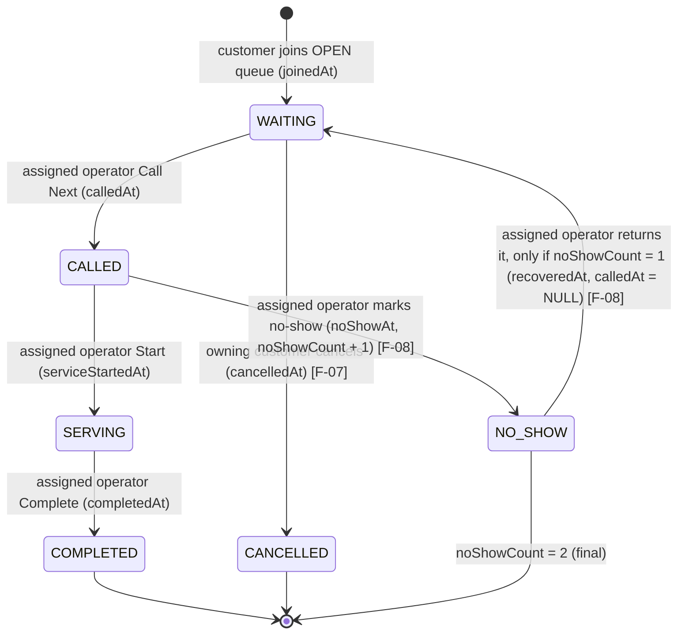

# Feature SDS: F-08 No-show Handling and Recovery

| Item | Value |
|---|---|
| Feature | F-08 No-show handling and recovery |
| Sprint | 2 (Deliverable 2, Part B) |
| Issue | #41 |
| Depends on | F-05 (operator lifecycle); interacts with F-04 (join, BR-05) and F-07 (cancel) |
| Contract version | v1 (2026-11-27) |
| Status | Implemented and verified locally at `37fd6c0` (contract review by @Khwanklao pending; not yet released). *Rev. 2026-11-27:* was "Contract v1, pending review by @Khwanklao". |
| Author / reviewer | @TeekhathatTT / @Khwanklao |
| Governing documents | [SRS](../srs.md) v3.0 (§1.2, FR-15, FR-16, BR-15–BR-17, §10.1), [System SDS](../system-sds.md) §14, [Sprint 2 API spec](../sprints/sprint-2/api-spec.md) §7–§11, [Sprint 2 UI spec](../sprints/sprint-2/ui-spec.md) §6–§9, [Sprint 2 test spec](../sprints/sprint-2/tests.md) §7 |

## 1. Purpose and scope

In Sprint 1, when an operator calls a customer who does not come to the counter, the entry stays `CALLED` for ever. The operator can only start and complete a service that never happened, which makes the record wrong, or leave it, which leaves a stuck "active" entry that also blocks the customer from rejoining (BR-05).

F-08 adds two operator actions:
- **Mark no-show:** a `CALLED` entry becomes `NO_SHOW`; the time is recorded and the no-show is counted.
- **Return to queue (recovery):** a late customer who arrives after being marked `NO_SHOW` can be put back in line **once**, at the place they already had.

In scope:
- the `NO_SHOW` status, the `noShowAt` and `recoveredAt` timestamps, the `noShowCount` counter, their migration and a `CHECK` constraint on the counter
- `POST /api/operator/queue-entries/{entryId}/no-show` and `POST /api/operator/queue-entries/{entryId}/recover`
- the operator queue page: Mark no-show button, a No-show section, a Return to queue button
- the customer entry page: `NO_SHOW` display and messages
- the effect on BR-05 (rejoin), Call Next, the operator entry list, `aheadCount` and F-07 cancel

Out of scope:
- an automatic timer or grace period (D-2)
- customers marking themselves no-show or returning themselves (issue #41)
- a configurable recovery limit, a full event log of every call and no-show, no-show statistics (F-11)
- any change to join, queue-number allocation, the catalog, authentication, Start or Complete

## 2. Linked requirements

| Type | IDs | Notes |
|---|---|---|
| Functional | FR-15 (new), FR-16 (new) | Mark no-show; return to queue |
| Functional (unchanged, affected) | FR-03, FR-07, FR-08, FR-09, FR-12, FR-13 | Assignment check reused; customer reads show `NO_SHOW`; operator list shows `NO_SHOW`; Call Next ignores it; error contract reused; timestamps server-generated |
| Business rules | BR-15, BR-16, BR-17 (new); BR-05, BR-09 (rev. 3.0) | See [SRS §5](../srs.md#5-business-rules-and-decisions) |
| Business rules (unchanged, verified) | BR-01, BR-02, BR-07, BR-10, BR-11, BR-12, BR-13 | |
| Non-functional | NFR-02, NFR-03, NFR-04, NFR-05, NFR-06, NFR-08 | No new NFR. NFR-04 is measured for the two new mutations (PERF-S2-002) |
| Acceptance criteria | AC-25 – AC-34 | [SRS §10.1](../srs.md#101-acceptance-criteria-sprint-2-f-08-rev-30) |

## 3. Workflow

1. The operator calls next. Entry A (queue number 7) becomes `CALLED`.
2. The customer does not come. The operator selects **Mark no-show** on A. A becomes `NO_SHOW` and moves to the **No-show** section of the operator page. The customer's page shows "No-show" and asks them to go to the counter.
3. The operator calls next again and serves other customers.
4. The customer of A arrives late. The operator selects **Return to queue** on A. A becomes `WAITING` again with number 7 and its original join time, so it is first in line among the customers who joined after it, and Call Next calls it next.
5. If A is called and marked no-show a second time, the No-show section shows "Already returned once" and there is no Return to queue button. The customer may join the queue again and gets a new number.
6. While A is `NO_SHOW`, the customer may also join the queue again on their own (BR-05). After that, A can no longer be returned (`409 DUPLICATE_ACTIVE_ENTRY`); the customer keeps the new entry.

## 4. State model

The Sprint 1 and F-07 transitions are unchanged. F-08 adds one edge out of `CALLED` and one edge back to `WAITING`.

| Status | Active (BR-05)? | Eligible for Call Next? | Shown in operator entry list? | Terminal? |
|---|---|---|---|---|
| `WAITING` | yes | yes | yes | no |
| `CALLED` | yes | no | yes | no |
| `SERVING` | yes | no | yes | no |
| `COMPLETED` | no | no | yes | yes |
| `CANCELLED` | no | no | no | yes |
| `NO_SHOW` (new) | **no** | no | **yes** | only when `noShowCount` = 2 |

## 5. Design decisions

| ID | Decision and reason |
|---|---|
| D-1 | **Only `CALLED` can be marked no-show.** `WAITING` was never called; `SERVING` means the customer came. Every other source status returns `409 INVALID_STATE_TRANSITION`. A repeated mark is not an idempotent success. |
| D-2 | **No grace period.** The operator may mark no-show at any time after the call. The operator sees whether the customer came; the system has no service-day clock policy and a timer would be hard to test and to explain. A grace period can be added later without changing the data model (review note R-1). |
| D-3 | **Recovery puts the entry back at its original FIFO position.** `joinedAt` and the queue number are kept, so FIFO (BR-01) needs no new ordering key and Call Next, `aheadCount` and the operator list need no code change. In practice the returned customer is called next, ahead of everyone who joined after them, which matches "they were already called once" (R-2). |
| D-4 | **Recovery is allowed once per entry.** `noShowCount` counts no-shows. Return is allowed only while it is 1. A second no-show (count 2) is final; a return is rejected with the new code `409 RECOVERY_LIMIT_REACHED`, so the UI can show a specific message. A `CHECK (noShowCount BETWEEN 0 AND 2)` constraint keeps the counter in range in the database (R-3). |
| D-5 | **`NO_SHOW` is not active (BR-05).** The customer is not blocked: they may join the same queue again with a new number. Because a return makes the old entry active again, a return is rejected with `409 DUPLICATE_ACTIVE_ENTRY` if the customer already has another active entry in that queue. The partial unique index `QueueEntry_active_customer_queue_uidx` is unchanged and is the database backstop (R-4). |
| D-6 | **On return, `calledAt` is cleared.** A `WAITING` row then looks like any other `WAITING` row (`calledAt` `NULL`), so F-07's cancel invariant (`CANCELLED` ⇒ `calledAt` `NULL`) still holds if the customer later leaves. The no-show time stays in `noShowAt` and the return time in `recoveredAt`. The time of the first call is not kept separately; a full event log is out of scope (R-5). |
| D-7 | **`noShowAt` holds the latest no-show.** After a second no-show it is overwritten. `noShowCount` and `recoveredAt` show that there was an earlier one. |
| D-8 | **`NO_SHOW` entries are shown to operators.** Unlike `CANCELLED` (F-07 D-7), the operator needs to see them to return them. The list order is unchanged (`joinedAt ASC, id ASC`); the UI groups them in their own section. |
| D-9 | **Queue availability is not checked** for either action, like Start, Complete and F-07 cancel. Existing entries of a `CLOSED` queue can still be handled (AD-05). |
| D-10 | **Permissions follow Start/Complete exactly:** session, CSRF, role `OPERATOR`, then in the transaction: entry exists (`404`), operator assigned to the entry's queue (`403`), then state checks (`409`). A customer, including the owner, gets `403` from the role check, so there is no ownership-based `404` on these routes. |
| D-11 | **New fields on every `QueueEntry` payload:** `noShowAt` (string or `null`), `recoveredAt` (string or `null`), `noShowCount` (integer). They are additive. |
| D-12 | **No confirmation step for Mark no-show.** Start and Complete have none, and the first no-show can be undone by Return to queue. The second is final; the button stays a separate, clearly labelled control (R-6). |

## 6. UI definition

Operator page `/operator/queues/:id` (`client/src/pages/OperatorQueueDetailPage.tsx`):
- **Active Service** section: each `CALLED` entry gets a **Mark no-show** button next to Start Service. `SERVING` entries do not.
- New **No-show** section below Waiting Queue, listing `NO_SHOW` entries in FIFO order with the badge "No-show", Customer ID and timestamps ("Missed:", and "Returned to queue:" if set).
  - `noShowCount` 1: a **Return to queue** button.
  - `noShowCount` 2: the text "Already returned once. This entry cannot be returned again." and no button.
- The summary line adds "No-show: N".
- Busy texts: "Marking no-show...", "Returning to queue...". Success messages: "Marked queue number N as no-show.", "Returned queue number N to the queue."

Customer page `/customer/entries/:id` (`client/src/pages/EntryDetailPage.tsx`):
- Badge "No-show" (icon: a clock with a slash), timestamps "Missed:" and "Returned to queue:".
- Message while it can be returned: "You missed your turn. If you are still here, please go to the counter. Staff can return you to the queue once."
- Message when final: "You missed your turn again, so this entry is closed. You can join the queue again." Polling stops.
- No new customer control. The Leave queue button (F-07) is not shown for `NO_SHOW`; it is shown again after a return because the entry is `WAITING`.

Full details: [Sprint 2 UI spec §6–§9](../sprints/sprint-2/ui-spec.md).

## 7. API definition

| Endpoint | Role | Body | Success |
|---|---|---|---|
| `POST /api/operator/queue-entries/{entryId}/no-show` | assigned OPERATOR, session + CSRF | none | `200 {data:{entry}}`, `status` `NO_SHOW` |
| `POST /api/operator/queue-entries/{entryId}/recover` | assigned OPERATOR, session + CSRF | none | `200 {data:{entry}}`, `status` `WAITING` |

Error contract (both): `400 INVALID_ARGUMENT` (malformed id), `401 UNAUTHORIZED`, `403 FORBIDDEN` (CSRF, non-operator role, not assigned), `404 RESOURCE_NOT_FOUND`, `409 INVALID_STATE_TRANSITION`. Recover also: `409 RECOVERY_LIMIT_REACHED`, `409 DUPLICATE_ACTIVE_ENTRY`. Full details: [Sprint 2 API spec §7–§11](../sprints/sprint-2/api-spec.md).

## 8. UI error mapping

| API response | Operator page message | Follow-up |
|---|---|---|
| `409 RECOVERY_LIMIT_REACHED` | "This entry was already returned to the queue once and cannot be returned again." | refresh the list |
| `409 DUPLICATE_ACTIVE_ENTRY` (recover) | "This customer has already joined the queue again, so this entry cannot be returned." | refresh the list |
| `409 INVALID_STATE_TRANSITION` / other `409` | existing "This queue entry's status has changed. The queue has been refreshed." | refresh the list |
| `404` | existing "We couldn't find that queue entry." | refresh the list |
| `403` | existing CSRF or permission message | none |
| other | existing "Something went wrong. Please try again." | none |

## 9. Data definition

| Item | Definition |
|---|---|
| Enum | `QueueStatus` gains `NO_SHOW` (`WAITING | CALLED | SERVING | COMPLETED | CANCELLED | NO_SHOW`) |
| Columns | `QueueEntry.noShowAt timestamptz NULL`, `QueueEntry.recoveredAt timestamptz NULL`, `QueueEntry.noShowCount integer NOT NULL DEFAULT 0` |
| Constraint | `QueueEntry_noShowCount_range_check CHECK ("noShowCount" >= 0 AND "noShowCount" <= 2)` (does not use the new enum value, so it can be in the same migration) |
| Migration | `server/prisma/migrations/20261127120000_f08_queue_entry_no_show/migration.sql` |
| Index `QueueEntry_active_customer_queue_uidx` | **Unchanged** (`WHERE "status" IN ('WAITING','CALLED','SERVING')`) |
| Other indexes and constraints | Unchanged |
| Row invariants (asserted by tests) | `NO_SHOW` ⇒ `noShowAt`, `calledAt` not `NULL`, `noShowCount` ≥ 1, `serviceStartedAt`, `completedAt`, `cancelledAt` `NULL`; `noShowCount` = 0 ⇔ `noShowAt` `NULL`; `recoveredAt` not `NULL` ⇒ `noShowCount` ≥ 1; `noShowCount` = 2 ⇒ `recoveredAt` not `NULL`; `WAITING` ⇒ `calledAt` `NULL` |
| Seed | No change |

Migration safety:
- Same pattern as F-07: `ALTER TYPE ... ADD VALUE 'NO_SHOW'` is safe in the migration transaction because nothing in it uses the value. The three columns are additive with a default, so the running revision keeps working.
- Apply the migration to the deployed database **before** the new revision serves traffic.
- Rollback caveat: an older revision's Prisma client does not know `NO_SHOW` and fails on reading such a row. Rolling back below this release needs `NO_SHOW` rows handled first.

## 10. Concurrency design

**Mark no-show** (`markNoShowEntry` in `server/src/services/operatorService.ts`), one transaction, the same pattern as Start/Complete:
1. `SELECT ... FROM "QueueEntry" WHERE id = $1 FOR UPDATE` with `clock_timestamp()`; missing → `404`.
2. Operator assignment for the entry's queue; missing → `403`.
3. Status is not `CALLED` → `409 INVALID_STATE_TRANSITION`.
4. Update `status = NO_SHOW`, `noShowAt = now`, `noShowCount = noShowCount + 1`. Commit, then respond.

Because Start also locks the row `FOR UPDATE` before checking the status, no-show and Start on the same entry run one after the other. The second sees the new status and returns `409`.

**Recover** (`recoverNoShowEntry`), one transaction:
1. Read the entry (no lock) to find its queue; missing → `404`.
2. Lock the queue row `SELECT ... FROM "ServiceQueue" WHERE id = $q FOR UPDATE`. Join takes the same lock first (System SDS §4.1), so a return and a join by the same customer to the same queue run one after the other.
3. Lock the entry `FOR UPDATE` and re-read it with `clock_timestamp()`.
4. Assignment missing → `403`. Status not `NO_SHOW` → `409 INVALID_STATE_TRANSITION`. `noShowCount` ≥ 2 → `409 RECOVERY_LIMIT_REACHED`.
5. Another active entry for the same customer and queue → `409 DUPLICATE_ACTIVE_ENTRY`.
6. Update `status = WAITING`, `calledAt = NULL`, `recoveredAt = now`. A unique violation on `QueueEntry_active_customer_queue_uidx` (should not happen after step 5) is also mapped to `409 DUPLICATE_ACTIVE_ENTRY`.

Lock order is always queue row, then entry row. No other code locks an entry and then the queue row, so the new path adds no deadlock cycle. Call Next locks only entries (`SKIP LOCKED`) and only `WAITING` ones, so it never waits on a `NO_SHOW` row.

| Race | Possible outcomes | Never happens |
|---|---|---|
| no-show vs Start on one `CALLED` entry | no-show `200` + Start `409`, or Start `200` + no-show `409` | both `200`; a `NO_SHOW` row with `serviceStartedAt` set |
| recover vs recover | one `200`, one `409 INVALID_STATE_TRANSITION` | two `200`s |
| recover vs join (same customer and queue) | recover `200` + join `409 DUPLICATE_ACTIVE_ENTRY`, or join `201` + recover `409 DUPLICATE_ACTIVE_ENTRY` | two active entries |
| recover vs Call Next | Call Next may call the returned entry after the recover commits, or call another entry | Call Next calls a `NO_SHOW` entry |

## 11. Validation, boundaries and permissions

Route order (same as Start/Complete): `validateUuidParam` → `requireAuth` → `requireCsrf` → `requireRole(OPERATOR)` → service.

| Caller | Assignment | Entry status | Action | Result |
|---|---|---|---|---|
| anonymous | — | any | either | `401 UNAUTHORIZED` |
| any role, bad/missing CSRF | — | any | either | `403 FORBIDDEN`, no change |
| CUSTOMER (owner or not) | — | any | either | `403 FORBIDDEN`, no change |
| OPERATOR | — (id malformed) | — | either | `400 INVALID_ARGUMENT` |
| OPERATOR | — (id unknown) | — | either | `404 RESOURCE_NOT_FOUND` |
| OPERATOR | not assigned | any | either | `403 FORBIDDEN`, no change |
| OPERATOR | assigned | `CALLED` | no-show | `200`, `NO_SHOW`, `noShowCount` + 1 |
| OPERATOR | assigned | not `CALLED` | no-show | `409 INVALID_STATE_TRANSITION` |
| OPERATOR | assigned | `NO_SHOW`, count 1, no other active entry | recover | `200`, `WAITING` |
| OPERATOR | assigned | `NO_SHOW`, count 2 | recover | `409 RECOVERY_LIMIT_REACHED` |
| OPERATOR | assigned | `NO_SHOW`, count 1, customer has another active entry in the queue | recover | `409 DUPLICATE_ACTIVE_ENTRY` |
| OPERATOR | assigned | not `NO_SHOW` | recover | `409 INVALID_STATE_TRANSITION` |

The queue's availability (`OPEN`/`CLOSED`) does not change any row of this table.

## 12. Layers with no change

- Join, queue-number allocation and the catalog (FR-04–FR-06): unchanged code. Join already treats only `WAITING`/`CALLED`/`SERVING` as active, so it allows a rejoin while the old entry is `NO_SHOW`.
- Call Next SQL (FR-09): unchanged; it selects only `WAITING`.
- `computeAheadCount`: unchanged; it counts only `WAITING`.
- `listOperatorQueueEntries`: unchanged filter (`<> CANCELLED`), so `NO_SHOW` is included.
- Start, Complete (FR-10, FR-11): unchanged; a `NO_SHOW` entry returns `409` there like any wrong state.
- F-07 cancel: unchanged code; `NO_SHOW` is not `WAITING`, so it returns `409`.
- Authentication, sessions, CSRF and RBAC middleware; seed data; the Docker image: unchanged.

Changed: the enum and columns; `formatQueueEntry` (D-11); two new service functions and routes; the `RECOVERY_LIMIT_REACHED` error code; the operator queue page; status badge, timestamps and messages on the customer side; customer detail polling stops for a final `NO_SHOW`.

## 13. Definition of Done

- [ ] Contract v1 reviewed by @Khwanklao and the review recorded
- [x] Red tests committed and the red run saved (`docs/sprints/sprint-2/evidence/f08-red-run.txt`, red commit `f6a4183`)
- [x] Migration applied to the local and test databases; partial unique index unchanged (NOSHOW-008)
- [x] All NOSHOW-001 – NOSHOW-020 tests executed and passing (`37fd6c0`)
- [x] Sprint 1 and F-07 regression (server, client, E2E) executed and passing with no existing test edited (REG-S2-002)
- [x] NFR-04 measured for the two new mutations (PERF-S2-002 passed: no-show p95 30.4 ms, recover p95 41.7 ms)
- [x] Server typecheck, client typecheck, build and `docker build` pass
- [x] Green run saved (`docs/sprints/sprint-2/evidence/f08-green-run.txt`)
- [x] Traceability, test spec and completion table updated with actual results and commit SHA
- [ ] PR into `sprint2-staging` reviewed by @Khwanklao, CI green
- [ ] Not part of the local DoD: production migration and release deploy (issue #41 DoD, done at release)

## 14. Review notes (decisions to challenge)

| # | Topic | Question for the reviewer |
|---|---|---|
| R-1 | Grace period | No minimum wait before Mark no-show (D-2). Should there be one (for example 2 minutes after `calledAt`)? |
| R-2 | Recovery position | The returned entry keeps its original place, so it is called next (D-3). Should it go to the back of the line instead? That needs a new ordering key. |
| R-3 | Limit | One return per entry (D-4). Is one right? Should the limit be configurable? |
| R-4 | Rejoin while `NO_SHOW` | Allowed, and it blocks a later return (D-5). Should `NO_SHOW` instead count as active until it is final? |
| R-5 | History | The first `calledAt` is cleared on return (D-6) and `noShowAt` keeps only the latest no-show (D-7). Is that enough history, or do we need an event table now? |
| R-6 | Confirmation | No confirmation before Mark no-show (D-12). Add one at least for the second no-show? |
| R-7 | Customer permission | A customer gets `403` (role) on these operator routes, not `404`. Agree? |
| R-8 | Lab 7 BR-06 cap | `lab7-staging` adds a cap of 2 active entries across queues (issue #52). When both branches meet, a return must also respect that cap. This branch is based on `sprint2-staging`, which does not have the cap yet. |
| R-9 | Migration order | Apply before deploy; rollback needs care once `NO_SHOW` rows exist. |

## 15. Revision history

| Date | Section | Previous text (kept for the record) | New text / reason |
|---|---|---|---|
| 2026-11-27 | Header "Status" | "Contract v1, pending review by @Khwanklao" | Implemented and verified locally at `37fd6c0`; review and release pending. |
| 2026-11-27 | §13 DoD | all items unticked | Ticked only the items whose tests or checks were executed and passed (see `docs/sprints/sprint-2/tests.md` §7.5). Contract review, PR review and release remain open. |
