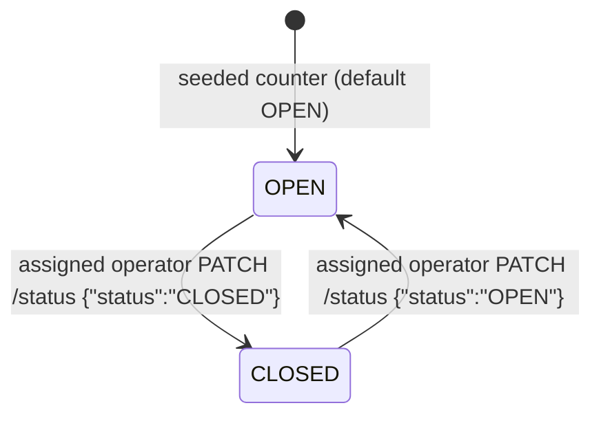

# Feature SDS: F-09 Multi-counter Support

| Item | Value |
|---|---|
| Feature | F-09 Multi-counter support |
| Sprint | 2 (Deliverable 2, Part B) |
| Issue | #42 |
| Depends on | F-03 (queues), F-05 (operator lifecycle); interacts with F-04 (customer reads), F-07 (cancel) and F-08 (no-show recovery) |
| Contract version | v1 (2026-11-27) |
| Status | Contract v1, pending review by @TeekhathatTT |
| Author / reviewer | @Khwanklao / @TeekhathatTT |
| Governing documents | [SRS](../srs.md) v4.0 (§1.3, FR-17–FR-19, BR-18–BR-20, §10.2), [System SDS](../system-sds.md) §15, [Sprint 2 API spec](../sprints/sprint-2/api-spec.md) §12–§16, [Sprint 2 UI spec](../sprints/sprint-2/ui-spec.md) §10–§13, [Sprint 2 test spec](../sprints/sprint-2/tests.md) §8 |

## 1. Purpose and scope

In Sprint 1, each service queue behaves as a single unnamed service desk: an operator calls the next `WAITING` entry at the queue level (`POST /api/operator/queues/{queueId}/call-next`), and the customer is told only "Please go to the service desk." When multiple operators serve the same queue simultaneously across physical desks or windows (for example Counter 1 and Counter 2), neither the operator workspace nor the customer's ticket indicates which counter claimed which customer, and individual counters cannot be opened or closed independently while the queue stays open.

F-09 introduces service counters within each service queue:
- **Counter management (`OPEN` / `CLOSED`):** an assigned operator views the counters belonging to a queue and opens or closes individual counters without closing the entire queue.
- **Counter-scoped Call Next:** an assigned operator calls the next `WAITING` entry for a specific `OPEN` counter; the server atomically claims the oldest eligible FIFO entry (`FOR UPDATE SKIP LOCKED`) and records its `counterId`, preventing double-claims when multiple counters call simultaneously.
- **Assigned counter visibility:** every serialized `QueueEntry` payload additively includes `counterId` and `counterName`, shown as a counter badge on the operator workspace and as a clear destination prompt on the customer's ticket (`"Please proceed to Counter 1."`).

In scope:
- the `CounterStatus` enum (`OPEN`, `CLOSED`), the `Counter` table (unique `(serviceQueueId, name)`, optional `assignedOperatorId`), nullable `QueueEntry.counterId` foreign key, their additive migration, and idempotent deterministic seed counters
- `GET /api/operator/queues/{queueId}/counters`, `PATCH /api/operator/counters/{counterId}/status`, and `POST /api/operator/counters/{counterId}/call-next`
- additive `counterId` and `counterName` fields on every serialized `QueueEntry` payload
- preserving the legacy `POST /api/operator/queues/{queueId}/call-next` endpoint (`counterId = null`, `204 No Content` when empty) so Sprint 1, F-07, and F-08 regression suites remain compatible
- operator queue page `/operator/queues/:id`: Counters panel, Open/Close toggle, counter-scoped Call Next, counter badge on `CALLED`/`SERVING` entries, and user-safe error mapping (`409 COUNTER_CLOSED`, `409 NO_WAITING_ENTRIES`)
- customer views `/customer/entries/:id` and `/customer` (My Active Tickets): assigned counter display when `CALLED` or `SERVING`, with graceful fallback when `counterName` is `null`
- cross-feature interaction with F-08 recovery (clearing `counterId` alongside `calledAt` when returning a `NO_SHOW` entry to `WAITING`)

Out of scope:
- runtime admin CRUD to create, rename, or delete counters, or UI to reassign `assignedOperatorId` (provisioned by seed data in Sprint 2; D-2)
- priority routing, skill-based counter matching, or counter-specific queues (F-10 covers priority policy)
- per-counter service-time analytics or utilization dashboards (F-11)
- automatically unassigning or cancelling `CALLED`/`SERVING` entries when a counter is closed (D-5)
- any change to customer join, queue-number allocation, queue catalog, authentication, session/CSRF middleware, or F-07 cancellation

## 2. Linked requirements

| Type | IDs | Notes |
|---|---|---|
| Functional | FR-17, FR-18, FR-19 (new) | List/toggle counter status; counter-scoped concurrency-safe Call Next; operator & customer visibility of assigned counter |
| Functional (unchanged, affected) | FR-03, FR-07, FR-08, FR-09, FR-10, FR-11, FR-12, FR-13, FR-16 | Assignment check reused; customer & operator reads include additive `counterId`/`counterName`; legacy FR-09 Call Next preserved; Start/Complete work on counter-called entries; F-08 recovery clears `counterId` |
| Business rules | BR-18, BR-19, BR-20 (new); BR-10, BR-16 (notes added in SRS v4.0) | See [SRS §5](../srs.md#5-business-rules-and-decisions) |
| Business rules (unchanged, verified) | BR-01, BR-02, BR-05, BR-07, BR-09, BR-11, BR-12, BR-13, BR-14, BR-15, BR-17 | FIFO order, active states, privacy, and F-07/F-08 rules preserved |
| Non-functional | NFR-02, NFR-03, NFR-04, NFR-05, NFR-06, NFR-07, NFR-08 | No new NFR. NFR-04 planned via `PERF-S2-003`; NFR-07 covers idempotent counter seeding |
| Acceptance criteria | AC-35 – AC-44 | [SRS §10.2](../srs.md#102-acceptance-criteria-sprint-2-f-09-rev-40) |

## 3. Workflow

1. An assigned operator opens `/operator/queues/:id` for **General Inquiry Desk**. The page loads both the queue's entries and its counters (`GET /api/operator/queues/{queueId}/counters`), showing **Counter 1** (`Open`) and **Counter 2** (`Open`).
2. Customer 1 (queue number 1) and Customer 2 (queue number 2) are `WAITING` in FIFO order.
3. Operator 1 selects **Call Next** for **Counter 1** (`POST /api/operator/counters/{counter1Id}/call-next`) while another operator session (or parallel request) selects **Call Next** for **Counter 2** (`POST /api/operator/counters/{counter2Id}/call-next`). PostgreSQL row locks serialize each counter and `FOR UPDATE SKIP LOCKED` assigns distinct `WAITING` entries: Entry 1 becomes `CALLED` at Counter 1 and Entry 2 becomes `CALLED` at Counter 2.
4. On `/operator/queues/:id`, Active Service displays Entry 1 with a **Counter 1** badge and Entry 2 with a **Counter 2** badge.
5. On `/customer/entries/:id`, Customer 1 sees status **Called**, badge **Counter 1**, and `"Please proceed to Counter 1."`. After the operator starts service, Customer 1 sees **In service** and `"Your service is in progress at Counter 1."`.
6. When Counter 2 needs to go on break, the operator toggles Counter 2 to **Closed** (`PATCH /api/operator/counters/{counter2Id}/status` with `{"status":"CLOSED"}`). Future Call Next requests on Counter 2 are rejected with `409 COUNTER_CLOSED`, while Entry 2 (already `CALLED` or `SERVING` at Counter 2) retains its Counter 2 assignment and can still be started, completed, or marked no-show.
7. If Entry 1 is marked `NO_SHOW` (F-08) and later returned to the queue (`POST .../recover`), both `calledAt` and `counterId` are cleared so the entry returns to `WAITING` cleanly; when Counter 2 later reopens and calls next, Entry 1 is assigned to Counter 2.

## 4. State model

F-09 introduces an independent two-state lifecycle on `Counter` (`OPEN` ↔ `CLOSED`) and does **not** add any new status value to `QueueStatus`.



Interaction between `Counter.status` and `QueueEntry`:

| Counter status | `POST .../counters/{counterId}/call-next` | Existing `CALLED` / `SERVING` entries with this `counterId` | New customer joins to parent `ServiceQueue` |
|---|---|---|---|
| `OPEN` | Allowed: claims oldest `WAITING` entry in `counter.serviceQueueId` (`200`), or `409 NO_WAITING_ENTRIES` if empty | May be started, completed, or marked no-show normally | Governed solely by `ServiceQueue.availability` (BR-08) |
| `CLOSED` | Rejected with `409 COUNTER_CLOSED`; no entry changes | Retain `counterId`; may still be started, completed, or marked no-show | Governed solely by `ServiceQueue.availability` (BR-08) |

`QueueEntry.counterId` lifecycle across `QueueStatus` values:

| `QueueEntry.status` | `counterId` / `counterName` invariant |
|---|---|
| `WAITING` | Always `NULL` (including after F-08 recovery) |
| `CALLED` | Counter id/name if called via counter endpoint; `NULL` if called via legacy queue endpoint |
| `SERVING` | Same as when `CALLED` |
| `COMPLETED` | Same as when `SERVING` (preserved for history) |
| `CANCELLED` | Always `NULL` (only `WAITING` can be cancelled) |
| `NO_SHOW` | Preserved from the missed call until/unless recovered; cleared to `NULL` by F-08 `recoverNoShowEntry` |

## 5. Design decisions

| ID | Decision and reason |
|---|---|
| D-1 | **Nullable `QueueEntry.counterId` FK (`ON DELETE SET NULL`) for additive compatibility.** Keeping `counterId` nullable means Sprint 1, F-07, and F-08 tests and existing database rows without counters remain valid without rewriting legacy tests or backfilling historical calls. |
| D-2 | **Seeded deterministic counters; no runtime admin CRUD in Sprint 2.** Seed data (`server/prisma/seed.ts`) upserts `Counter 1` and `Counter 2` (`OPEN`, `assignedOperatorId: null`) for each seeded queue using deterministic RFC 4122 UUIDv4s, preserving `status` on re-seed (same pattern as `ServiceQueue.lastQueueNumber`). Admin CRUD for creating/deleting counters is out of scope for F-09 (review note R-3). |
| D-3 | **New counter-scoped Call Next endpoint; legacy queue-level endpoint preserved.** `POST /api/operator/counters/{counterId}/call-next` handles counter-aware calling. Legacy `POST /api/operator/queues/{queueId}/call-next` stays unchanged (`counterId = NULL`, `204 No Content` when empty) so Sprint 1 (`FLOW-001`–`FLOW-003`, `CONCURRENCY-003`), F-07 (`CANCEL-012`–`CANCEL-014`), and F-08 (`NOSHOW-006`, `NOSHOW-011`) tests pass unmodified (R-6). |
| D-4 | **Empty queue on counter Call Next returns `409 NO_WAITING_ENTRIES`.** On `POST /api/operator/counters/{counterId}/call-next`, an empty waiting queue returns `409 NO_WAITING_ENTRIES` with the standard error envelope so clients can distinguish an empty queue from a `409 COUNTER_CLOSED` conflict with structured JSON feedback, while legacy `/queues/{queueId}/call-next` preserves `204 No Content` (BR-10). Flagged for reviewer alignment in R-1. |
| D-5 | **Closing a counter does not disrupt in-flight entries.** Consistent with `AD-05` (closing a queue lets existing entries finish), closing a counter blocks only future `call-next` on that counter (`409 COUNTER_CLOSED`). Entries already `CALLED` or `SERVING` at that counter keep their `counterId` and can still be started, completed, or marked no-show (R-2). |
| D-6 | **Queue availability is not checked on counter status toggle or counter Call Next.** Just like Start, Complete, F-07 cancel, and F-08 no-show/recover, operators may finish serving waiting/called customers of a `CLOSED` queue (`AD-05`) and manage its counters independently. |
| D-7 | **Optional `Counter.assignedOperatorId` acts as an additional scope restriction, not a replacement for `OperatorAssignment`.** An operator must always be assigned to `counter.serviceQueueId` via `OperatorAssignment`. When `counter.assignedOperatorId` is `null` (default for seeded counters), any operator assigned to that queue may toggle or call next at that counter. When `assignedOperatorId` is non-null, only that operator may toggle or call next at that counter; another operator assigned to the same queue receives `403 FORBIDDEN` (R-4). |
| D-8 | **Idempotent `PATCH /api/operator/counters/{counterId}/status`.** Setting an `OPEN` counter to `OPEN` or a `CLOSED` counter to `CLOSED` succeeds with `200 OK` and returns the current counter state rather than failing with `409`, keeping status toggles resilient to retries and stale tabs. |
| D-9 | **Additive `counterId` and `counterName` on every `QueueEntry` payload.** Including `counterName` directly on `QueueEntry` avoids requiring customers (who have no operator counter-list endpoint) to resolve a `counterId` separately, and keeps the contract additive for clients that ignore unknown fields. Queries include `counter: { select: { name: true } }`. |
| D-10 | **F-08 `recoverNoShowEntry` clears `counterId = NULL` alongside `calledAt = NULL`.** A recovered `WAITING` entry has no active counter assignment until it is called again, preserving the `WAITING => counterId IS NULL` invariant and ensuring the customer sees the newly calling counter next time (R-5). |
| D-11 | **Permissions follow Start/Complete/F-08 order:** `validateUuidParam` → `requireAuth` → `requireCsrf` (mutations) → `requireRole(OPERATOR)` → service/middleware assignment check. On queue-scoped `GET /api/operator/queues/{queueId}/counters`, `requireQueueAssignment` runs before the handler (same as `GET .../entries`). On counter-scoped routes (`PATCH .../counters/{counterId}/status` and `POST .../counters/{counterId}/call-next`), the transaction locks the counter first (`404 RESOURCE_NOT_FOUND` if missing), then checks `OperatorAssignment` and `assignedOperatorId` (`403 FORBIDDEN`). |

## 6. UI definition

Operator page `/operator/queues/:id` (`client/src/pages/OperatorQueueDetailPage.tsx` + new `client/src/components/operator/CounterPanel.tsx`):
- New **Counters** section near the top of the queue management workspace (above Active Service), listing every counter returned by `GET /api/operator/queues/{queueId}/counters` in deterministic order (`name ASC, id ASC`).
- Each counter card shows:
  - counter name (e.g., `Counter 1`), status badge (`Open` or `Closed`, text + icon, never color alone),
  - a **Close counter** / **Open counter** toggle button (`PATCH /api/operator/counters/{counterId}/status`),
  - a per-counter **Call Next** button (`POST /api/operator/counters/{counterId}/call-next`, disabled when the counter is `CLOSED` or while a mutation on that counter is pending).
- Active Service (`CALLED` and `SERVING`) cards display a visible counter badge (e.g., `Counter 1`) whenever `entry.counterName` is non-null.
- Busy texts: `"Updating counter..."` (status toggle), `"Calling next..."` (counter Call Next). Success messages announced in the live region: `"Counter 1 is now Closed."`, `"Counter 1 is now Open."`, `"Called queue number N to Counter 1."`.
- If a queue has zero counters (for example in a non-seeded custom test queue), the Counters panel shows a neutral empty state (`"No counters configured for this queue."`) and the existing queue-level **Call Next** fallback remains usable.

Customer views:
- `/customer/entries/:id` (`client/src/pages/EntryDetailPage.tsx`):
  - When `status` is `CALLED` and `counterName` is non-null: displays a prominent counter badge (`Counter 1`) and message `"Please proceed to {counterName}."`. When `counterName` is `null`, keeps the Sprint 1 message `"Please go to the service desk."`.
  - When `status` is `SERVING` and `counterName` is non-null: displays the counter badge and `"Your service is in progress at {counterName}."`. When `counterName` is `null`, keeps `"Your service is in progress."`.
  - When `status` is `WAITING` or `CANCELLED`, no counter badge is shown.
- `/customer` → My Active Tickets (`client/src/components/customer/MyTicketsList.tsx`):
  - When an entry is `CALLED` or `SERVING` and `counterName` is non-null, renders the counter badge (e.g., `Counter 1`) next to the status badge.

Full details: [Sprint 2 UI spec §10–§13](../sprints/sprint-2/ui-spec.md#f-09-multi-counter-support-v30).

## 7. API definition

| Endpoint | Role | Body | Success |
|---|---|---|---|
| `GET /api/operator/queues/{queueId}/counters` | assigned OPERATOR, session | none | `200 { data: { counters: Counter[] } }` |
| `PATCH /api/operator/counters/{counterId}/status` | assigned OPERATOR (and matching `assignedOperatorId` if set), session + CSRF | `{ "status": "OPEN" \| "CLOSED" }` | `200 { data: { counter: Counter } }` |
| `POST /api/operator/counters/{counterId}/call-next` | assigned OPERATOR (and matching `assignedOperatorId` if set), session + CSRF | none | `200 { data: { entry: QueueEntry } }` (`status: CALLED`, `counterId`, `counterName` set) |

New error codes: `409 COUNTER_CLOSED` (calling next on a `CLOSED` counter) and `409 NO_WAITING_ENTRIES` (calling next on an `OPEN` counter when no `WAITING` entries exist). Full request/response schemas and status tables: [Sprint 2 API spec §12–§16](../sprints/sprint-2/api-spec.md#f-09-multi-counter-support-v30).

## 8. UI error mapping

| API response | Operator page message | Follow-up |
|---|---|---|
| `409 COUNTER_CLOSED` | `"This counter is closed. Open the counter before calling the next customer."` | refresh counters and entry list |
| `409 NO_WAITING_ENTRIES` | `"There are no waiting customers in this queue right now."` | refresh entry list |
| `400 INVALID_ARGUMENT` | `"Invalid counter request. Please refresh and try again."` | none |
| `404 RESOURCE_NOT_FOUND` (counter route) | `"We couldn't find that counter."` | refresh counters list |
| `403 FORBIDDEN` (CSRF vs RBAC/assignment) | existing CSRF or permission message | none |
| `401 UNAUTHORIZED` | existing global session-expired banner | global handler |
| network or other | existing `"Something went wrong. Please try again."` | none |

Server error messages are never rendered directly to users.

## 9. Data definition

| Item | Definition |
|---|---|
| New enum | `CounterStatus`: `OPEN`, `CLOSED` |
| New table `Counter` | `id UUID PRIMARY KEY DEFAULT gen_random_uuid()`, `serviceQueueId UUID NOT NULL REFERENCES "ServiceQueue"("id") ON DELETE CASCADE`, `name VARCHAR(80) NOT NULL`, `status "CounterStatus" NOT NULL DEFAULT 'OPEN'`, `assignedOperatorId UUID NULL REFERENCES "User"("id") ON DELETE SET NULL`, `createdAt TIMESTAMPTZ NOT NULL DEFAULT now()`, `updatedAt TIMESTAMPTZ NOT NULL DEFAULT now()` |
| New constraints & indexes on `Counter` | `UNIQUE ("serviceQueueId", "name")` (`Counter_serviceQueueId_name_key`); `INDEX "Counter_serviceQueueId_idx" ON "Counter" ("serviceQueueId", "name" ASC, "id" ASC)`; `INDEX "Counter_assignedOperatorId_idx" ON "Counter" ("assignedOperatorId")` |
| Column added to `QueueEntry` | `counterId UUID NULL REFERENCES "Counter"("id") ON DELETE SET NULL`; `INDEX "QueueEntry_counterId_idx" ON "QueueEntry" ("counterId")` |
| Migration | `server/prisma/migrations/20261127150000_f09_multi_counter_support/migration.sql` |
| Existing indexes & constraints | `QueueEntry_active_customer_queue_uidx`, `QueueEntry_serviceQueueId_queueNumber_key`, `QueueEntry_fifo_idx`, `QueueEntry_noShowCount_range_check` are all **unchanged** |
| Row invariants (asserted by tests) | (1) `status IN ('WAITING', 'CANCELLED')` ⇒ `counterId IS NULL`; (2) `counterId IS NOT NULL` ⇒ referenced `Counter.serviceQueueId = QueueEntry.serviceQueueId`; (3) no two active entries for the same `(customerId, serviceQueueId)`; (4) no duplicate `(serviceQueueId, queueNumber)`; (5) all F-07 and F-08 invariants continue to hold |
| Deterministic seed (`server/prisma/seed.ts`) | Upserts 4 counters using deterministic RFC 4122 UUIDv4s (`assignedOperatorId: null`, `status: OPEN` on create; `status` omitted from `update` so re-seeding preserves operational counter state, matching `lastQueueNumber`):<br>• General Inquiry Desk (`aaaaaaaa-...`): `Counter 1` (`cccccccc-cccc-4ccc-8ccc-ccccccccccc1`), `Counter 2` (`cccccccc-cccc-4ccc-8ccc-ccccccccccc2`)<br>• Specialized Consultation (`bbbbbbbb-...`): `Counter 1` (`dddddddd-dddd-4ddd-8ddd-ddddddddddd1`), `Counter 2` (`dddddddd-dddd-4ddd-8ddd-ddddddddddd2`) |

Migration safety:
- The migration is purely additive: it creates a new enum `CounterStatus`, a new table `Counter`, and adds a nullable `counterId` column to `QueueEntry` with an FK and index. Existing rows remain untouched (`counterId = NULL`).
- Apply the migration to the deployed database **before** the new Cloud Run revision serves traffic, and run the idempotent seed step (or counter provisioning) if default counters are required on an existing database.
- Rollback caveat: because `counterId` is nullable and `Counter` is a separate table, rolling back the application revision to the pre-F-09 release does **not** break existing Prisma queries on `QueueEntry` (older revisions ignore the extra column and table), unlike F-07/F-08 enum additions — though counter assignments written during F-09 will not be surfaced by the older revision.

## 10. Concurrency design

### 10.1 Transaction steps

**Toggle counter status** (`updateCounterStatus` in `server/src/services/operatorService.ts`), one transaction:
1. Lock the counter row: `SELECT "id", "serviceQueueId", "status", "assignedOperatorId" FROM "Counter" WHERE "id" = $1::uuid FOR UPDATE`. Missing → `404 RESOURCE_NOT_FOUND`.
2. Verify `OperatorAssignment` for `(operatorId, counter.serviceQueueId)` and, if `counter.assignedOperatorId !== null`, verify `counter.assignedOperatorId === operatorId`. Otherwise → `403 FORBIDDEN`.
3. Update `status` (and `updatedAt`). Commit, then respond `200 OK`.

**Counter-scoped Call Next** (`callNextEntryForCounter` in `server/src/services/operatorService.ts`), one transaction:
1. Lock the counter row: `SELECT "id", "serviceQueueId", "name", "status", "assignedOperatorId" FROM "Counter" WHERE "id" = $1::uuid FOR UPDATE`. Missing → `404 RESOURCE_NOT_FOUND`.
2. Verify `OperatorAssignment` for `(operatorId, counter.serviceQueueId)` and, if `counter.assignedOperatorId !== null`, verify `counter.assignedOperatorId === operatorId`. Otherwise → `403 FORBIDDEN`.
3. Check `counter.status === 'OPEN'`; if `CLOSED` → `409 COUNTER_CLOSED`.
4. Claim the oldest unlocked `WAITING` entry in `counter.serviceQueueId`:
   ```sql
   SELECT "id", clock_timestamp() AS "now"
   FROM "QueueEntry"
   WHERE "serviceQueueId" = $serviceQueueId::uuid
     AND "status" = 'WAITING'::"QueueStatus"
   ORDER BY "joinedAt" ASC, "id" ASC
   LIMIT 1
   FOR UPDATE SKIP LOCKED
   ```
   If zero rows returned → `409 NO_WAITING_ENTRIES`.
5. Update the claimed entry: `status = 'CALLED'`, `calledAt = now`, `counterId = counter.id`. Commit, then respond `200 OK` with the serialized entry including `counterId` and `counterName`.

### 10.2 Deadlock-freedom and lock-order analysis

Every write path in the system acquires row locks strictly along an acyclic partial order: `ServiceQueue` → `QueueEntry` and `Counter` → `QueueEntry` (never `QueueEntry` → `Counter`, never `QueueEntry` → `ServiceQueue`, and never `ServiceQueue` ↔ `Counter`).

| Operation | Row locks acquired (in exact order) | Lock mode | Can deadlock with F-09? |
|---|---|---|---|
| `callNextEntryForCounter` (F-09) | 1. `Counter` (target counter)<br>2. `QueueEntry` (one `WAITING` row) | 1. `FOR UPDATE`<br>2. `FOR UPDATE SKIP LOCKED` | **No.** Different counters lock distinct `Counter` rows and skip locked `QueueEntry` rows; same counter serializes at step 1. |
| `updateCounterStatus` (F-09) | 1. `Counter` (target counter) | `FOR UPDATE` | **No.** Single-table lock; serializes cleanly with `callNextEntryForCounter` on the same `Counter` row. |
| `joinQueue` (Sprint 1) | 1. `ServiceQueue` (target queue) | `FOR UPDATE` | **No.** Disjoint from `Counter` and does not lock existing `WAITING` rows. |
| `callNextEntry` (legacy Sprint 1) | 1. `QueueEntry` (one `WAITING` row) | `FOR UPDATE SKIP LOCKED` | **No.** Skips any `QueueEntry` locked by `callNextEntryForCounter` and never locks `Counter`. |
| `startServiceEntry` / `completeServiceEntry` / `markNoShowEntry` | 1. `QueueEntry` (target entry) | `FOR UPDATE` | **No.** Never locks `Counter` (reads counter name via join only after or without locking `Counter`). |
| `recoverNoShowEntry` (F-08) | 1. `ServiceQueue` (target queue)<br>2. `QueueEntry` (target `NO_SHOW` row) | 1. `FOR UPDATE`<br>2. `FOR UPDATE` | **No.** Never locks `Counter`; only locks a `NO_SHOW` entry, which Call Next ignores. |
| `cancelEntry` (F-07) | 1. `QueueEntry` (target `WAITING` row via conditional `UPDATE`) | Row exclusive lock on `UPDATE` | **No.** Never locks `Counter`; under `READ COMMITTED`, waits on an in-flight Call Next lock on that `QueueEntry` and re-evaluates `WHERE status = 'WAITING'`. |

**Known limitation (inherited from Sprint 1 §12 #1):** under `FOR UPDATE SKIP LOCKED`, if Counter 1 locks waiting entry #1 and rolls back after Counter 2 skips #1 and claims #2, #2 is called before #1. This remains an acceptable trade-off for non-blocking multi-counter throughput.

### 10.3 Race matrix

| Race | Possible outcomes | Never happens |
|---|---|---|
| Counter 1 Call Next vs Counter 2 Call Next (≥ 2 `WAITING` entries A, B) | Both `200`, claiming distinct entries `{A, B}` (one counter gets A, the other gets B) | Both counters claim A; either entry left `WAITING` with `counterId` set |
| Counter 1 Call Next vs Counter 2 Call Next (only 1 `WAITING` entry A) | Exactly one counter gets `200` (A becomes `CALLED` with that counter's `counterId`), the other gets `409 NO_WAITING_ENTRIES` | Both get `200`; double-claim |
| Same counter Call Next vs Close Counter (`PATCH /status CLOSED`) | Serialized on `Counter` `FOR UPDATE`: either Call Next `200` then Close `200`, or Close `200` then Call Next `409 COUNTER_CLOSED` | Call Next succeeds after Close committed; deadlock |
| Counter Call Next vs Customer Cancel (F-07) on one `WAITING` entry | Either Call Next `200` (entry `CALLED` with `counterId`, cancel `409`) or Cancel `200` (entry `CANCELLED` with `counterId = NULL`, Call Next `409 NO_WAITING_ENTRIES` if empty) | Both succeed on the same entry; `CANCELLED` entry with non-null `counterId` |

## 11. Validation, boundaries and permissions

Route middleware order:
- `GET /api/operator/queues/:queueId/counters`: `validateUuidParam('queueId')` → `requireAuth` → `requireRole(OPERATOR)` → `requireQueueAssignment` → handler.
- `PATCH /api/operator/counters/:counterId/status`: `validateUuidParam('counterId')` → `requireAuth` → `requireCsrf` → `requireRole(OPERATOR)` → body validation (strict Zod object `{ status: z.enum(['OPEN', 'CLOSED']) }`) → service transaction (`404` → `403` → update).
- `POST /api/operator/counters/:counterId/call-next`: `validateUuidParam('counterId')` → `requireAuth` → `requireCsrf` → `requireRole(OPERATOR)` → service transaction (`404` → `403` → `409` → update).

| Caller | Queue assignment | `assignedOperatorId` | Counter status / queue state | Endpoint | Result |
|---|---|---|---|---|---|
| anonymous | — | — | any | any F-09 route | `401 UNAUTHORIZED` |
| any role, missing/wrong CSRF | — | — | any | `PATCH /status`, `POST /call-next` | `403 FORBIDDEN`, no change |
| CUSTOMER | — | — | any | any F-09 route | `403 FORBIDDEN`, no change |
| OPERATOR | — (malformed UUID) | — | — | any F-09 route | `400 INVALID_ARGUMENT` |
| OPERATOR | not assigned (or unknown `queueId`) | — | any | `GET .../queues/{queueId}/counters` | `403 FORBIDDEN` |
| OPERATOR | — (unknown valid UUIDv4 `counterId`) | — | — | `PATCH /status`, `POST /call-next` | `404 RESOURCE_NOT_FOUND` |
| OPERATOR | not assigned to counter's queue | any | any | `PATCH /status`, `POST /call-next` | `403 FORBIDDEN`, no change |
| OPERATOR | assigned | non-null, ≠ caller | any | `PATCH /status`, `POST /call-next` | `403 FORBIDDEN`, no change |
| OPERATOR | assigned | `null` or = caller | invalid JSON / `status` body | `PATCH /status` | `400 INVALID_ARGUMENT`, no change |
| OPERATOR | assigned | `null` or = caller | `OPEN` or `CLOSED` | `PATCH /status` (valid body) | `200 OK`, updated `Counter` |
| OPERATOR | assigned | `null` or = caller | `CLOSED` | `POST /call-next` | `409 COUNTER_CLOSED`, no change |
| OPERATOR | assigned | `null` or = caller | `OPEN`, 0 `WAITING` | `POST /call-next` | `409 NO_WAITING_ENTRIES`, no change |
| OPERATOR | assigned | `null` or = caller | `OPEN`, ≥ 1 `WAITING` | `POST /call-next` | `200 OK`, oldest `WAITING` → `CALLED` with `counterId` |

Parent `ServiceQueue.availability` (`OPEN` / `CLOSED`) does not change any row of this table.

## 12. Layers with no change

- Customer queue catalog (`GET /api/queues`), customer join (`POST /api/queues/{queueId}/entries`), and queue-number allocation (FR-04–FR-06): unchanged logic; newly created `WAITING` rows have `counterId = NULL`.
- `computeAheadCount`: unchanged; still counts only `WAITING` entries in the same queue.
- Legacy `POST /api/operator/queues/{queueId}/call-next`: unchanged SQL and `204` empty behavior; sets `counterId = NULL`.
- Start, Complete, and Mark No-show (FR-10, FR-11, FR-15): unchanged transition logic; entries keep their existing `counterId` and serialize `counterId` + `counterName`.
- F-07 customer cancellation (`POST /api/me/queue-entries/{entryId}/cancel`): unchanged logic (`WAITING` rows always have `counterId = NULL`).
- Authentication, session storage, CSRF middleware, and Docker multi-stage build pipeline: unchanged.

Changed: Prisma schema & migration (`CounterStatus`, `Counter`, `QueueEntry.counterId`), `server/prisma/seed.ts` (deterministic counters), `formatQueueEntry` and entry queries (include `counter: { select: { name: true } }` to serialize `counterId` and `counterName`), `recoverNoShowEntry` (clear `counterId: null`), new pure counter policy helper (`server/src/services/counterPolicy.ts`), new service functions & routes in `operatorService.ts` / `operator.ts`, error codes `COUNTER_CLOSED` & `NO_WAITING_ENTRIES`, operator UI counter panel & entry badges, and customer UI counter prompt & badges.

## 13. Definition of Done

- [ ] Contract v1 reviewed by @TeekhathatTT and the review recorded
- [ ] Red tests committed and the red run saved (`docs/sprints/sprint-2/evidence/f09-red-run.txt`)
- [ ] Migration applied to the local and test databases; idempotent seed creates deterministic counters without breaking existing constraints (`COUNTER-013`)
- [ ] All `COUNTER-001` – `COUNTER-018` tests executed and passing
- [ ] Sprint 1, F-07, and F-08 regression (server, client, E2E) executed and passing with no existing test edited (`REG-S2-003`)
- [ ] NFR-04 measured for the new F-09 read and mutation paths (`PERF-S2-003`)
- [ ] Server typecheck, client typecheck, build, `prisma migrate diff` (test DB → schema), and `docker build` pass
- [ ] Green run saved (`docs/sprints/sprint-2/evidence/f09-green-run.txt`)
- [ ] Traceability, test spec, and completion table updated with actual results and commit SHA
- [ ] PR into `sprint2-staging` reviewed by @TeekhathatTT, CI green
- [ ] Not part of the local DoD: production migration, counter seeding, and release deploy (issue #42 DoD, done at release)

## 14. Review notes (decisions to challenge)

| # | Topic | Question for the reviewer |
|---|---|---|
| R-1 | Empty-queue status code on counter Call Next | Counter-scoped `POST /api/operator/counters/{counterId}/call-next` returns `409 NO_WAITING_ENTRIES` when no `WAITING` entries exist (D-4), whereas legacy `POST /api/operator/queues/{queueId}/call-next` returns `204 No Content` (BR-10). Do you prefer `409 NO_WAITING_ENTRIES` (structured JSON error distinguishing empty queue from `409 COUNTER_CLOSED`) or `204 No Content` for consistency with Sprint 1? |
| R-2 | Closing a counter with active `CALLED`/`SERVING` entries | Closing a counter blocks only future `call-next` on that counter; existing `CALLED`/`SERVING` entries keep their `counterId` and can be finished normally (D-5, matching `AD-05`). Should closing a counter instead be rejected (`409`) while it still has an active `CALLED`/`SERVING` entry? |
| R-3 | Counter provisioning vs admin CRUD | Counters are provisioned via deterministic seed data (`Counter 1`, `Counter 2` per seeded queue) with no create/delete API in Sprint 2 (D-2). Agree that CRUD belongs out of scope for F-09? |
| R-4 | `assignedOperatorId` enforcement | When `Counter.assignedOperatorId` is `null` (default on seeded counters), any operator assigned to that queue may operate the counter; when non-null, only that specific operator may toggle or call next on it (`403 FORBIDDEN` otherwise, D-7). Should `GET .../counters` still show all counters of the queue to any assigned operator (so they see peer counter status), or filter to their own? Currently all counters of the queue are shown. |
| R-5 | Clearing `counterId` on F-08 recovery | `recoverNoShowEntry` clears `counterId = NULL` alongside `calledAt = NULL` (D-10), while `markNoShowEntry` preserves `counterId` for missed-turn history. Agree? |
| R-6 | Legacy `/queues/{queueId}/call-next` compatibility | Keeping legacy queue-level Call Next working with `counterId = NULL` lets all Sprint 1, F-07, and F-08 tests pass untouched (D-3). Should the operator UI hide the legacy queue-level Call Next button whenever the queue has ≥ 1 counter, showing only per-counter Call Next buttons? Currently yes (legacy button shown only as fallback when 0 counters exist). |
| R-7 | One-active-entry-per-counter cap | F-09 does not currently prevent a single `OPEN` counter from calling a second `WAITING` entry while a previous entry it called is still `CALLED` or `SERVING` (matching Sprint 1's queue-level Call Next). Should a counter be limited to 1 active `CALLED`/`SERVING` entry at a time, or allow multiple? |
| R-8 | Lab 7 BR-06 interaction | Like F-08 (R-8), this branch is based on `sprint2-staging`, which does not yet include Lab 7's 2-active-entry cross-queue cap (`BR-06`). F-09 does not change join or active-state definitions, so merging with Lab 7 has no conflict in counter logic. |
| R-9 | Migration & seed on deploy | The migration is additive and backward-compatible on read, but existing deployed queues will have zero counters until the idempotent seed (or a counter-provisioning script) is run against Cloud SQL. |

## 15. Revision history

| Date | Section | Previous text (kept for the record) | New text / reason |
|---|---|---|---|
| 2026-11-27 | All | — | Contract v1 authored for Issue #42 (`F-09 Multi-counter support`), pending review by @TeekhathatTT. |
