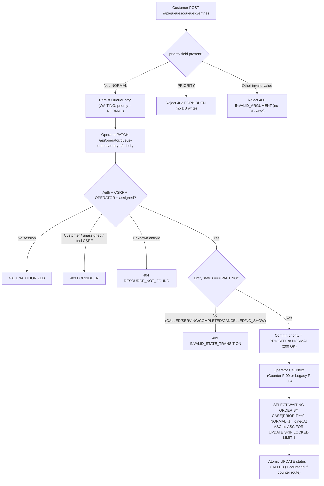

# Feature SDS: F-10 Priority Queue Policy

| Item | Value |
|---|---|
| Feature | F-10 Priority queue policy |
| Sprint | 2 (Deliverable 2, Part B) |
| Issue | #43 |
| Depends on | F-03 (queues & number allocation), F-05 (operator lifecycle); interacts with F-04 (customer join & reads), F-07 (cancellation), F-08 (no-show recovery), and F-09 (multi-counter support) |
| Contract version | v1.0 (2026-11-28) |
| Status | Draft — Pending Teammate Review (`@TeekhathatTT`) |
| Author / reviewer | `@Khwanklao` / `@TeekhathatTT` |
| Governing documents | [SRS](../srs.md) v5.0 (§1.4, FR-20–FR-22, BR-01 rev. 5.0, BR-21–BR-23, §10.3 AC-46–AC-55); Sprint 2 API/UI/Test/Completion/Traceability specs to be synced upon contract approval and implementation |

---

## 1. Purpose and scope

In Sprint 1 through F-09, every `WAITING` entry in a service queue is processed strictly in arrival order (`joinedAt ASC, id ASC`, Sprint 1 BR-01). Real service counters frequently need to prioritize urgent, accessibility, or VIP customers ahead of regular arrivals while still preserving fair FIFO order among customers of the same priority level and preventing customers from self-promoting in line.

F-10 introduces an operator-managed two-level priority queue policy (`NORMAL` and `PRIORITY`):
- **Default `NORMAL` on join & server-enforced anti-self-elevation:** every customer join creates a `NORMAL` entry; any attempt by a `CUSTOMER` to supply a non-`NORMAL` priority on join or invoke the operator priority-update endpoint is rejected server-side with `403 FORBIDDEN`.
- **Operator priority management on `WAITING` entries:** an assigned `OPERATOR` can promote a `WAITING` entry to `PRIORITY` or return it to `NORMAL` via `PATCH /api/operator/queue-entries/{entryId}/priority`; attempting to modify priority on any non-`WAITING` entry is rejected with `409 INVALID_STATE_TRANSITION`.
- **Deterministic priority-aware FIFO ordering:** both F-09 counter-scoped Call Next and legacy queue-level Call Next claim the next eligible `WAITING` entry ordered strictly by `PRIORITY` before `NORMAL`, then `joinedAt ASC, id ASC`, using an explicit SQL sort expression inside `FOR UPDATE SKIP LOCKED` transactions. Customer `aheadCount` and operator waiting-list ordering use the exact same ordering rule.

### In scope
- PostgreSQL enum `QueuePriority` (`NORMAL`, `PRIORITY`), non-null `QueueEntry.priority` column defaulting to `NORMAL`, additive migration, and partial expression index `QueueEntry_waiting_priority_fifo_idx` on `WAITING` entries.
- New operator endpoint `PATCH /api/operator/queue-entries/{entryId}/priority` (assigned `OPERATOR`, session + CSRF, strict body `{ "priority": "NORMAL" | "PRIORITY" }`).
- Server-side validation on `POST /api/queues/{queueId}/entries` rejecting customer-supplied `{"priority": "PRIORITY"}` with `403 FORBIDDEN` and malformed/unknown `priority` values with `400 INVALID_ARGUMENT`, while continuing to accept empty bodies and `{"priority": "NORMAL"}` (`201 Created`).
- Priority-aware FIFO selection in both `callNextAtCounter` (F-09) and `callNextEntry` (legacy F-05), priority-aware `computeAheadCount`, and priority-aware `listOperatorQueueEntries`.
- Additive `priority` (`"NORMAL" | "PRIORITY"`) field on every serialized `QueueEntry` payload.
- Operator UI (`/operator/queues/:id`): **Priority** badge (text + icon) and **Set Priority** / **Set Normal** toggle enabled only for `WAITING` entries.
- Customer UI (`/customer/entries/:id` and `/customer` → My Active Tickets): read-only **Priority** badge (text + icon) when `priority === "PRIORITY"` and updated priority-aware `aheadCount` message while `WAITING`.
- Cross-feature alignment with F-07 (cancel), F-08 (`NO_SHOW` recovery preserves `priority`), and F-09 (concurrent multi-counter claiming).

### Out of scope (Sprint 2)
- **Automatic time-based anti-starvation aging:** Sprint 2 uses manual operator priority adjustment only (operators may promote long-waiting `NORMAL` entries or demote `PRIORITY` entries) so queue order remains 100% deterministic and testable. Automatic wait-time aging is deferred as a future enhancement (D-6).
- More than two priority levels (e.g., numeric scores or 3+ tiers).
- Customer self-selected priority, paid fast-track, or eligibility verification workflows.
- `ADMIN` role support (no `ADMIN` role exists in `Role` in `server/prisma/schema.prisma`; only `CUSTOMER` and `OPERATOR` exist).
- Counter-specific priority routing or priority-only counters (counter skill matching remains excluded).
- Priority wait-time analytics / reporting (F-11) and appointment booking (F-12).

---

## 2. Linked requirements

| Type | IDs | Notes |
|---|---|---|
| Functional (new) | FR-20, FR-21, FR-22 | Operator priority update & anti-self-elevation; priority-aware atomic Call Next / `aheadCount` / F-08 preservation; additive `priority` payload & operator/customer UI |
| Functional (unchanged, affected) | FR-03, FR-05, FR-07, FR-08, FR-09, FR-10, FR-11, FR-12, FR-13, FR-14, FR-15, FR-16, FR-18, FR-19 | Assignment checks reused; join defaults to `NORMAL` & rejects self-elevation; operator list, `aheadCount`, and both Call Next endpoints adopt priority-aware FIFO; F-08 recovery preserves `priority` |
| Business rules (new / revised) | BR-01 (rev. 5.0), BR-21, BR-22, BR-23; BR-16 & BR-19 (rev. 5.0 notes) | See [SRS §5](../srs.md#5-business-rules-and-decisions) |
| Business rules (unchanged, verified) | BR-02, BR-03, BR-04, BR-05, BR-06, BR-07, BR-08, BR-09, BR-10, BR-11, BR-12, BR-13, BR-14, BR-15, BR-17, BR-18, BR-20 | Queue numbering, active-entry caps, privacy, lifecycle transitions, counter integrity, and F-07/F-08/F-09 invariants preserved |
| Non-functional | NFR-02, NFR-03, NFR-04, NFR-05, NFR-06, NFR-08 | No new NFR; NFR-04 planned via `PERF-S2-004` on 1,000-entry dataset |
| Acceptance criteria | AC-46 – AC-55 | [SRS §10.3](../srs.md#103-acceptance-criteria-sprint-2-f-10-rev-50) |

---

## 3. Workflow and state / sequence diagrams

### 3.1 Core workflow
1. Customer 1 (`N1`, joined at `t0`) and Customer 2 (`N2`, joined at `t1`) join **General Inquiry Desk** (`POST /api/queues/{queueId}/entries`). Both entries are persisted as `status = WAITING`, `priority = NORMAL`.
2. On `/operator/queues/:id`, the assigned operator sees `N1` ahead of `N2` in the **Waiting Queue** section.
3. Because Customer 2 requires urgent assistance, the operator selects **Set Priority** on `N2` (`PATCH /api/operator/queue-entries/{N2}/priority` with `{"priority":"PRIORITY"}`). PostgreSQL commits `priority = PRIORITY` without changing `joinedAt`, `queueNumber`, or `status`.
4. Immediately after the refresh, the operator's **Waiting Queue** displays `N2` (`Priority` badge) ahead of `N1`. On `/customer/entries/:id`, Customer 2 sees a read-only `Priority` badge and `"You are next"` (`aheadCount: 0`), while Customer 1 sees `"Currently waiting. 1 person ahead of you."` (`aheadCount: 1`).
5. When the operator selects **Call Next** at **Counter 1** (`POST /api/operator/counters/{C1}/call-next`), `N2` is atomically claimed (`status = CALLED`, `counterId = C1`, `priority = PRIORITY`). Attempting to change `N2`'s priority now returns `409 INVALID_STATE_TRANSITION`, and the UI no longer renders a priority toggle on `N2`.
6. If `N2` is marked `NO_SHOW` (F-08) and later returned to the queue (`POST .../recover`), `N2` returns to `WAITING` with `calledAt = NULL`, `counterId = NULL`, original `joinedAt`, and **`priority = PRIORITY` preserved**, placing `N2` ahead of `NORMAL` entries again.

### 3.2 Workflow & priority-ordering diagram



### 3.3 Priority mutability across `QueueStatus` lifecycle

```mermaid
stateDiagram-v2
    [*] --> WAITING: Customer join (priority = NORMAL)
    WAITING --> WAITING: Assigned operator PATCH /priority (NORMAL <-> PRIORITY)
    WAITING --> CALLED: Priority-ordered Call Next (priority locked)
    WAITING --> CANCELLED: Customer cancel [F-07] (priority retained for history)
    CALLED --> SERVING: Start Service (priority locked)
    SERVING --> COMPLETED: Complete Service (priority retained for history)
    CALLED --> NO_SHOW: Mark No-show [F-08] (priority locked)
    NO_SHOW --> WAITING: Return to queue [F-08] (priority PRESERVED; mutable again while WAITING)
```



| `QueueEntry.status` | `PATCH .../priority` allowed? | `priority` value invariant |
|---|---|---|
| `WAITING` | **Yes** (assigned `OPERATOR`, `200 OK`) | `NORMAL` or `PRIORITY` (mutable; defaults to `NORMAL` on join; preserved on F-08 recovery) |
| `CALLED` | **No** (`409 INVALID_STATE_TRANSITION`) | Preserved from when called |
| `SERVING` | **No** (`409 INVALID_STATE_TRANSITION`) | Preserved from when called |
| `COMPLETED` | **No** (`409 INVALID_STATE_TRANSITION`) | Preserved for history |
| `CANCELLED` | **No** (`409 INVALID_STATE_TRANSITION`) | Preserved for history |
| `NO_SHOW` | **No** (`409 INVALID_STATE_TRANSITION`) | Preserved from when called; carried back to `WAITING` if recovered via F-08 |

---

## 4. Business rules and design decisions

| ID | Decision and rationale |
|---|---|
| D-1 | **Two-level `QueuePriority` enum (`NORMAL`, `PRIORITY`) with explicit SQL sort key.** Declaring `enum QueuePriority { NORMAL PRIORITY }` with `@default(NORMAL)` keeps the domain minimal and readable. Because PostgreSQL enum comparison (`<` / `>`) depends on enum declaration order (where `NORMAL < PRIORITY` would sort `NORMAL` before `PRIORITY` under `ASC`), every SQL query and index uses the explicit expression `CASE WHEN "priority" = 'PRIORITY'::"QueuePriority" THEN 0 ELSE 1 END ASC, "joinedAt" ASC, "id" ASC`. Ordering is therefore immune to enum declaration order. |
| D-2 | **RBAC uses existing `Role.OPERATOR` + `OperatorAssignment` (no `ADMIN` role).** Inspection of `server/prisma/schema.prisma` confirms `enum Role { CUSTOMER, OPERATOR }`. Only an authenticated `OPERATOR` assigned to `entry.serviceQueueId` may update priority, matching `start`, `complete`, `no-show`, and `recover` (`AD-08`). |
| D-3 | **Endpoint path `PATCH /api/operator/queue-entries/{entryId}/priority` matches existing operator entry routes.** All existing operator entry mutations live under `/api/operator/queue-entries/:entryId/{start,complete,no-show,recover}`, and counter updates use `PATCH /api/operator/counters/:counterId/status`. Placing priority updates at `PATCH /api/operator/queue-entries/{entryId}/priority` keeps middleware order (`validateUuidParam('entryId')` → `requireAuth` → `requireCsrf` → `requireRole(OPERATOR)` → body validation → `FOR UPDATE` transaction) identical to F-08/F-09 and avoids redundant `:queueId` mismatch edge cases (flagged in review note R-1). |
| D-4 | **Strict server-side rejection of customer self-elevation on join (`POST /api/queues/{queueId}/entries`).** Existing Sprint 1/F-07/F-08/F-09 clients send an empty body on join. Empty/omitted body and `{"priority":"NORMAL"}` succeed (`201 Created`, `priority: "NORMAL"`). Sending `{"priority":"PRIORITY"}` is explicitly rejected with `403 FORBIDDEN` (never silently ignored), and sending a malformed/unknown `priority` value (e.g., `"HIGH"`, `123`, `null`, `""`) is rejected with `400 INVALID_ARGUMENT` (R-2). |
| D-5 | **Priority updates allowed only on `WAITING` entries, idempotent on same value, independent of parent queue `availability`.** Changing priority after an entry is `CALLED`, `SERVING`, `COMPLETED`, `CANCELLED`, or `NO_SHOW` has no queue-ordering effect and is rejected with `409 INVALID_STATE_TRANSITION` (reusing the existing standard error code so clients need no redundant code; R-3). Setting `PRIORITY -> PRIORITY` or `NORMAL -> NORMAL` on a `WAITING` entry succeeds idempotently (`200 OK`), matching F-09 `PATCH .../status` (D-8). Parent queue `CLOSED` status does not block priority updates on existing `WAITING` entries (`AD-05`). |
| D-6 | **Anti-starvation policy (Sprint 2): manual operator adjustment only.** Automatic time-based aging (e.g., auto-promoting `NORMAL` entries after N minutes) is explicitly excluded in Sprint 2 because the system has no service-day clock policy (same rationale as F-08 D-2) and time-dependent promotion complicates deterministic E2E/concurrency tests. Operators can manually promote long-waiting `NORMAL` entries or demote `PRIORITY` entries at any time. Automatic aging is documented as a future Sprint 3+ enhancement (R-4). |
| D-7 | **F-08 `NO_SHOW` recovery preserves `priority`.** F-08 (`docs/features/sprint-2-f08-no-show-recovery.md` D-3) returns a recovered entry to its original queue position by preserving `joinedAt` and `queueNumber` while clearing `calledAt` (and F-09 clears `counterId`). F-10 preserves `priority` on recovery so a priority customer who missed their call once retains their priority tier upon operator-approved recovery; if staff wish to downgrade them, they can immediately toggle priority to `NORMAL` while the entry is `WAITING` (R-5). |
| D-8 | **Both F-09 counter Call Next and legacy queue-level Call Next use priority-aware FIFO.** Updating both `callNextAtCounter` and legacy `callNextEntry` ensures consistent BR-01 rev. 5.0 behavior across all call paths—including the zero-usable-counter legacy UI fallback (`COUNTER-019`)—while keeping all Sprint 1 / F-07 / F-08 / F-09 regression tests (where all entries default to `NORMAL`) 100% green unmodified. |
| D-9 | **`computeAheadCount` and `GET /api/operator/queues/{queueId}/entries` match Call Next order.** `computeAheadCount` counts `WAITING` entries in the same queue with either a strictly higher priority (`PRIORITY` ahead of `NORMAL`) or the same priority and `(joinedAt, id) < (entry.joinedAt, entry.id)`. `GET /api/operator/queues/{queueId}/entries` orders by `(priority_rank ASC, joinedAt ASC, id ASC)`, which reduces identically to `(joinedAt ASC, id ASC)` when all rows are `NORMAL` (preserving Sprint 1 `QUEUE-007`). |
| D-10 | **Additive `priority` field on every `QueueEntry` payload.** `formatQueueEntry` always emits `priority: "NORMAL" | "PRIORITY"`. Clients that ignore unknown fields remain unaffected, and both operator and customer screens render priority badges without extra API calls. |

---

## 5. Layer-by-layer definitions

### 5.1 Data layer (Prisma / PostgreSQL)

| Item | Definition |
|---|---|
| New enum | `enum QueuePriority { NORMAL PRIORITY }` (PostgreSQL `CREATE TYPE "QueuePriority" AS ENUM ('NORMAL', 'PRIORITY')`) |
| New column on `QueueEntry` | `priority QueuePriority @default(NORMAL)` (`ALTER TABLE "QueueEntry" ADD COLUMN "priority" "QueuePriority" NOT NULL DEFAULT 'NORMAL'`) |
| New PostgreSQL index | Partial expression index in migration SQL (supports exact `ORDER BY` index scan for Call Next and `aheadCount`, independent of enum declaration order):<br>`CREATE INDEX "QueueEntry_waiting_priority_fifo_idx" ON "QueueEntry" ("serviceQueueId", (CASE WHEN "priority" = 'PRIORITY'::"QueuePriority" THEN 0 ELSE 1 END) ASC, "joinedAt" ASC, "id" ASC) WHERE "status" = 'WAITING'::"QueueStatus";` |
| Migration | Planned additive migration `server/prisma/migrations/<timestamp>_f10_priority_queue_policy/migration.sql` |
| Existing indexes & constraints | `QueueEntry_active_customer_queue_uidx`, `QueueEntry_serviceQueueId_queueNumber_key`, `QueueEntry_fifo_idx`, `QueueEntry_customer_joinedAt_idx`, `QueueEntry_counterId_idx`, `QueueEntry_noShowCount_range_check`, `QueueEntry_counterId_serviceQueueId_fkey` (`ON DELETE RESTRICT ON UPDATE RESTRICT`), and all `Counter` constraints are **unchanged** |
| Seed (`server/prisma/seed.ts`) & `provision-counters.ts` | **No change** (seed creates users, queues, operator assignments, and counters; no queue entries are pre-seeded, and any created entry defaults to `NORMAL`) |
| Row invariants (asserted by tests) | (1) `priority IN ('NORMAL', 'PRIORITY')` and never `NULL`; (2) `PATCH .../priority` never mutates `joinedAt`, `queueNumber`, `status`, `counterId`, or any lifecycle timestamp; (3) all Sprint 1, Lab 7 BR-06, F-07, F-08, and F-09 row invariants continue to hold |

**Migration and rollback safety:**
- The migration is strictly additive: `CREATE TYPE "QueuePriority"` + `ADD COLUMN "priority" "QueuePriority" NOT NULL DEFAULT 'NORMAL'` backfills all existing rows to `'NORMAL'` in place in PostgreSQL 11+ (metadata-only instant default) with zero downtime or data loss.
- Apply the migration to the deployed database **before** the new Cloud Run revision serves traffic.
- Rollback caveat: a pre-F-10 revision ignores the new `priority` column on read and inserts rows with DB default `'NORMAL'`, so rolling back does not crash Prisma reads, though priority ordering stops being honored until F-10 is re-deployed (any `PRIORITY` values remain persisted in PostgreSQL).

---

### 5.2 API layer

#### Updated `QueueEntry` object (additive; extends Sprint 2 api-spec §12.2)

```json
{
  "id": "f4d56583-5d7d-4fef-bb21-5e6a5a7a9a68",
  "serviceQueueId": "aaaaaaaa-aaaa-4aaa-8aaa-aaaaaaaaaaaa",
  "customerId": "11111111-1111-4111-8111-111111111111",
  "queueNumber": 7,
  "status": "WAITING",
  "priority": "PRIORITY",
  "joinedAt": "2026-11-28T09:00:00.000Z",
  "calledAt": null,
  "serviceStartedAt": null,
  "completedAt": null,
  "cancelledAt": null,
  "noShowAt": null,
  "recoveredAt": null,
  "noShowCount": 0,
  "counterId": null,
  "counterName": null,
  "aheadCount": 0
}
```

`priority` (`"NORMAL" | "PRIORITY"`) is included in **every** `QueueEntry` response across all existing and new endpoints.

#### New endpoint: `PATCH /api/operator/queue-entries/{entryId}/priority`

- **Purpose:** Update the priority (`NORMAL` ↔ `PRIORITY`) of a `WAITING` queue entry in an operator's assigned queue (FR-20).
- **Headers:** `Cookie: <session-cookie>`, `X-CSRF-Token: <token-from-session>`, `Content-Type: application/json`.
- **Request body** (strict Zod schema `z.object({ priority: z.enum(['NORMAL', 'PRIORITY']) }).strict()`):
  ```json
  {
    "priority": "PRIORITY"
  }
  ```
- **Validation & processing order:**
  1. `validateUuidParam('entryId')` → `400 INVALID_ARGUMENT` if not UUIDv4.
  2. `requireAuth` → `401 UNAUTHORIZED` if missing/invalid/expired session.
  3. `requireCsrf` → `403 FORBIDDEN` if missing/wrong CSRF header.
  4. `requireRole(Role.OPERATOR)` → `403 FORBIDDEN` for `CUSTOMER` (including the entry's owner).
  5. Body schema validation (`z.object({ priority: z.enum(['NORMAL', 'PRIORITY']) }).strict()`) → `400 INVALID_ARGUMENT` on missing body, unknown/non-string `priority`, or extra unknown keys.
  6. Inside one transaction:
     - `SELECT "id", "serviceQueueId", "status", "priority" FROM "QueueEntry" WHERE "id" = $1::uuid FOR UPDATE` → missing returns `404 RESOURCE_NOT_FOUND`.
     - Verify `OperatorAssignment` for `(caller, entry.serviceQueueId)` → missing returns `403 FORBIDDEN`.
     - Verify `entry.status === 'WAITING'` → otherwise returns `409 INVALID_STATE_TRANSITION`.
     - Update `priority = body.priority` (idempotent if unchanged; `joinedAt`, `queueNumber`, and all timestamps unchanged). Commit before responding.
- **Success response:** `200 OK`, `{ "data": { "entry": <QueueEntry> } }`.

#### Changes to existing endpoints

| Endpoint | Change |
|---|---|
| `POST /api/queues/{queueId}/entries` | Always creates `WAITING` entries with `priority: "NORMAL"`. Omitted/empty body or `{"priority":"NORMAL"}` succeeds (`201 Created`). If `req.body?.priority === "PRIORITY"` → reject with `403 FORBIDDEN` (customer self-elevation blocked server-side, after auth/role/CSRF). If `req.body?.priority` is present and not `"NORMAL"` or `"PRIORITY"` (e.g., `"HIGH"`, `123`, `null`, `""`) → reject with `400 INVALID_ARGUMENT`. Response includes `priority: "NORMAL"`. |
| `POST /api/operator/counters/{counterId}/call-next` (F-09) | Ordering updated from `"joinedAt" ASC, "id" ASC` to `(CASE WHEN "priority" = 'PRIORITY'::"QueuePriority" THEN 0 ELSE 1 END) ASC, "joinedAt" ASC, "id" ASC` inside `FOR UPDATE SKIP LOCKED`. Response includes `priority`. |
| `POST /api/operator/queues/{queueId}/call-next` (legacy F-05) | Ordering updated identically to `(CASE WHEN "priority" = 'PRIORITY'::"QueuePriority" THEN 0 ELSE 1 END) ASC, "joinedAt" ASC, "id" ASC` inside `FOR UPDATE SKIP LOCKED`; keeps `counterId = NULL` and `204 No Content` when empty. Response includes `priority`. |
| `GET /api/operator/queues/{queueId}/entries` | Ordering updated to `(CASE WHEN "priority" = 'PRIORITY'::"QueuePriority" THEN 0 ELSE 1 END) ASC, "joinedAt" ASC, "id" ASC` (identical to Sprint 1 FIFO when all entries are `NORMAL`). Response includes `priority`. |
| `GET /api/me/queue-entries/{entryId}` | `computeAheadCount` counts only `WAITING` entries in the same queue strictly ahead under `(priority_rank ASC, joinedAt ASC, id ASC)`. Response includes `priority`. |
| `GET /api/me/queue-entries`, `POST /api/me/queue-entries/{entryId}/cancel` (F-07), `POST /api/operator/queue-entries/{entryId}/{start,complete,no-show,recover}` (F-05/F-08) | Transition logic unchanged; `recoverNoShowEntry` preserves `priority`; every returned `QueueEntry` includes additive `priority`. |
| `GET /api/queues`, `GET /api/auth/*`, `GET /api/operator/queues`, `GET /api/operator/queues/{queueId}/counters`, `PATCH /api/operator/counters/{counterId}/status` | **No change.** |

---

### 5.3 UI layer

| Screen / Component | Change |
|---|---|
| `/operator/queues/:id` (`client/src/pages/OperatorQueueDetailPage.tsx`) | - Render a clear **Priority** badge (text `"Priority"` + star/arrow icon, never color alone) next to the status badge on any entry where `entry.priority === 'PRIORITY'`. (Standard `NORMAL` entries need no noisy badge, or show no priority badge so urgent entries stand out immediately.)<br>- Render the **Waiting Queue** section in the priority-aware FIFO order returned by the API (rename subtitle from `"FIFO"` to `"Priority & FIFO"` or keep heading `"Waiting Queue"` with clear order).<br>- On **`WAITING` entries only**, render a native `<button>` toggle: `"Set Priority"` (`aria-label="Set queue number N as priority"`) when `NORMAL`, or `"Set Normal"` (`aria-label="Set queue number N to normal priority"`) when `PRIORITY`. Never render this button on `CALLED`, `SERVING`, `NO_SHOW`, or `COMPLETED` entries.<br>- Busy state: disable the entry's priority button with `"Updating priority..."` and per-entry in-flight ref guard against double-clicks.<br>- Success: announce `"Queue number N priority set to Priority."` / `"Queue number N priority set to Normal."` in the existing `aria-live="polite"` region and refresh the entry list.<br>- Error mapping (§6): show user-safe `role="alert"` message and refresh the entry list on `409` or `404`. |
| `/customer/entries/:id` (`client/src/pages/EntryDetailPage.tsx`) | - Render a read-only **Priority** badge (text `"Priority"` + icon, never color alone) when `entry.priority === 'PRIORITY'`.<br>- **No priority edit/toggle control** anywhere on customer views.<br>- Existing `aheadCount` messages (`"You are next"`, `"Currently waiting. N people ahead of you."`) automatically reflect the server's priority-aware `aheadCount`. |
| `/customer` → My Active Tickets (`client/src/components/customer/MyTicketsList.tsx`) | - Render the read-only **Priority** badge next to the status badge on ticket cards where `entry.priority === 'PRIORITY'`. No edit control. |
| `/login`, `/operator` (dashboard), `/customer` → Available Queues (`AvailableQueues.tsx`), `CounterPanel.tsx` | **No change.** |

---

### 5.4 Layers with no change

- Authentication, session storage, cookies, CSRF middleware (`requireCsrf`), UUID validation middleware (`validateUuidParam`), and queue-assignment middleware (`requireQueueAssignment`): **No change.**
- Customer queue discovery (`GET /api/queues`) and queue-number monotonic allocation (`ServiceQueue.lastQueueNumber`): **No change.**
- BR-05 same-queue duplicate guard and Lab 7 BR-06 2-active-entry cross-queue cap (`joinQueue` and `recoverNoShowEntry`): **No change.**
- F-05 `startServiceEntry` / `completeServiceEntry`, F-07 `cancelEntry`, F-08 `markNoShowEntry` / `recoverNoShowEntry` transition rules (other than returning additive `priority` via `formatQueueEntry`): **No change.**
- F-09 counter listing, counter open/close toggling, counter ownership enforcement (`assignedOperatorId`), and counter provisioning scripts (`seed.ts`, `provision-counters.ts`): **No change.**
- Docker multi-stage build and Cloud Run deployment workflow: **No change** (standard additive migration applied before deploy).

---

## 6. Validation, error contract, boundaries, and permissions

### 6.1 Permission and status-code matrix

| Endpoint | Caller | Assignment / Payload / State | HTTP | Error code | DB change |
|---|---|---|---|---|---|
| `PATCH /api/operator/queue-entries/{entryId}/priority` | Anonymous | any | `401` | `UNAUTHORIZED` | none |
| `PATCH /api/operator/queue-entries/{entryId}/priority` | Any role | missing or wrong `X-CSRF-Token` | `403` | `FORBIDDEN` | none |
| `PATCH /api/operator/queue-entries/{entryId}/priority` | `CUSTOMER` (owner or other) | valid session + CSRF | `403` | `FORBIDDEN` | none |
| `PATCH /api/operator/queue-entries/{entryId}/priority` | `OPERATOR` | malformed `entryId` (non-UUIDv4) | `400` | `INVALID_ARGUMENT` | none |
| `PATCH /api/operator/queue-entries/{entryId}/priority` | `OPERATOR` | missing/invalid body, unknown `priority`, or extra keys | `400` | `INVALID_ARGUMENT` | none |
| `PATCH /api/operator/queue-entries/{entryId}/priority` | `OPERATOR` | unknown valid UUIDv4 `entryId` | `404` | `RESOURCE_NOT_FOUND` | none |
| `PATCH /api/operator/queue-entries/{entryId}/priority` | `OPERATOR` (unassigned) | valid entry in unassigned queue | `403` | `FORBIDDEN` | none |
| `PATCH /api/operator/queue-entries/{entryId}/priority` | `OPERATOR` (assigned) | entry is `CALLED`, `SERVING`, `COMPLETED`, `CANCELLED`, or `NO_SHOW` | `409` | `INVALID_STATE_TRANSITION` | none |
| `PATCH /api/operator/queue-entries/{entryId}/priority` | `OPERATOR` (assigned) | entry is `WAITING`, `{"priority":"PRIORITY"}` or `{"priority":"NORMAL"}` (`OPEN` or `CLOSED` queue) | `200` | — | `priority` updated |
| `POST /api/queues/{queueId}/entries` | `CUSTOMER` | empty body or `{"priority":"NORMAL"}` (`OPEN` queue, within BR-05/BR-06) | `201` | — | `WAITING` entry created (`NORMAL`) |
| `POST /api/queues/{queueId}/entries` | `CUSTOMER` | `{"priority":"PRIORITY"}` | `403` | `FORBIDDEN` | none |
| `POST /api/queues/{queueId}/entries` | `CUSTOMER` | malformed/unknown `priority` (e.g., `"HIGH"`, `123`, `null`, `""`) | `400` | `INVALID_ARGUMENT` | none |

### 6.2 UI error mapping (operator priority action)

| API response | Operator page message | Follow-up |
|---|---|---|
| `409 INVALID_STATE_TRANSITION` | `"This entry is no longer waiting, so its priority cannot be changed."` | Refresh entry list |
| `404 RESOURCE_NOT_FOUND` | `"We couldn't find that queue entry."` | Refresh entry list |
| `400 INVALID_ARGUMENT` | `"Invalid priority request. Please refresh and try again."` | None |
| `403 FORBIDDEN` (CSRF vs RBAC) | Existing CSRF or `"You do not have permission to perform this action."` | None |
| `401 UNAUTHORIZED` | Existing global session-expired banner | Global handler |
| Network or other | `"Something went wrong. Please try again."` | None |

Server error messages are never rendered directly to users.

---

## 7. Concurrency and lock-order analysis

### 7.1 Transaction steps

**Update entry priority** (`updateEntryPriority` in `server/src/services/operatorService.ts`), one transaction:
1. Lock the entry row: `SELECT "id", "serviceQueueId", "status", "priority" FROM "QueueEntry" WHERE "id" = $1::uuid FOR UPDATE`. Missing → `404 RESOURCE_NOT_FOUND`.
2. Verify `OperatorAssignment` for `(operatorId, entry.serviceQueueId)`. Missing → `403 FORBIDDEN`.
3. Verify `entry.status === 'WAITING'`. Otherwise → `409 INVALID_STATE_TRANSITION`.
4. Update `priority = targetPriority` (without changing `joinedAt`, `queueNumber`, or `status`). Commit before responding `200 OK`.

**Priority-ordered Call Next** (`callNextAtCounter` and legacy `callNextEntry`):
```sql
SELECT "id", clock_timestamp() AS "now"
FROM "QueueEntry"
WHERE "serviceQueueId" = $serviceQueueId::uuid
  AND "status" = 'WAITING'::"QueueStatus"
ORDER BY (CASE WHEN "priority" = 'PRIORITY'::"QueuePriority" THEN 0 ELSE 1 END) ASC,
         "joinedAt" ASC,
         "id" ASC
LIMIT 1
FOR UPDATE SKIP LOCKED
```

### 7.2 Deadlock-freedom analysis

`updateEntryPriority` acquires a single row lock on `QueueEntry` (`FOR UPDATE`), identical to `startServiceEntry`, `completeServiceEntry`, and `markNoShowEntry`. The global lock hierarchy remains strictly acyclic:
- `User` (`FOR NO KEY UPDATE`) → `ServiceQueue` (`FOR UPDATE`) → `QueueEntry` (`FOR UPDATE`) (`joinQueue`, `recoverNoShowEntry`)
- `Counter` (`FOR UPDATE`) → `QueueEntry` (`FOR UPDATE SKIP LOCKED`) (`callNextAtCounter`)
- `QueueEntry` (`FOR UPDATE`) alone (`updateEntryPriority`, `startServiceEntry`, `completeServiceEntry`, `markNoShowEntry`, `cancelEntry`)

No operation acquires `QueueEntry` before `User`, `ServiceQueue`, or `Counter`, so F-10 introduces **zero** deadlock cycles.

### 7.3 Race matrix

| Race | Possible outcomes | Never happens |
|---|---|---|
| Counter 1 Call Next vs Counter 2 Call Next (mixed `PRIORITY` + `NORMAL` waiting entries) | Both claim distinct entries with zero double-claims/lost updates; `PRIORITY` entries are claimed ahead of `NORMAL` (within `FOR UPDATE SKIP LOCKED` semantics: if Counter 1 locks `P1`, Counter 2 skips `P1` and claims `P2` or `N1`) | Both counters claim the same entry; lost update |
| `PATCH .../priority` vs Call Next on the same `WAITING` entry `E` | (a) Priority commits before Call Next scans → Call Next sees updated priority and claims `E` cleanly (`200` + `200`); (b) Call Next locks/commits `CALLED` first → `PATCH .../priority` waits on `FOR UPDATE`, reads `status = CALLED`, returns `409 INVALID_STATE_TRANSITION`; (c) `PATCH .../priority` holds lock while Call Next runs `SKIP LOCKED` → Call Next skips `E` (claiming next eligible entry or returning `409 NO_WAITING_ENTRIES`/`204`) and `PATCH` succeeds (`200`) | Deadlock; priority updated on a `CALLED` entry |
| `PATCH .../priority` vs F-07 customer `cancel` on the same `WAITING` entry `E` | Either priority commits first then cancel commits `CANCELLED` (`200` + `200`), or cancel commits `CANCELLED` first and `PATCH .../priority` returns `409 INVALID_STATE_TRANSITION` | Deadlock; priority mutated after `CANCELLED` |
| Two parallel `PATCH .../priority` on the same `WAITING` entry `E` | Serialized on `QueueEntry` `FOR UPDATE`; both return `200 OK` and final DB state matches the second committer | Deadlock; corrupted state |

---

## 8. Acceptance criteria (summary)

Full normative acceptance criteria are defined in [SRS §10.3](../srs.md#103-acceptance-criteria-sprint-2-f-10-rev-50):
- **AC-46:** Default `NORMAL` priority on join + additive `priority` field across every `QueueEntry` payload.
- **AC-47:** Priority-aware Call Next (`PRIORITY` before `NORMAL`, FIFO `(joinedAt ASC, id ASC)` tie-breaking) on both counter-scoped and legacy Call Next, matching `GET .../entries` and `aheadCount`; pure FIFO preserved when all entries are `NORMAL`.
- **AC-48:** Assigned operator updates `WAITING` entry priority (`NORMAL` ↔ `PRIORITY`), idempotent repeat, works on `CLOSED` queue, `joinedAt`/`queueNumber` unchanged, persisted across reload.
- **AC-49:** Non-`WAITING` priority update rejected with `409 INVALID_STATE_TRANSITION`; invalid payload / UUID rejected with `400 INVALID_ARGUMENT`.
- **AC-50:** Server-side RBAC, CSRF, assignment, and customer anti-self-elevation checks (`401`/`403`/`404` on `PATCH .../priority`; `403` for `{"priority":"PRIORITY"}` and `400` for malformed `priority` on customer join).
- **AC-51:** Multi-counter Call Next concurrency with mixed priorities and `PATCH .../priority` vs Call Next / Cancel races (≥ 15 rounds each, zero deadlocks, zero double-claims).
- **AC-52:** Cross-feature F-08 recovery preserves `priority` (`PRIORITY` and `NORMAL`), and F-07 cancellation works for `PRIORITY` `WAITING` entries while retaining `priority` for history.
- **AC-53:** Additive schema migration (`QueuePriority` enum, `DEFAULT 'NORMAL'`, partial expression index `QueueEntry_waiting_priority_fifo_idx`), existing constraints unchanged, and NFR-04 latency verified (`PERF-S2-004`).
- **AC-54:** Operator UI Priority badge (text + icon), priority-ordered Waiting Queue, `WAITING`-only toggle (`Set Priority` / `Set Normal`), busy/live/error handling, keyboard-only, 360 px / 1280 px zero overflow.
- **AC-55:** Customer UI read-only Priority badge (zero edit controls), updated priority-aware `aheadCount`, 360 px / 1280 px zero overflow, and full Sprint 1 / Lab 7 / F-07 / F-08 / F-09 regression (`REG-S2-004`).

---

## 9. System Test Specification (STS)

All tests below are `planned` until contract v1.0 is approved by `@TeekhathatTT` and implementation begins (red-first TDD).

| Test ID | AC Ref | Level | Preconditions & Inputs | Expected Outcome | Status |
|---|---|---|---|---|---|
| PRIO-001 | AC-47, AC-49 | Unit (`server/tests/f10-priority-rule.test.ts`) | Pure priority policy helpers: `isPriorityValid(v)`, `canUpdateEntryPriority(status)`, `priorityRank(priority)`, `compareWaitingEntries(a, b)` across all 6 `QueueStatus` values and tie cases | `isPriorityValid` true only for `'NORMAL'` and `'PRIORITY'`; `canUpdateEntryPriority` true only for `'WAITING'`; `PRIORITY` ranks ahead of `NORMAL` (`0 < 1`); ties break by `joinedAt ASC`, then `id ASC` | planned |
| PRIO-002 | AC-46 | API+DB (`server/tests/f10-priority-queue.test.ts`) | `resetAndSeed()`; customer1 joins `queue1` with empty body; operator1 lists entries, calls next, starts, completes | Join returns `201` with `priority: "NORMAL"`; DB row has `priority = 'NORMAL'`; every `QueueEntry` response across join, customer list/detail, operator list, Call Next, Start, Complete includes `priority` | planned |
| PRIO-003 | AC-47 | API+DB (`server/tests/f10-priority-queue.test.ts`) | `queue1` has `WAITING` entries `N1` (`NORMAL`, `t0`), `N2` (`NORMAL`, `t1`), `P1` (`PRIORITY`, `t2`), `P2` (`PRIORITY`, `t2` with `P1.id < P2.id`); test both counter-scoped Call Next (`C1`/`C2`) and legacy `POST /api/operator/queues/{queue1}/call-next`; plus all-`NORMAL` FIFO sub-case | Both counter-scoped and legacy Call Next claim strictly `P1`, `P2`, `N1`, `N2`; all-`NORMAL` sub-case claims strictly `joinedAt ASC, id ASC` (Sprint 1 FIFO parity) | planned |
| PRIO-004 | AC-47 | API+DB (`server/tests/f10-priority-queue.test.ts`) | Same mixed waiting set `[N1, N2, P1, P2]` in `queue1`; read `GET /api/operator/queues/{queue1}/entries` and `GET /api/me/queue-entries/{id}` for each customer | Operator list returns `[P1, P2, N1, N2]`; customer `aheadCount` returns `P1: 0`, `P2: 1`, `N1: 2`, `N2: 3`; demoting `P1 -> NORMAL` recalculates `aheadCount` immediately | planned |
| PRIO-005 | AC-48 | API+DB (`server/tests/f10-priority-queue.test.ts`) | `resetAndSeed()`; customer1 joins `queue1` (`WAITING`, `NORMAL`); operator1 sends `PATCH .../priority` `PRIORITY`, repeat `PRIORITY`, then `NORMAL`; also test `WAITING` entry in `CLOSED` `queue2` with explicit `OperatorAssignment(operator1, queue2)` | All valid updates return `200 OK` with updated `priority` persisted on fresh DB query; `joinedAt`, `queueNumber`, `status` unchanged; repeat is idempotent (`200`); `CLOSED` parent queue succeeds (`200`) | planned |
| PRIO-006 | AC-49 | API+DB (`server/tests/f10-priority-queue.test.ts`) | Entries in `queue1` in each non-`WAITING` status: `CALLED`, `SERVING`, `COMPLETED`, `CANCELLED`, and `NO_SHOW`; operator1 sends `PATCH .../priority` `{"priority":"PRIORITY"}` | Every status returns `409 INVALID_STATE_TRANSITION`; DB row (`priority`, `status`, all timestamps) is unchanged | planned |
| PRIO-007 | AC-49, AC-50 | API+DB (`server/tests/f10-priority-queue.test.ts`) | Assigned operator1 sends `PATCH .../priority` with: empty body, `{}`, `{"priority":"HIGH"}`, `{"priority":""}`, `{"priority":1}`, `{"priority":"PRIORITY","extra":true}`, malformed UUID `not-a-uuid`, and unknown valid UUIDv4 | All invalid bodies and malformed UUID return `400 INVALID_ARGUMENT`; unknown valid UUIDv4 returns `404 RESOURCE_NOT_FOUND`; zero DB changes | planned |
| PRIO-008 | AC-50 | API+DB (`server/tests/f10-priority-queue.test.ts`) | `WAITING` entry owned by customer1 in `queue1`; call `PATCH /api/operator/queue-entries/{id}/priority` as: anonymous; customer1 (owner) + CSRF; customer2 + CSRF; operator2 (unassigned) + CSRF; operator1 missing/wrong CSRF | Returns `401`, `403`, `403`, `403`, `403`, `403` respectively; DB row stays `NORMAL` and unchanged | planned |
| PRIO-009 | AC-50, AC-46 | API+DB (`server/tests/f10-priority-queue.test.ts`) | Customer1 calls `POST /api/queues/{queue1}/entries` with valid session + CSRF and body: (a) `{"priority":"PRIORITY"}`; (b) `{"priority":"URGENT"}`, `{"priority":null}`, `{"priority":123}`; (c) `{"priority":"NORMAL"}` | (a) `403 FORBIDDEN`, zero rows inserted, `lastQueueNumber` unchanged; (b) `400 INVALID_ARGUMENT`, zero rows inserted; (c) `201 Created` with `priority: "NORMAL"` | planned |
| PRIO-010 | AC-51 | API+DB Concurrency (`server/tests/f10-priority-queue.test.ts`) | ≥ 15 rounds: `queue1` has 2 `PRIORITY` entries (`P1`, `P2`) and 1 `NORMAL` entry (`N1`), both `C1` and `C2` `OPEN`; fire parallel `POST .../counters/{C1}/call-next` and `POST .../counters/{C2}/call-next` | Every round: both return `200`, claiming `{P1, P2}` (two distinct `PRIORITY` entries, never `N1`, zero double-claims, zero lost updates, zero deadlocks) | planned |
| PRIO-011 | AC-51 | API+DB Concurrency (`server/tests/f10-priority-queue.test.ts`) | ≥ 15 rounds each: (a) single `WAITING` entry `E`, parallel `PATCH .../priority` (`PRIORITY`) and `POST .../counters/{C1}/call-next`; (b) single `WAITING` entry `E`, parallel `PATCH .../priority` (`PRIORITY`) and customer `POST .../cancel` | Zero deadlocks in every round; outcomes strictly match race matrix §7.3 (never mutates `priority` on a `CALLED`/`CANCELLED` row after transition); all DB row invariants hold | planned |
| PRIO-012 | AC-52 | API+DB Cross-feature (`server/tests/f10-priority-queue.test.ts`) | (a) `N1` (`t0`, `NORMAL`) and `P1` (`t1`, promoted to `PRIORITY`) in `queue1`; call `P1` at `C1`, mark `NO_SHOW` (F-08), recover `P1`, then Call Next at `C2`; (b) recover a `NORMAL` `NO_SHOW` entry; (c) customer cancels a `PRIORITY` `WAITING` entry (F-07) | (a) Recovered `P1` returns to `WAITING` with `priority: "PRIORITY"`, `calledAt: null`, `counterId: null`, and is called at `C2` ahead of `N1`; (b) recovered `NORMAL` entry keeps `priority: "NORMAL"`; (c) cancelled `PRIORITY` entry stays `CANCELLED` with `priority: "PRIORITY"`, skipped by Call Next and excluded from `aheadCount` | planned |
| PRIO-013 | AC-53 | API+DB DB Integrity (`server/tests/f10-priority-queue.test.ts`) | Inspect `pg_type` / `pg_enum` for `QueuePriority`, `pg_indexes` for `QueueEntry_waiting_priority_fifo_idx`, attempt invalid SQL enum insert, verify existing constraints (`QueueEntry_active_customer_queue_uidx`, `QueueEntry_noShowCount_range_check`, `QueueEntry_counterId_serviceQueueId_fkey`) intact | `QueuePriority` has `NORMAL`/`PRIORITY`; partial expression index exists; invalid enum rejected by PostgreSQL; all existing indexes and constraints unchanged | planned |
| PRIO-014 | AC-54 | Client (`client/src/test/f10-priorityQueue.test.tsx`) | Mocked `OperatorQueueDetailPage` with `WAITING` (`NORMAL` & `PRIORITY`), `CALLED` (`PRIORITY`), `SERVING`, `NO_SHOW`, `COMPLETED` entries | `Priority` badge renders (text + icon) on `PRIORITY` entries; `Set Priority`/`Set Normal` button renders **only** on `WAITING` entries; click sends `PATCH .../priority` with CSRF, disables with `"Updating priority..."` (single request on double-click), announces update, and refreshes; `409`/`404`/`403`/`500` render §6.2 messages and refresh on `409`/`404` | planned |
| PRIO-015 | AC-55 | Client (`client/src/test/f10-priorityQueue.test.tsx`) | Mocked `EntryDetailPage` and `MyTicketsList` with `NORMAL` and `PRIORITY` entries (`WAITING`, `CALLED`, `SERVING`, `COMPLETED`) | Read-only `Priority` badge renders when `priority === 'PRIORITY'`; zero priority toggle/edit buttons rendered anywhere on customer pages; priority-aware `aheadCount` text displays accurately | planned |
| PRIO-016 | AC-46, AC-47, AC-48, AC-54, AC-55 | E2E Chromium (`e2e/tests/f10-priority-queue.spec.ts`) | Reset DB; customer1 (`N1`) then customer2 (`N2`) join `queue1`; operator1 opens `/operator/queues/:id`, promotes `N2` to `PRIORITY`, reloads page, calls next at Counter 1; check customer1 & customer2 views | `N2` persists as `PRIORITY` after reload and moves ahead of `N1`; Counter 1 calls `N2` before `N1`; customer2 sees read-only `Priority` badge and `"Please proceed to Counter 1."`; customer1 sees updated waiting state | planned |
| PRIO-017 | AC-49, AC-52, AC-54 | E2E Chromium (`e2e/tests/f10-priority-queue.spec.ts`) | Customer1 (`N1`, `NORMAL`) and customer2 (`P1`, `PRIORITY`) join `queue1`; operator calls `P1`, verifies no priority toggle on `CALLED` entry, marks `NO_SHOW`, returns `P1` to queue, calls next; also verify stale-state `409` refresh when entry is called via API before clicking toggle | `P1` retains `Priority` badge after F-08 recovery and is called ahead of `N1`; stale toggle click shows user-safe `409` message and refreshes list | planned |
| PRIO-018 | AC-54, AC-55 | E2E Chromium (`e2e/tests/f10-priority-queue.spec.ts`) | Customer1 joins `queue1`; operator1 toggles priority using keyboard only (Tab/Enter/Space); check `scrollWidth <= clientWidth` at `360 × 800` and `1280 × 800` on `/operator/queues/:id`, `/customer`, `/customer/entries/:id` | Keyboard-only toggle succeeds; zero page-level horizontal overflow on all three screens at both widths | planned |
| REG-S2-004 | AC-55 | Full Regression (All) | Run `npm run test --workspace=server`, `npm run test --workspace=client`, `npm run test:e2e`, server typecheck + build, client build | All existing Sprint 1, Lab 7 BR-06, F-07, F-08, and F-09 tests pass alongside F-10 tests | planned |
| PERF-S2-004 | AC-53 (NFR-04) | Performance (`server/tests/nfr/perf-s2-004-priority.ts`) | 1,000 `WAITING` entries in `queue1` (mixed `PRIORITY` / `NORMAL`), 5 warm-ups + 100 timed sequential requests per operation: `PATCH .../priority`, priority-ordered `POST .../counters/:id/call-next`, `GET .../operator/queues/:id/entries`, `GET /api/me/queue-entries/:id` (`aheadCount`) | Reads p95 ≤ 500 ms; mutations p95 ≤ 1,000 ms; functional checks confirm priority order and zero duplicate claims | planned |

---

## 10. Definition of Done & evidence checklist (Issue #43)

- [ ] Contract v1.0 (`docs/srs.md` v5.0 and `docs/features/sprint-2-f10-priority-queue-policy.md`) reviewed and approved by `@TeekhathatTT`
- [ ] Sprint 2 supporting specs (`docs/sprints/sprint-2/api-spec.md`, `ui-spec.md`, `tests.md`, `docs/features.md`, `docs/system-sds.md`, `docs/traceability.md`) synced with approved contract
- [ ] Red tests (`PRIO-001` – `PRIO-018`) committed first; existing regression tests stay green while F-10 tests fail red
- [ ] Prisma schema & additive SQL migration (`QueuePriority`, `QueueEntry.priority`, `QueueEntry_waiting_priority_fifo_idx`) applied to `qms_db` and `qms_test_db` and verified (`PRIO-013`)
- [ ] Backend priority policy, `PATCH /api/operator/queue-entries/:entryId/priority`, anti-self-elevation guard on join, priority-aware Call Next (F-09 + legacy F-05), `aheadCount`, and `listOperatorQueueEntries` implemented
- [ ] Frontend operator Priority badge + `WAITING`-only toggle and customer read-only Priority badge implemented
- [ ] All `PRIO-001` – `PRIO-018` tests executed and passing locally (Unit, API+DB, Concurrency, Cross-feature F-07/F-08/F-09, Client, E2E Chromium)
- [ ] Full regression (`REG-S2-004`: Sprint 1, Lab 7 BR-06, F-07, F-08, F-09) passing locally
- [ ] NFR-04 measured for F-10 (`PERF-S2-004`, evidence saved to `docs/sprints/sprint-2/evidence/perf-s2-004.txt`) and F-10 E2E screenshots saved under `docs/sprints/sprint-2/evidence/f10-*.png`
- [ ] Server typecheck, server build, client build (`tsc && vite build`), and `docker build` pass
- [ ] `docs/sprints/sprint-2/completion.md`, `tests.md`, and `traceability.md` updated with actual verified results
- [ ] PR into `sprint2-staging` reviewed by `@TeekhathatTT`, CI green
- [ ] Release DoD (at release): Cloud SQL migration applied before deploy and production verification recorded

---

## 11. Review notes (decisions for `@TeekhathatTT` to challenge)

| # | Topic | Question for the reviewer |
|---|---|---|
| R-1 | Endpoint path (`D-3`) | We placed the priority mutation at `PATCH /api/operator/queue-entries/{entryId}/priority` to match `/api/operator/queue-entries/{entryId}/{start,complete,no-show,recover}` and `PATCH /api/operator/counters/{counterId}/status`. Do you prefer that path over `PATCH /api/queues/{queueId}/entries/{entryId}/priority`? |
| R-2 | Customer `{"priority":"NORMAL"}` on join (`D-4`) | Sending `{"priority":"PRIORITY"}` returns `403 FORBIDDEN` and malformed values return `400 INVALID_ARGUMENT`, while omitting `priority` or sending `{"priority":"NORMAL"}` succeeds (`201`). Should sending *any* `priority` key from a customer (even `"NORMAL"`) also be rejected, or is allowing explicit `"NORMAL"` preferred? |
| R-3 | Non-`WAITING` error code (`D-5`) | Rejecting priority changes on `CALLED`/`SERVING`/`COMPLETED`/`CANCELLED`/`NO_SHOW` reuses `409 INVALID_STATE_TRANSITION` (consistent with F-07 cancel and F-08 no-show/recover). Agree, or do you want a dedicated error code? |
| R-4 | Manual anti-starvation policy (`D-6`) | Sprint 2 relies on manual operator adjustment with no automatic time-based aging so ordering stays deterministic and testable. Agree to defer automatic aging to Sprint 3+? |
| R-5 | F-08 `NO_SHOW` recovery interaction (`D-7`) | Recovering a `PRIORITY` `NO_SHOW` entry preserves `priority: "PRIORITY"` (just as F-08 preserves `joinedAt` and `queueNumber`). Should recovery instead reset `priority` to `NORMAL`? |
| R-6 | Operator list ordering (`D-9`) | `GET /api/operator/queues/{queueId}/entries` orders by `(priority_rank ASC, joinedAt ASC, id ASC)`, which preserves Sprint 1 `QUEUE-007` identically when all rows are `NORMAL` while showing `PRIORITY` waiting entries at the top of Waiting Queue. Agree? |

---

## 12. Revision history

| Version | Date | Author | Section | Previous text (kept for the record) | New text / reason |
|---|---|---|---|---|---|
| v1.0 | 2026-11-28 | `@Khwanklao` | All | — | Initial Contract v1.0 authored for Issue #43 (`F-10 Priority queue policy`), aligned with SRS v5.0, F-07, F-08 (v1.1 + BR-06), and F-09 (v1.3). Pending review by `@TeekhathatTT`. Future revisions will append rows here without rewriting prior history. |
