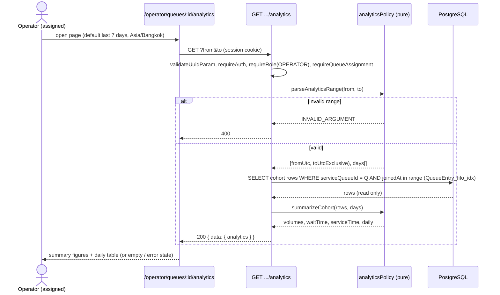

# Feature SDS: F-11 Operational analytics

| Field | Value |
|---|---|
| Feature | F-11 Operational analytics |
| Sprint | 3. Implemented for the 29 November 2026 checkpoint (Deliverable 2 Part C). |
| Issue | #44 |
| Depends on | F-01 (persistence), F-05 (operator lifecycle and timestamps); reads data written by F-07, F-08, F-09 and F-10 |
| Contract version | v1.1 (2026-11-28) |
| Status | Contract v1.0 merged (`fba2e2f`, PR #73). Implemented and verified locally (red `eb01c13`, green `e2ea189`); pending PR review and release. |
| Author / reviewer | `@TeekhathatTT` / `@Khwanklao` |
| Governing documents | [SRS](../srs.md) v6.0 (§1.5, FR-23, FR-24, BR-24–BR-26, §10.4 AC-56–AC-62), [Sprint 3 API spec](../sprints/sprint-3/api-spec.md) §2, [Sprint 3 UI spec](../sprints/sprint-3/ui-spec.md) §2, [Sprint 3 test spec](../sprints/sprint-3/tests.md) §2 (the canonical STS) |

## 1. Purpose

Management cannot see how long customers wait or how long service takes (SRS §2). Queue history is already stored: every `QueueEntry` keeps `joinedAt`, `calledAt`, `serviceStartedAt`, `completedAt`, `cancelledAt`, `noShowAt` and `recoveredAt` (BR-11). F-11 turns these timestamps into a read-only report for an operator's assigned queue over a chosen date range.

## 2. Scope

In scope:
- `GET /api/operator/queues/{queueId}/analytics?from=YYYY-MM-DD&to=YYYY-MM-DD`: volumes, waiting-time and service-time statistics, and a daily breakdown
- the operator analytics page `/operator/queues/:id/analytics` and a link to it from the operator queue workspace
- tests: unit, API+DB, client, E2E and a performance test

Out of scope (SRS §1.5): CSV/PDF export, charts, cross-queue or organisation dashboards, per-counter or per-operator rankings, live/streaming metrics, caching or materialized tables, and customer-facing statistics.

## 3. Workflow



## 4. Decisions

| ID | Decision | Reason |
|---|---|---|
| D-1 | The cohort is defined by `joinedAt` in the range. Volumes count the **current** status of those entries (BR-24). | Each entry is counted once, and the report can be rebuilt from stored rows. A day's "completed" count is the number of entries that joined that day and are now `COMPLETED`; it is not a count by completion date. |
| D-2 | Waiting time is `calledAt − joinedAt`. Service time is `completedAt − serviceStartedAt` (BR-25). | Both use timestamps the system already writes. Note: the issue text says "servingAt → completedAt"; the stored column for that moment is `serviceStartedAt`. |
| D-3 | Statistics: `count`, `averageSeconds`, `medianSeconds`, `p90Seconds` and `maxSeconds`. Percentiles use linear interpolation, the same as PostgreSQL `percentile_cont`. Values are rounded half-up to 1 decimal. When `count = 0`, the four values are `null`. | The median and p90 show the skew that an average hides. `null` avoids a fake `0` in an empty range. |
| D-4 | The timezone is fixed to `Asia/Bangkok` (UTC+07:00, no DST). `from`/`to` are inclusive dates. The span is at most 31 days. The API echoes `timezone` (BR-26). | Days match the local service day, the boundaries are exact (AC-58), and reads stay bounded (NFR-04). |
| D-5 | Statistics are computed in application code by pure functions (`server/src/services/analyticsPolicy.ts`) over the cohort rows from one indexed `SELECT`. No SQL aggregation, cache or schema change. | The pure functions are unit-tested against hand-computed values (ANALYTICS-001). The existing `QueueEntry_fifo_idx (serviceQueueId, joinedAt, id)` serves the range scan. At the 31-day cap the cohort is small (PERF-S3-001 checks it). |
| D-6 | Access: same middleware chain as `GET /api/operator/queues/{queueId}/entries`. A malformed `queueId` gets `400`, then the chain returns `401` for no session, `403` for a non-operator, `404` for an unknown queue and `403` for an unassigned operator. The range is validated after access, inside the handler. | One access rule for every operator queue read (BR-26, AD-08). A customer cannot learn whether a queue exists. |
| D-7 | The report is a `GET` with no CSRF token and no writes. Unknown query parameters are rejected (`400`). | It is a safe method under AD-01. Strict parameters catch client bugs early. |
| D-8 | The UI shows durations as `Xm YYs` (for example `4m 05s`), or `—` for `null`. The daily table uses a `<table>` with a `<caption>`; there is no chart. | It is readable and accessible without a chart library (NFR-11 later). |
| D-9 (v1.1) | Below the Tailwind `sm` breakpoint, the daily breakdown is shown as one card per day, and the table is hidden. From `sm` upwards, the table is shown. | ANALYTICS-012 showed that the 7-column table, even inside a scroll container, crosses the 360 px viewport edge, which the shared UI-001 overflow check rejects (NFR-06). |

## 5. Data definitions

**No schema change and no migration.** F-11 reads `QueueEntry` and `ServiceQueue` only. Seed and `provision-counters.ts` are unchanged.

| Field used | Meaning in F-11 |
|---|---|
| `serviceQueueId` | queue filter |
| `joinedAt` | cohort and day bucket (Asia/Bangkok) |
| `status` | volume bucket |
| `calledAt` | end of waiting time (latest call; cleared and re-set by F-08 recovery) |
| `serviceStartedAt`, `completedAt` | service time (`COMPLETED` only) |
| `recoveredAt` | `volumes.recovered` |
| `priority` | `volumes.priority` |

## 6. API

The full contract is in [Sprint 3 API spec §2](../sprints/sprint-3/api-spec.md#2-f-11-operational-analytics). In summary, `GET /api/operator/queues/{queueId}/analytics?from&to` returns:

```json
{ "data": { "analytics": {
  "queueId": "aaaaaaaa-aaaa-4aaa-8aaa-aaaaaaaaaaaa", "queueName": "General Inquiry Desk",
  "from": "2026-11-20", "to": "2026-11-26", "timezone": "Asia/Bangkok",
  "volumes": { "joined": 9, "waiting": 1, "called": 1, "serving": 1, "completed": 4, "cancelled": 1, "noShow": 1, "recovered": 1, "priority": 1 },
  "waitTime":    { "count": 7, "averageSeconds": 351.4, "medianSeconds": 300.0, "p90Seconds": 720.0, "maxSeconds": 900.0 },
  "serviceTime": { "count": 4, "averageSeconds": 570.0, "medianSeconds": 540.0, "p90Seconds": 810.0, "maxSeconds": 900.0 },
  "daily": [ { "date": "2026-11-20", "joined": 2, "completed": 2, "cancelled": 0, "noShow": 0, "averageWaitSeconds": 210.0, "averageServiceSeconds": 450.0 } ]
} } }
```

These are the expected values for the known dataset `DS-11` ([tests.md §2.1](../sprints/sprint-3/tests.md#21-known-dataset-ds-11)). Only the first `daily` row is shown here.

## 7. Server design

- **`server/src/services/analyticsPolicy.ts`** (pure, no DB):
  - `parseAnalyticsRange(from, to, maxDays = 31)` returns `{ fromUtc, toUtcExclusive, days }` or throws `INVALID_ARGUMENT`. It uses a strict `^\d{4}-\d{2}-\d{2}$` pattern, rejects dates that do not round-trip, and enforces `from ≤ to` and a span of at most 31 days.
  - `bangkokDate(instant)` returns `YYYY-MM-DD` for UTC+07:00.
  - `summarizeDurations(seconds[])` returns `{ count, averageSeconds, medianSeconds, p90Seconds, maxSeconds }`.
  - `summarizeCohort(rows, days)` returns `{ volumes, waitTime, serviceTime, daily }`.
- **`server/src/services/analyticsService.ts`**: `getQueueAnalytics(queueId, from, to)`. It parses the range, then reads the queue name and the cohort in one transaction-free read:
  ```sql
  SELECT id, status, priority, "joinedAt", "calledAt", "serviceStartedAt", "completedAt", "recoveredAt"
  FROM "QueueEntry" WHERE "serviceQueueId" = $1 AND "joinedAt" >= $fromUtc AND "joinedAt" < $toUtcExclusive
  ORDER BY "joinedAt", id
  ```
  It then calls `summarizeCohort`.
- **Route** in `server/src/routes/operator.ts`: `GET /queues/:queueId/analytics` with `requireAuth`, `requireRole(OPERATOR)` and `requireQueueAssignment`. A zod `.strict()` query schema `{ from, to }` returns `400` on failure.

Concurrency: the report is a single read. It holds no lock, so it cannot deadlock or block a write. A report taken during a live change reflects the committed state when the read ran (READ COMMITTED).

## 8. Client design

- `client/src/api/analytics.ts`: `getQueueAnalytics(queueId, from, to)`.
- `client/src/pages/OperatorAnalyticsPage.tsx`, route `/operator/queues/:queueId/analytics` under the existing operator guard.
- A link labelled **Analytics** on `OperatorQueueDetailPage`.
- The UI states are defined in [Sprint 3 UI spec §2](../sprints/sprint-3/ui-spec.md#2-f-11-operator-analytics-page).

## 9. Acceptance criteria and tests

AC-56 to AC-62 are in [SRS §10.4](../srs.md#104-acceptance-criteria-sprint-3-f-11-rev-60). The tests are `ANALYTICS-001`–`ANALYTICS-012`, `PERF-S3-001` and `REG-S3-001`, specified in [tests.md §2](../sprints/sprint-3/tests.md#2-f-11-operational-analytics).

## 10. Definition of Done (F-11 part of issue #44)

- [x] Contract v1.0 (SRS v6.0, this SDS, Sprint 3 API/UI/test specs) reviewed by `@Khwanklao` and merged before any F-11 code
- [x] RED: F-11 tests committed first and failing for the missing feature, with the existing suites green (output and SHA saved to `docs/sprints/sprint-3/evidence/f11-red-run.txt`)
- [x] GREEN: server, client and E2E (Chromium) pass, including `ANALYTICS-001`–`ANALYTICS-012` (output and SHA in `f11-green-run.txt`)
- [x] `PERF-S3-001` executed (`perf-s3-001.txt`)
- [x] `REG-S3-001`: all Sprint 1 and Sprint 2 tests pass unmodified
- [x] `docs/sprints/sprint-3/completion.md` and `traceability.md` updated with the executed results
- [ ] PR into `sprint2-staging` (the current integration branch) reviewed by `@Khwanklao`, with CI green

## 11. Review questions

| # | Question | Proposed answer |
|---|---|---|
| R-1 | Should the cohort be "joined in range" or "event in range" (for example, completed in range)? | Joined in range (D-1). Each entry is counted once, and the daily totals add up. |
| R-2 | Fixed `Asia/Bangkok`, or a `tz` parameter? | Fixed, echoed in the response. A `tz` parameter can be added later without breaking clients. |
| R-3 | Should the 31-day cap be larger? | Keep 31 for Sprint 3. NFR-04 is measured at the cap. |
| R-4 | Should the report include per-counter (F-09) or per-priority (F-10) waiting time? | Not now (out of scope). Volumes include a `priority` count only. |

## 12. Revision history

| Version | Date | Author | Sections | Previous text | Change |
|---|---|---|---|---|---|
| v1.0 | 2026-11-28 | `@TeekhathatTT` | All | — | First contract for issue #44 (F-11), aligned with SRS v6.0. Pending review by `@Khwanklao`. Later revisions add rows here and do not rewrite earlier ones. |
| v1.1 | 2026-11-28 | `@TeekhathatTT` | Header, §4 (D-9), §10 | D-8 alone described the daily table (D-8 is kept). The status said "pending review" and the DoD items were unchecked. | Records the merge (`fba2e2f`), red `eb01c13` and green `e2ea189`. Adds D-9 (daily cards below `sm`). Ticks the executed DoD items; the PR item stays open. |
