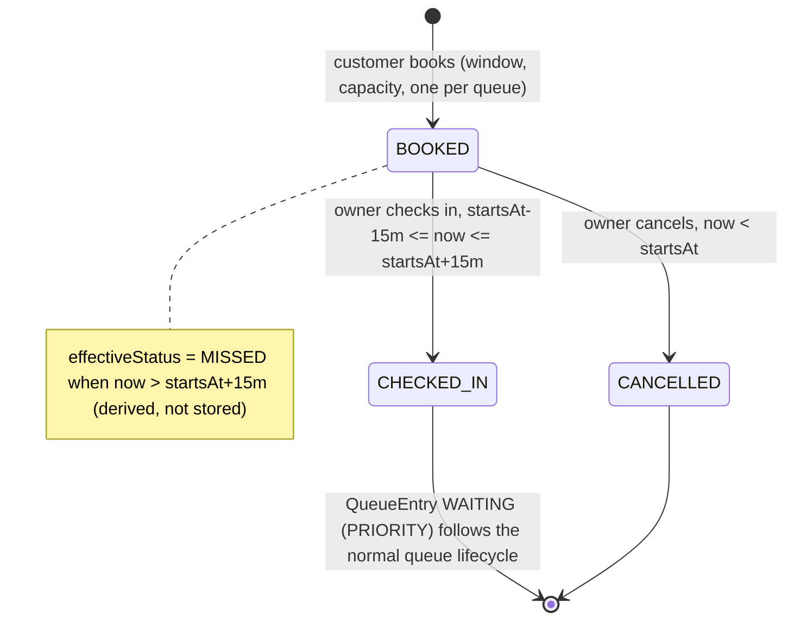

# Feature SDS: F-12 Advance appointment booking

| Field | Value |
|---|---|
| Feature | F-12 Advance appointment booking |
| Sprint | 3. The contract is due at the 29 November 2026 checkpoint. The implementation is due 13 December 2026. |
| Issue | #44 (contract). The implementation issue will be created after 29 November. |
| Depends on | F-03 (queues, numbering), F-04 (customer join and reads); interacts with F-07, F-08 and F-10 (check-in creates a `PRIORITY` entry), and with F-11 (check-in entries appear in analytics) |
| Contract version | v1.0 (2026-11-28) |
| Status | Contract v1.0, pending review by `@Khwanklao`; not implemented |
| Author / reviewer | `@TeekhathatTT` / `@Khwanklao` |
| Governing documents | [SRS](../srs.md) v6.0 (FR-25–FR-30, BR-27–BR-32, BR-21 rev. 6.0 note, §10.5 AC-63–AC-72), [Sprint 3 API spec](../sprints/sprint-3/api-spec.md) §3, [UI spec](../sprints/sprint-3/ui-spec.md) §3, [tests.md](../sprints/sprint-3/tests.md) §3 |

## 1. Purpose and scope

Walk-in queues force customers to wait on site without knowing when they will be served. F-12 lets operators publish time slots with a fixed capacity. Customers book a place ahead, cancel it, or check in when they arrive. Check-in turns the booking into a normal queue entry, which the system places in the `PRIORITY` tier so that a booked customer goes ahead of walk-ins.

In scope:
- operator slot create, list and close
- customer slot list, book, list own appointments, cancel and check in
- the operator appointments view
- database constraints and concurrency rules

Out of scope (SRS §1.5): recurring or bulk slots, editing or deleting slots, waitlists, reminders or notifications, payments, no-show penalties, and time zones other than `Asia/Bangkok`.

## 2. Lifecycle

Slot status: `OPEN → CLOSED` (operator). There is no reopen in v1.0.

## 3. Decisions

| ID | Decision | Reason |
|---|---|---|
| D-1 | A slot is one row with `startsAt`, `endsAt`, `capacity` and `status`. `(serviceQueueId, startsAt)` is unique. Slots are never deleted (BR-27). | This is the smallest model that supports capacity, and the history stays auditable. |
| D-2 | Booking window: from 14 days to 60 minutes before the start. Cancellation is allowed until the start. Check-in is allowed from 15 minutes before to 15 minutes after the start. All windows use the server clock (`clock_timestamp()` in the transaction) (BR-28, BR-30, BR-31). | Clear, testable boundaries. Tests control time by creating slots relative to `now()`, so there is no fake clock in production code. |
| D-3 | Capacity is checked under `SELECT … FOR UPDATE` on the slot. Active means `BOOKED` + `CHECKED_IN`. There is one active appointment per customer per queue (checked under the `User` row lock), with the partial unique index `(slotId, customerId) WHERE status IN ('BOOKED','CHECKED_IN')` as a backstop (BR-29). | No overbooking and no duplicates under concurrency (NFR-03). The same lock order as `joinQueue`. |
| D-4 | Check-in creates the queue entry through the same transactional steps as `joinQueue` (lock order `User` → `ServiceQueue` → `Appointment`; BR-05, BR-06 and BR-08 apply), with `priority = PRIORITY` set by the server (BR-21 rev. 6.0 note). | One code path for numbering and caps, and no customer self-elevation. |
| D-5 | `MISSED` is derived when the appointment is read. It is not stored, and there is no scheduler (BR-32). | Avoids background jobs on Cloud Run (min instances 0). |
| D-6 | Closing a slot does not cancel its bookings (BR-27). | Operators can stop new bookings without breaking customers' plans. |

## 4. Data definitions (planned additive migration `<timestamp>_f12_appointment_booking`)

| Object | Definition |
|---|---|
| enum `SlotStatus` | `OPEN`, `CLOSED` |
| enum `AppointmentStatus` | `BOOKED`, `CANCELLED`, `CHECKED_IN` |
| `AppointmentSlot` | `id uuid PK`, `serviceQueueId uuid FK → ServiceQueue (RESTRICT)`, `startsAt timestamptz`, `endsAt timestamptz`, `capacity int`, `status SlotStatus DEFAULT 'OPEN'`, `createdById uuid FK → User`, `createdAt`, `updatedAt`. `UNIQUE (serviceQueueId, startsAt)`, `CHECK (capacity BETWEEN 1 AND 20)`, `CHECK (endsAt > startsAt)`, and index `(serviceQueueId, startsAt)`. |
| `Appointment` | `id uuid PK`, `slotId uuid FK → AppointmentSlot (RESTRICT)`, `customerId uuid FK → User (RESTRICT)`, `status AppointmentStatus DEFAULT 'BOOKED'`, `bookedAt`, `cancelledAt?`, `checkedInAt?`, `queueEntryId uuid? UNIQUE FK → QueueEntry (RESTRICT)`. Partial unique index `Appointment_active_customer_slot_uidx (slotId, customerId) WHERE status IN ('BOOKED','CHECKED_IN')`, index `(customerId, bookedAt DESC)`, and `CHECK ((status = 'CHECKED_IN') = (queueEntryId IS NOT NULL AND checkedInAt IS NOT NULL))`. |
| Existing tables | `QueueEntry`, `ServiceQueue`, `Counter` and `User`: **no change**. |
| Seed | Dev/test seed adds no slots; tests create their own. Production needs no provisioning step. |

## 5. API (detail in [api-spec §3](../sprints/sprint-3/api-spec.md#3-f-12-advance-appointment-booking))

| Method and path | Role | Result |
|---|---|---|
| `POST /api/operator/queues/{queueId}/slots` | assigned OPERATOR, CSRF | `201 { slot }` |
| `GET /api/operator/queues/{queueId}/slots?date=` | assigned OPERATOR | `200 { slots[] }`, with `bookedCount` |
| `PATCH /api/operator/slots/{slotId}` `{"status":"CLOSED"}` | assigned OPERATOR, CSRF | `200 { slot }` |
| `GET /api/operator/queues/{queueId}/appointments?date=` | assigned OPERATOR | `200 { appointments[] }` |
| `GET /api/queues/{queueId}/slots?date=` | CUSTOMER | `200 { slots[] }` (bookable only, `remainingCapacity`) |
| `POST /api/slots/{slotId}/appointments` | CUSTOMER, CSRF | `201 { appointment }` |
| `GET /api/me/appointments` | CUSTOMER | `200 { appointments[] }`, with `effectiveStatus` |
| `POST /api/me/appointments/{id}/cancel` | owner CUSTOMER, CSRF | `200 { appointment }` |
| `POST /api/me/appointments/{id}/check-in` | owner CUSTOMER, CSRF | `201 { appointment, entry }` |

## 6. Concurrency and deadlock analysis

- **Book:** locks `User` (`FOR NO KEY UPDATE`, for the per-queue duplicate check), then `AppointmentSlot` (`FOR UPDATE`, for capacity), then inserts the `Appointment`.
- **Cancel:** locks `Appointment` (`FOR UPDATE`) and updates it conditionally.
- **Check-in:** locks `User`, then `ServiceQueue` (`FOR UPDATE`), then `Appointment` (`FOR UPDATE`).
- **Slot close:** locks `AppointmentSlot` only.

All paths take locks in the global order `User → ServiceQueue → AppointmentSlot → Appointment → QueueEntry`, so there are no lock cycles. AC-67 runs each race at least 15 times.

## 7. Acceptance criteria, tests and DoD

AC-63 to AC-72 are in SRS §10.5. Planned tests: `APPT-001`–`APPT-020` and `PERF-S3-002` ([tests.md §3](../sprints/sprint-3/tests.md#3-f-12-advance-appointment-booking)).

DoD (13 December):
- [ ] Contract reviewed and merged
- [ ] RED then GREEN, with SHAs
- [ ] Migration applied to Cloud SQL before deploy
- [ ] All `APPT-*` tests and `PERF-S3-002` passing
- [ ] Full regression passing
- [ ] UI at 360 px and 1280 px, and in the NFR-11 scan
- [ ] PR reviewed, CI green, released and deployed

## 8. Review questions

| # | Question | Proposed answer |
|---|---|---|
| R-1 | Should check-in give `PRIORITY`, or keep `NORMAL` with `joinedAt = startsAt`? | `PRIORITY` (D-4). It is simple and visible, and it reuses F-10. Backdating `joinedAt` would distort F-11 waiting times. |
| R-2 | One active appointment per customer per queue, or per day? | Per queue (BR-29). It is easy to explain and test. Revisit after UAT. |
| R-3 | Do `MISSED` appointments count against the customer (for example, a booking ban)? | No penalties in v1.0. |
| R-4 | Should operators be able to reopen a closed slot? | Not in v1.0. Create a new slot instead. |

## 9. Revision history

| Version | Date | Author | Sections | Previous text | Change |
|---|---|---|---|---|---|
| v1.0 | 2026-11-28 | `@TeekhathatTT` | All | — | First contract (issue #44), aligned with SRS v6.0. Pending review by `@Khwanklao`. |
