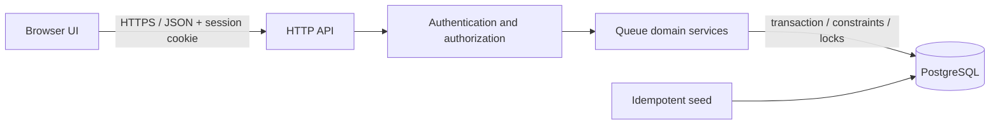
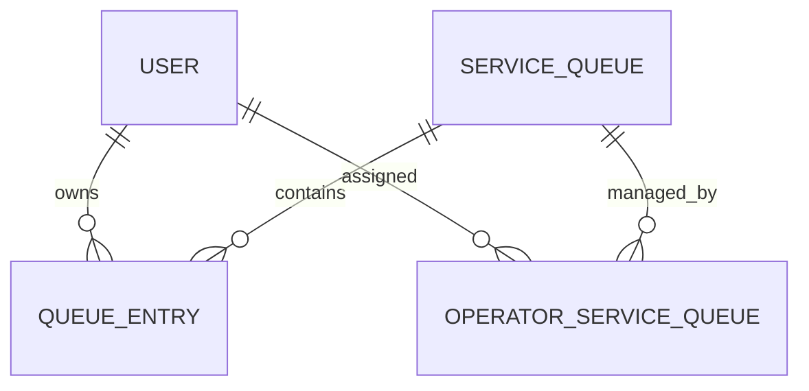

# System-Level Software Design Specification

## 1. Technology baseline

| Layer | Repository evidence | Sprint 1 design |
|---|---|---|
| Frontend | README describes a React Lab 5 example; source absent | Browser UI; React is proposed, subject to Issue #2 confirmation |
| Backend | README describes Express API example; source absent | HTTP API; Express proposed, subject to Issue #2 |
| Runtime | README assumes Node.js 24 | Node.js 24 reference baseline |
| Database/access | README describes PostgreSQL and Prisma; no schema or manifest present | Relational PostgreSQL with Prisma proposed; transactions/locking must satisfy this design |
| Authentication | None implemented/discovered | Opaque server-side session in secure cookie proposed |
| Tests | No test framework/config discovered | Issue #2 selects framework; contract requires unit, DB integration and E2E coverage |
| Local environment | README is Lab 5 starter documentation | Document native local setup; Docker is not Issue #1/2 implementation requirement |

No stack implementation is present on `sprint1-staging`; these choices are proposals, not findings. Issue #2 must inspect the application repository and approve/record the actual package manager and framework.

## 2. Architecture and request flow

Use a browser client, HTTP API, domain/service layer, persistence adapter and PostgreSQL. The browser renders workflow state but has no authority to grant access or transition state. API routes authenticate, validate, authorize, call transactional domain operations, then serialize a fixed response envelope. ORM/database failures are translated at the API boundary; internal details stay server-side.



```mermaid
sequenceDiagram
  participant B as Browser
  participant A as API
  participant S as Session/RBAC
  participant D as Queue service
  participant DB as Database
  B->>A: POST /api/auth/login
  A->>DB: Verify password hash + active account
  A-->>B: Set opaque session cookie; return user ID/role
  B->>A: Protected queue request + cookie + CSRF token
  A->>S: Validate session, role, ownership/assignment
  S-->>A: Authorized principal
  A->>D: Execute requested operation
  D->>DB: Read/write within transaction
  DB-->>D: Committed result
  D-->>A: Domain result
  A-->>B: Standard JSON envelope
```

Authentication flow: login verifies account is active and password hash; rotate session ID on success; set cookie; logout revokes session server-side and clears cookie. Use CSRF token for cookie-authenticated mutations. Authorization order: authenticate → role check → resource lookup/ownership or queue assignment → business/state validation → transaction. Customer entry lookup masks non-ownership as 404; operator queue assignment is 403.

## 3. Data model

Types are logical PostgreSQL types. IDs are opaque UUIDs in API; timestamps are `timestamptz` in UTC. If Issue #2 picks another DB, it must preserve the stated uniqueness and transaction invariants.

### 3.1 User

| Field | Type | Required/default | Key/constraint/index |
|---|---|---|---|
| id | UUID | Required, generated | PK |
| email | varchar(254) | Required, normalized lowercase | Unique; login index |
| passwordHash | varchar(255) | Required | Never serialized |
| role | enum `CUSTOMER`,`OPERATOR` | Required | Check/enum |
| accountStatus | enum `ACTIVE`,`DISABLED` | Required, default ACTIVE | Login lookup with email |
| createdAt | timestamptz | Required, now | — |
| updatedAt | timestamptz | Required, now/update | — |

Use email as the proposed login identifier (PENDING APPROVAL with authentication/UI). Seed user passwords come from environment/secret input and are hashed; no default known production password. Customer names/contact are not required by this sprint. If an operator display name is needed, an optional non-sensitive display name may be added with team approval.

### 3.2 ServiceQueue

| Field | Type | Required/default | Key/constraint/index |
|---|---|---|---|
| id | UUID | Required, generated | PK |
| name | varchar(120) | Required | Unique among active queues proposed |
| description | varchar(500) | Nullable | — |
| availability | enum `OPEN`,`CLOSED` | Required, default CLOSED | Customer catalog index `(availability,name)` |
| nextQueueNumber | bigint | Required, default 1 | Positive; updated transactionally; BR-02–04 pending |
| createdAt | timestamptz | Required, now | — |
| updatedAt | timestamptz | Required, now/update | — |

### 3.3 OperatorServiceQueue (assignment)

| Field | Type | Required/default | Key/constraint/index |
|---|---|---|---|
| operatorId | UUID | Required | FK User(id), composite PK |
| serviceQueueId | UUID | Required | FK ServiceQueue(id), composite PK |
| assignedAt | timestamptz | Required, now | Index `(serviceQueueId,operatorId)` |

Only users with role OPERATOR may be assigned; enforce in provisioning/domain validation (cross-table role cannot be a simple FK check). This join entity is required to implement scoped operator permissions.

### 3.4 QueueEntry

| Field | Type | Required/default | Key/constraint/index |
|---|---|---|---|
| id | UUID | Required, generated | PK |
| customerId | UUID | Required | FK User(id) |
| serviceQueueId | UUID | Required | FK ServiceQueue(id) |
| queueNumber | bigint | Required | Positive; unique `(serviceQueueId,queueNumber)` |
| status | enum WAITING/CALLED/SERVING/COMPLETED | Required, WAITING | Queue/status index |
| joinedAt | timestamptz | Required, server now | FIFO index `(serviceQueueId,status,joinedAt,id)` |
| calledAt | timestamptz | Nullable | Set only on WAITING→CALLED |
| serviceStartedAt | timestamptz | Nullable | Set only on CALLED→SERVING |
| completedAt | timestamptz | Nullable | Set only on SERVING→COMPLETED |

Foreign keys restrict deletion of referenced users/queues while history exists; queue/user deactivation is preferred. Add a race-safe uniqueness mechanism for `(customerId,serviceQueueId)` among statuses `WAITING`,`CALLED`,`SERVING` (partial unique index if supported, otherwise locked transaction/guard table). Add `(serviceQueueId,status,joinedAt,id)` and `(customerId,joinedAt DESC)` indexes. A separate audit table is not required for Sprint 1; lifecycle timestamps and immutable completed row are the history contract.

### 3.5 Migration and seed strategy

Database setup is intentionally explicit: schema changes are performed through migration files checked into the repository, with each migration adding or altering tables and constraints in a reversible order. The design requires migration scripts to create the user, queue, assignment and queue-entry tables, add the required uniqueness and status constraints, and preserve the queue-number and active-entry invariants. Local seed data must be idempotent and must create at least one `OPEN` queue and one assigned operator plus a sample customer account for manual validation; seed output must never print cleartext passwords or user secrets.

### 3.6 Relationships



## 4. Integrity and concurrency

- Join: begin transaction; lock target queue row; verify OPEN; check active duplicate; allocate/increment counter; insert WAITING row; commit. The unique `(queueId,number)` constraint is final defense. The active-entry invariant must be enforced by partial unique index or a serializable/locked mechanism that serializes the customer+queue key. Translate race loser to `409 DUPLICATE_ACTIVE_ENTRY`.
- Call Next: transaction selects first WAITING row ordered `(joinedAt,id)` with a row lock and skip-locked/equivalent; update that row to CALLED and set `calledAt`; commit. If no row, return empty. Concurrent callers cannot claim the same row. If implementation uses `SKIP LOCKED`, retries/claim selection must still meet FIFO among currently unlocked eligible entries; test simultaneous calls and document DB-specific behavior.
- Start/complete: conditional update `WHERE id=? AND status=<expected>` within transaction; confirm operator assignment in transaction. Zero rows after authorized lookup means conflict, not success. Status and timestamp update together.
- All invariants are backend-enforced. DB constraints protect identity/uniqueness; transactions and locks protect multi-row/race rules; domain logic validates allowed transitions and authorization. Never depend on UI checks.

## 5. Authentication and authorization

Use opaque random server-side session IDs, store only a hash of the session token if practical, rotate ID at login, expire idle sessions after 30 minutes and absolute sessions after 12 hours (proposed values, PENDING APPROVAL), revoke on logout and disable-account detection. Cookie: HttpOnly, SameSite=Lax, Secure in production, path `/`; local HTTP may omit Secure. Password hash Argon2id preferred, or reviewed bcrypt parameters. Rate-limit login in implementation if chosen stack supports it; never reveal whether account exists. Session storage must be shared persistent storage in deployment; for local setup, DB-backed session store is preferred.

Every protected endpoint authenticates. Customer paths require CUSTOMER and ownership. Operator paths require OPERATOR plus `OperatorServiceQueue` assignment. A role mismatch is 403; unauthenticated is 401. The API never trusts a role, user ID or assignment supplied by the browser.

## 6. Configuration and local setup contract

Required configuration names (final formats assigned in Issue #2): `DATABASE_URL`, `SESSION_SECRET` (≥32 random bytes), `APP_ORIGIN`, `NODE_ENV`, and seed-only `SEED_CUSTOMER_EMAIL`, `SEED_CUSTOMER_PASSWORD`, `SEED_OPERATOR_EMAIL`, `SEED_OPERATOR_PASSWORD`. If multiple operators/queues are seeded, use a documented structured seed input; do not hardcode usable passwords. Example files contain placeholders only. Fail startup for missing/weak production secrets. Seed creates at least one open queue and assigned operator for a usable local demo; seed is idempotent and outputs no passwords. Local test accounts use test-only generated credentials managed by test fixtures. Exact shell commands, ports and package scripts depend on the actual app source and are an Issue #2 decision. No Docker/GCP/CI/CD is specified as an Issue #1 implementation.
