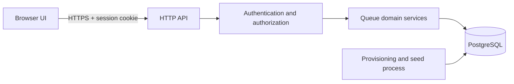

# System-Level Software Design Specification

This specification describes the intended Sprint 1 design. The repository currently contains documentation only; schema, runtime configuration, and UI behavior described here are implementation contracts, not claims about existing code.

## 1. Architecture Overview

QMS is a browser client, an HTTP API, a domain-service layer, and a PostgreSQL relational database. The browser renders customer and operator workflows and sends requests to the API. The API authenticates sessions, validates inputs, authorizes roles and resource access, applies business rules, and executes database transactions. PostgreSQL is the source of truth for persisted queue state, uniqueness, and concurrency control.



### 1.1 Request processing

For protected requests, the API processes work in this order:

1. Authenticate the session; reject absent, invalid, or expired sessions.
2. Validate route parameters, query parameters, and request payload.
3. Authorize the user's role and, where applicable, queue assignment or entry ownership.
4. Validate the requested business operation and lifecycle state.
5. Execute the mutation in a database transaction.
6. Commit before returning a successful mutation response.
7. Return only the contractually permitted data.

Authorization and ownership checks are server-side. UI control visibility is not an authorization boundary.

## 2. Role and Permission Matrix

`—` means the role does not have the operation. Anonymous requests to protected operations receive `401 UNAUTHORIZED`. Future-sprint behavior is not a Sprint 1 permission.

| Action / endpoint | Anonymous | CUSTOMER | OPERATOR | Authorization / expected result |
|---|---|---|---|---|
| `POST /api/auth/login` | May submit credentials | May submit credentials | May submit credentials | Valid credentials establish a session; invalid credentials receive `401 UNAUTHORIZED` without disclosing account state. |
| `POST /api/auth/logout` | `401 UNAUTHORIZED` | May revoke own session | May revoke own session | Successful logout returns `204 No Content` with no body. |
| `GET /api/auth/me` | `401 UNAUTHORIZED` | May read own authenticated identity | May read own authenticated identity | Returns current session user's ID, email, and role. |
| Access any protected endpoint without a valid session | `401 UNAUTHORIZED` | — | — | Authentication is required before protected business operations. |
| `GET /api/queues` | `401 UNAUTHORIZED` | May list OPEN queues | May list OPEN queues | Only OPEN queues are returned. |
| `POST /api/queues/{queueId}/entries` | `401 UNAUTHORIZED` | May join an OPEN queue | `403 FORBIDDEN` | A closed queue or duplicate active entry returns the corresponding `409` error. |
| `GET /api/me/queue-entries` | `401 UNAUTHORIZED` | May list own entries | `403 FORBIDDEN` | Results are scoped to the authenticated customer. |
| `GET /api/me/queue-entries/{entryId}` | `401 UNAUTHORIZED` | May read own entry | `403 FORBIDDEN` | Another customer's or missing entry returns `404 RESOURCE_NOT_FOUND`; resource existence is not disclosed. |
| `GET /api/operator/queues` | `401 UNAUTHORIZED` | `403 FORBIDDEN` | May list assigned queues | Assignment scope is enforced by the API. |
| `GET /api/operator/queues/{queueId}/entries` | `401 UNAUTHORIZED` | `403 FORBIDDEN` | May list assigned queue entries | Unassigned queue access returns `403 FORBIDDEN`; queue order is deterministic FIFO. |
| `POST /api/operator/queues/{queueId}/call-next` | `401 UNAUTHORIZED` | `403 FORBIDDEN` | May call next in an assigned queue | Unassigned access returns `403 FORBIDDEN`; invalid transitions return `409 INVALID_STATE_TRANSITION`; empty queue returns `204` with no body. |
| `POST /api/operator/queue-entries/{entryId}/start` | `401 UNAUTHORIZED` | `403 FORBIDDEN` | May start an entry in an assigned queue | Unassigned access returns `403 FORBIDDEN`; missing resource returns `404 RESOURCE_NOT_FOUND`; invalid transition returns `409 INVALID_STATE_TRANSITION`. |
| `POST /api/operator/queue-entries/{entryId}/complete` | `401 UNAUTHORIZED` | `403 FORBIDDEN` | May complete an entry in an assigned queue | Unassigned access returns `403 FORBIDDEN`; missing resource returns `404 RESOURCE_NOT_FOUND`; invalid transition returns `409 INVALID_STATE_TRANSITION`. |
| Customer queue position calculation | Not available | Not specified by the Sprint 1 API | Not specified by the Sprint 1 API | Sprint 1 exposes entry status and FIFO-ordered operator entries; a customer-facing position endpoint is not defined. |
| Customer cancellation or withdrawal | Not available | Planned for Sprint 2 (F-07) | — | Not part of Sprint 1. |
| No-show handling | Not available | — | Planned for Sprint 2 (F-08) | Not part of Sprint 1. |

### 2.1 Authorization rules

- Authentication is checked before protected business operations.
- CUSTOMER may read only their own queue-entry data. Cross-owner reads return the same `404 RESOURCE_NOT_FOUND` behavior as a missing entry.
- OPERATOR may view or operate only queues to which they are assigned. Assignment failures return `403 FORBIDDEN`; they are not masked as customer privacy failures.
- Role checks, entry ownership, and operator assignment are enforced server-side for every request.
- Hiding or disabling UI controls does not replace API authorization.
- Provisioning and seed operations are setup responsibilities, not an interactive runtime role or public API permission.

## 3. Data Model

The following fields describe the Sprint 1 logical model. IDs are UUIDs; timestamps are PostgreSQL `timestamptz` values stored in UTC.

### 3.1 User

| Field | Type | Constraints |
|---|---|---|
| `id` | UUID | Primary key |
| `email` | `varchar(254)` | Required, unique normalized login identifier |
| `passwordHash` | `varchar(255)` | Required salted adaptive hash; never returned by the API |
| `role` | enum `CUSTOMER`, `OPERATOR` | Required |
| `accountStatus` | enum `ACTIVE`, `DISABLED` | Required |
| `createdAt` | `timestamptz` | Server-generated |
| `updatedAt` | `timestamptz` | Server-generated |

### 3.2 ServiceQueue

| Field | Type | Constraints |
|---|---|---|
| `id` | UUID | Primary key |
| `name` | `varchar(120)` | Required |
| `description` | `varchar(500)` | Nullable |
| `availability` | enum `OPEN`, `CLOSED` | Required |
| `lastQueueNumber` | `BIGINT` | Required, default `0`, `CHECK ("lastQueueNumber" >= 0)` |
| `createdAt` | `timestamptz` | Server-generated |
| `updatedAt` | `timestamptz` | Server-generated |

`lastQueueNumber` is a per-service-queue allocation counter, not a global or in-memory counter. It records the largest number allocated to that queue. It must not move backwards during normal operation. BR-04 specifies no automatic reset in Sprint 1; no reset operation is defined.

### 3.3 OperatorAssignment

| Field | Type | Constraints |
|---|---|---|
| `operatorId` | UUID | Foreign key to `User` |
| `serviceQueueId` | UUID | Foreign key to `ServiceQueue` |
| `assignedAt` | `timestamptz` | Server-generated |

The composite primary key is `(operatorId, serviceQueueId)`. Only OPERATOR users may be assigned. The key supports listing queues by operator; no additional index is specified without a demonstrated query need.

### 3.4 QueueEntry

| Field | Type | Constraints |
|---|---|---|
| `id` | UUID | Primary key |
| `customerId` | UUID | Required foreign key to `User` |
| `serviceQueueId` | UUID | Required foreign key to `ServiceQueue` |
| `queueNumber` | `BIGINT` | Required, `CHECK ("queueNumber" > 0)` |
| `status` | enum `WAITING`, `CALLED`, `SERVING`, `COMPLETED` | Required |
| `joinedAt` | `timestamptz` | Server-generated |
| `calledAt` | `timestamptz` | Nullable |
| `serviceStartedAt` | `timestamptz` | Nullable |
| `completedAt` | `timestamptz` | Nullable |

The lifecycle and active-state definitions match the SRS: active states are `WAITING`, `CALLED`, and `SERVING`; `COMPLETED` is terminal. Completed entries remain for historical review.

#### Required database constraints and indexes

```sql
ALTER TABLE "ServiceQueue"
  ADD CONSTRAINT "ServiceQueue_lastQueueNumber_nonnegative_chk"
  CHECK ("lastQueueNumber" >= 0);

ALTER TABLE "QueueEntry"
  ADD CONSTRAINT "QueueEntry_queueNumber_positive_chk"
  CHECK ("queueNumber" > 0),
  ADD CONSTRAINT "QueueEntry_serviceQueueId_queueNumber_key"
  UNIQUE ("serviceQueueId", "queueNumber");

CREATE INDEX "QueueEntry_fifo_idx"
ON "QueueEntry" ("serviceQueueId", "joinedAt" ASC, "id" ASC);

CREATE UNIQUE INDEX "QueueEntry_active_customer_queue_uidx"
ON "QueueEntry" ("customerId", "serviceQueueId")
WHERE "status" IN ('WAITING', 'CALLED', 'SERVING');

CREATE INDEX "QueueEntry_customer_joinedAt_idx"
ON "QueueEntry" ("customerId", "joinedAt" DESC);
```

- The queue-number unique constraint prevents duplicate numbers within a service queue.
- The FIFO index filters by queue and orders entries by `joinedAt`, with `id` as a stable tie-breaker for equal timestamps. This matches the API and BR-01 ordering contract.
- The partial unique index prevents a customer from holding more than one active entry in the same queue while permitting completed history and a later rejoin.
- The customer-history index supports `GET /api/me/queue-entries`, which filters by customer and can return completed as well as active entries.
- No separate status or availability index is specified for Sprint 1: the current access patterns do not establish that it is needed. PostgreSQL does not automatically index referencing foreign-key columns; add further indexes only if measured query patterns justify them.

#### Prisma and PostgreSQL-specific definitions

Prisma models can declare ordinary fields, primary keys, unique constraints, and standard indexes. The partial unique active-entry index uses a status predicate and must be represented by a PostgreSQL SQL migration unless the selected Prisma version explicitly supports that exact predicate. The migration and Prisma model must describe the same logical fields and constraints. No migration or Prisma schema exists in this documentation-only repository.

## 4. Concurrency and Integrity Design

### 4.1 Queue-number allocation

Queue number allocation uses the PostgreSQL row-level locking decision in BR-03 and AD-02. The implementation must perform these logical steps in one database transaction:

1. Begin a transaction and acquire a row-level lock on the target `ServiceQueue` row using a locking strategy supported by the selected Prisma/PostgreSQL versions.
2. Confirm the queue exists and is `OPEN`.
3. Confirm the customer is eligible to join, including the no-active-entry rule.
4. Increment that queue's `lastQueueNumber`.
5. Use the newly allocated value as `QueueEntry.queueNumber`.
6. Insert the `QueueEntry` with status `WAITING` and a server-generated `joinedAt`.
7. Commit the transaction before returning success.

The counter increment and entry insert are atomic: any failure rolls back both. The unique constraint on `(serviceQueueId, queueNumber)` is the final duplicate-number guard; the partial unique index is the final active-entry guard. Application-level checks alone are insufficient. The design requires a database row lock but does not prescribe a specific SQL statement or Prisma API until implementation versions are selected.

### 4.2 Entry lifecycle and call-next

Allowed transitions are `WAITING -> CALLED -> SERVING -> COMPLETED`. Lifecycle status and corresponding server-generated UTC timestamp are committed atomically. Call-next selects the oldest eligible WAITING entry by `joinedAt ASC, id ASC` and claims it in a transaction so concurrent operators cannot claim the same entry. If no eligible entry exists, the API returns `204 No Content` without changing state. Stale or conflicting mutations use the API's `409` conflict contract.

## 5. API Conventions

The authoritative base path is `/api`, as established in the Sprint 1 API specification. Versioning is not currently defined; this design preserves the existing path rather than introducing a new `/api/v1` contract during Sprint 1.

### 5.1 URL and method conventions

Use the existing resource paths and HTTP methods. The documented routes include `/api/auth/...`, `/api/queues/...`, `/api/me/queue-entries/...`, and `/api/operator/...`. Do not replace these with structural examples or add unapproved endpoints. JSON payloads use UTF-8; timestamps are RFC 3339 UTC.

### 5.2 Success responses

All successful responses with a JSON body use a `data` envelope:

```json
{
  "data": {
    "user": {
      "id": "example-id",
      "email": "customer@example.invalid",
      "role": "CUSTOMER"
    }
  }
}
```

List responses place the list in `data`, for example `{"data":{"queues":[]}}` or `{"data":{"entries":[]}}`; no pagination metadata or pagination contract is defined for Sprint 1. `204 No Content` responses (logout and empty Call Next) have no response body and do not use the envelope.

### 5.3 Error responses

When an error response has a body, it uses the API specification's stable error envelope:

```json
{
  "error": {
    "code": "INVALID_STATE_TRANSITION",
    "message": "The requested transition is not allowed.",
    "requestId": "request-id"
  }
}
```

HTTP status represents the protocol-level result; `code` is a stable machine-readable application error identifier; `message` is safe for clients; `requestId` supports diagnostics without disclosing internal details. Never expose database/SQL errors, stack traces, secrets, or private resource existence. Established codes are:

| HTTP status | Error code(s) | Use |
|---|---|---|
| 400 | `INVALID_ARGUMENT` | Malformed identifier, payload, query, or input validation failure |
| 401 | `UNAUTHORIZED` | Missing, invalid, or expired session; invalid credentials |
| 403 | `FORBIDDEN` | Authenticated user has the wrong role or lacks queue assignment |
| 404 | `RESOURCE_NOT_FOUND` | Unknown resource; also used for customer cross-owner lookup |
| 409 | `QUEUE_NOT_AVAILABLE`, `DUPLICATE_ACTIVE_ENTRY`, `INVALID_STATE_TRANSITION`, `CONCURRENT_MODIFICATION` | Closed/ineligible queue, duplicate active join, invalid transition, or stale/conflicting mutation |
| 500 | `INTERNAL_ERROR` | Unexpected server failure; safe generic message only |

The contract does not use `422 Unprocessable Content`.

### 5.4 HTTP status conventions

| Status | Sprint 1 use |
|---|---|
| `200 OK` | Successful reads, login, and lifecycle mutations returning JSON |
| `201 Created` | Successful customer queue-entry creation |
| `204 No Content` | Successful logout and empty Call Next; no response body |
| `400 Bad Request` | Malformed or invalid request data |
| `401 Unauthorized` | Missing/invalid session or invalid credentials |
| `403 Forbidden` | Authenticated user lacks role permission or operator assignment |
| `404 Not Found` | Resource absent or customer-private entry not owned by requester |
| `409 Conflict` | Queue availability, duplicate active entry, invalid transition, or concurrent modification |
| `500 Internal Server Error` | Unexpected server failure with a safe error body |

## 6. UI Conventions and Common States

These are shared design requirements, not claims that UI components are implemented. The detailed screen map and role-specific interactions remain in the [Sprint 1 UI specification](./sprints/sprint-1/ui-spec.md).

### 6.1 Responsive layout

| Viewport | Layout guidance |
|---|---|
| 360–767 px | Mobile: single-column content, compact navigation, stacked forms and queue details |
| 768–1279 px | Tablet: flexible content width and navigation; use multi-column layouts only where readable |
| 1280 px and above | Desktop: wider content area and operator workspace/table layouts where appropriate |

The explicit Sprint 1 pass widths remain 360 px and 1280 px from NFR-06 and the UI specification. The 768 px tablet breakpoint is a layout guidance point, not a separately tested requirement. No page-level horizontal overflow is permitted at the specified test widths.

### 6.2 Loading and duplicate submission

- Use a localized spinner for short actions and skeleton placeholders for substantial page/list loading where useful.
- Indicate ongoing work; disable repeat submission while a mutation is pending.
- Preserve visible page context during local updates where possible.
- These are design requirements, not claims about existing loading components.

### 6.3 Empty states

- No available queues: explain that there are currently no OPEN queues.
- No waiting entries: show a neutral empty state; Call Next returns 204 and does not change queue state.
- No assigned queues: explain that the operator has no queue assignment.
- No queue history: show a clear empty result rather than a blank page.

### 6.4 Error and success feedback

- Show field-specific validation inline, operation failures in a user-safe alert or toast, and resource-load failures as a page-level error with retry only when retry is safe.
- Do not display server internals, SQL details, stack traces, secrets, or another customer's existence.
- Give confirmation for successful join (queue number and WAITING status), call-next (called entry), start (SERVING), and completion (COMPLETED).
- Empty Call Next uses the neutral empty state rather than a success or error with a response body.

### 6.5 Validation and status indicators

- Mark required inputs, describe invalid values next to the relevant field, and disable actions that are not valid for the current known state. The API remains authoritative and may reject stale UI state.
- Use the lifecycle values and labels `WAITING` (Waiting), `CALLED` (Called), `SERVING` (In service), and `COMPLETED` (Completed).
- Use text and icons, not color alone; maintain visible labels, keyboard focus, touch-friendly small-screen controls, and accessible status announcements.

## 7. Environment and Configuration

This repository has no application source, package manifest, runtime configuration, environment-variable references, setup scripts, or database migrations. Therefore, no environment-variable names, defaults, or setup commands are currently implemented or verified. The following is a **proposed minimum configuration contract for a future implementation**, not a claim about an existing stack. Names must be confirmed against the selected backend before implementation.

| Proposed variable | Required? | Purpose | Default / notes |
|---|---|---|---|
| `NODE_ENV` | Required if the selected backend is Node.js; otherwise use the equivalent runtime mode setting | Select development, test, or production behavior | Proposed name only; no project default is configured. |
| `PORT` | Required unless the implementation defines a documented safe default | HTTP API listen port | No configured default exists in this repository. |
| `DATABASE_URL` | Required | PostgreSQL connection string | Use a separate database for development, test, and production; never commit credentials. |
| `SESSION_SECRET` | Required | Secret material for session signing or encryption | Generate and provide securely per environment; no shared or committed default. |

Additional variables must be documented only when required by the selected implementation (for example, a separately configured CSRF secret if the chosen session design requires one). Development and test must use isolated databases and non-production session secrets. Production secrets must be injected through secure environment configuration, not checked into source control.

To satisfy NFR-07, a future implementation must document a clean-checkout workflow that configures required values, installs repository dependencies, initializes PostgreSQL schema and idempotent seed data, starts the application using repository-supported commands, and verifies the seeded customer, operator, assignment, and OPEN queue. Those commands cannot be stated or claimed as tested until implementation files exist and setup is run.

## 8. Security and Reliability

- Passwords use salted adaptive hashes (Argon2id or reviewed bcrypt configuration); credentials, hashes, and session secrets are never returned or logged.
- Authentication uses server-validated sessions in HTTP-only cookies; cookie-authenticated mutations require CSRF protection.
- Production session cookies are `Secure`, `HttpOnly`, and `SameSite=Lax`.
- Login failure responses do not disclose whether an account exists.
- Cross-owner customer lookups use `404 RESOURCE_NOT_FOUND`; operator access to unassigned queues uses `403 FORBIDDEN`.
- Mutation success is returned only after the database commit.
- All API error messages are safe for clients and omit implementation details.

## 9. Related Sprint 1 Contracts

- [SRS](./srs.md) defines requirements and business rules.
- [Feature inventory](./features.md) and [traceability matrix](./traceability.md) map requirements to features and verification.
- [Sprint plan](./sprints/plan.md) defines scope by sprint.
- [API specification](./sprints/sprint-1/api-spec.md), [UI specification](./sprints/sprint-1/ui-spec.md), and [test specification](./sprints/sprint-1/tests.md) define detailed contracts.

This SDS is aligned to the current Sprint 1 documentation baseline. No source code, schema, migration, API handler, UI component, or deployment configuration is implemented in this repository.

## 10. Implementation decisions (Issue #3)

These record choices the specification left open. They do not change any requirement, request/response shape, or error code above.

| Topic | Decision |
|---|---|
| Session storage | Server-side `Session` table (additive migration `20261112090500_auth_sessions`): `id` (UUID PK), `userId` (FK to `User`, `ON DELETE CASCADE`), `tokenHash` (`varchar(64)`, unique), `csrfToken` (`varchar(64)`), `createdAt`, `expiresAt` (`timestamptz`); indexes on `userId` and `expiresAt`. Logout deletes the row (AD-01, AUTH-003). |
| Session token | 32 random bytes, base64url, sent only in the session cookie. The database stores `HMAC-SHA256(SESSION_SECRET, token)` in hex, never the raw token. A session whose user is `DISABLED` is treated as unauthenticated. Expired rows are deleted when presented. |
| Session lifetime | 8 hours absolute from login; not extended by activity. Constant in code (`SESSION_TTL_MS`); no environment variable. |
| Cookies | `qms_session`: `HttpOnly`, `SameSite=Lax`, `Path=/`, `Secure` only when `NODE_ENV=production`, max age = remaining lifetime. `qms_csrf`: same attributes but not `HttpOnly`, so the client can read it. |
| CSRF delivery | A random CSRF token is generated per session at login, stored in `Session.csrfToken`, and set in the `qms_csrf` cookie (re-issued by `GET /api/auth/me`). The client sends it as `X-CSRF-Token` on every non-GET request; the server compares it to the session's token in constant time. It is never placed in a response body. |
| Login hardening | Email is trimmed and lower-cased before lookup. An unknown email still performs one bcrypt comparison against a fixed dummy hash. Unknown email, wrong password, and `DISABLED` account return the same `401 UNAUTHORIZED` body (`Invalid email or password.`) with no `Set-Cookie`. A successful login deletes any session presented with the request (session-fixation protection). Body validation: `email` string, 1–254 characters after trimming; `password` string, 1–200 characters. |
| Middleware order | `loadSession` (app level, never rejects) → `requireAuth` (401) → `requireCsrf` (403, mutations only) → validation → `requireRole` / `requireQueueAssignment` (403/404) → handler. |

## 11. Implementation decisions (Issue #5)

These record choices the specification left open for the customer screens. They do not change any requirement, endpoint, request/response shape, error code, or database schema above.

| # | Topic | Decision |
|---|---|---|
| 1 | Queue name on entries | Entry payloads carry only `serviceQueueId`. The client maps it to a name using `GET /api/queues`. A queue that is not in that list (for example closed after the customer joined) is shown with the neutral label `Service queue`. Spec gap: a team decision is needed on adding the queue name to the entry payload. |
| 2 | Refreshing | Re-fetch after every join; a visible `Refresh` button; polling every 10 seconds (`REFRESH_INTERVAL_MS` in `client/src/hooks/usePolling.ts`) of `GET /api/me/queue-entries` while My Active Tickets is shown and of the entry detail while the entry is not `COMPLETED`, only while `document.visibilityState === 'visible'`. A failed poll keeps the last data and shows "Could not refresh. Retrying...". Timers are cleared on unmount. Status changes are announced in an `aria-live="polite"` region. Spec gap: the interval was undefined. |
| 3 | Tabs | `/customer` uses an accessible tablist (`role="tablist"`/`tab`/`tabpanel`, `aria-selected`, `aria-controls`, roving `tabIndex`, Left/Right/Home/End keys). Available Queues is the default. After a join the user stays on the tab and sees a success panel (queue name, queue number, status, "View details" link); both lists are re-fetched. |
| 4 | Queue number display | The integer is shown exactly as returned. No prefix or padding until the number format is approved. |
| 5 | Detail messages | `WAITING` with `aheadCount` 0: "You are next"; with N ahead: "Currently waiting. N people ahead of you." (singular for 1); `CALLED`: "Please go to the service desk."; `SERVING`: "Your service is in progress."; `COMPLETED`: "Service completed." The ahead line appears only for `WAITING`. The list view does not show `aheadCount` and does not call the detail endpoint per item. |
| 6 | My Active Tickets content | Entries exactly as the API returns them (newest first), completed ones included and labelled `Completed`. No client-side grouping. |
| 7 | Join error mapping | `409 DUPLICATE_ACTIVE_ENTRY`: "You already have an active entry in this queue."; `409 QUEUE_NOT_AVAILABLE`: "This queue is not available right now." plus a queue-list re-fetch; `404 RESOURCE_NOT_FOUND`: "This queue is no longer available." plus a re-fetch; `403 FORBIDDEN` (includes CSRF failure): "We couldn't verify this request. Please refresh the page or sign in again." without logging out; anything else: "Something went wrong. Please try again." `401` uses the existing global session-expired handler. Server messages are never shown. Only the clicked queue's button is disabled. |
| 8 | Duplicate-click protection | Besides the disabled button and `Joining queue...` spinner, a per-queue in-flight guard (a ref) makes two fast clicks send exactly one request. The server's transaction and unique index remain authoritative. |
| 9 | Detail not found | `404` (missing or another customer's entry) and `400` (malformed id) show the same generic "We couldn't find that queue entry." with a link back to `/customer`. No entry data is rendered. |

## 12. Implementation decisions (Issue #6)

These record choices the specification left open for the operator workflow and endpoints. They do not change any requirement, endpoint, request/response shape, error code, or database schema above.

| # | Topic | Decision |
|---|---|---|
| 1 | Concurrency-safe Call Next | `POST /api/operator/queues/:queueId/call-next` runs inside a PostgreSQL transaction using `SELECT id, "joinedAt", clock_timestamp() AS "now" FROM "QueueEntry" WHERE "serviceQueueId" = $1::uuid AND status = 'WAITING'::"QueueStatus" ORDER BY "joinedAt" ASC, id ASC LIMIT 1 FOR UPDATE SKIP LOCKED`. Concurrent `call-next` requests on the same queue skip rows locked by in-flight transactions and either claim the next eligible `WAITING` row (`200 OK`) or return `204 No Content` with an empty body if none remain (`CONCURRENCY-003`). |
| 2 | Concurrency-safe Start & Complete | `POST /api/operator/queue-entries/:entryId/start` and `/complete` acquire a row-level lock (`SELECT ... FROM "QueueEntry" WHERE id = $1::uuid FOR UPDATE`) inside a transaction, verify `OperatorAssignment` (`403 FORBIDDEN` if unassigned), verify expected status (`CALLED` for start, `SERVING` for complete; `409 INVALID_STATE_TRANSITION` otherwise), and compute the transition timestamp using `GREATEST(clock_timestamp(), previousTimestamp)` so `joinedAt <= calledAt <= serviceStartedAt <= completedAt` always holds under database check constraints (`CONCURRENCY-004`). |
| 3 | Operator Queue Management layout | `/operator` lists the operator's assigned queues (`OPEN` and `CLOSED`) with availability badges and links to `/operator/queues/:id`. `/operator/queues/:id` groups entries into three sections: **Active Service** (`CALLED` and `SERVING`), **Waiting Queue — FIFO** (`WAITING` in `joinedAt ASC, id ASC` order), and **Completed** (`COMPLETED`), with a top-level **Call Next** action and per-entry **Start Service** (enabled only for `CALLED`) and **Complete Service** (enabled only for `SERVING`) controls. |
| 4 | Refreshing & conflict recovery | Every operator mutation (`call-next`, `start`, `complete`) immediately re-fetches `GET /api/operator/queues/:queueId/entries` upon completion. If a concurrent operator action causes `409 INVALID_STATE_TRANSITION`, the UI shows a user-safe conflict banner and automatically refreshes the entry list so stale buttons are updated immediately. Both `/operator` and `/operator/queues/:id` also poll every 10 seconds while visible (`usePolling`). |

