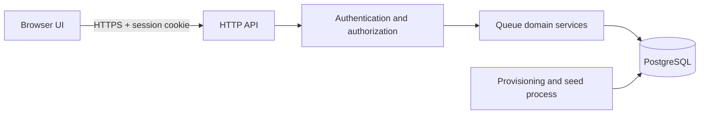

# System-Level Software Design Specification

> **Version:** 1.1 | **Last Updated:** 2026-11-27 | **Sprint 1 Baseline:** commit `e304cd9` (`main`), deployed revision `qms-00005-5kz` | **Change Ref:** Issue #51 (Lab 7 Part A — BR-06)

This specification describes the Sprint 1 baseline design and approved post-baseline contract updates. Implementation decisions recorded in §§10–12 document verified Sprint 1 behaviors.

## 1. Architecture Overview

QMS is a browser client, an HTTP API, a domain-service layer, and a PostgreSQL relational database. The browser renders customer and operator workflows and sends requests to the API. The API authenticates sessions, validates inputs, authorizes roles and resource access, applies business rules, and executes database transactions. PostgreSQL is the source of truth for persisted queue state, uniqueness, and concurrency control.



### 1.1 Request processing

For protected requests, the API processes work in this order:

1. Authenticate the session; reject absent, invalid, or expired sessions.
2. Validate route parameters, query parameters, and request payload.
3. Authorize the user's role and, where applicable, queue assignment or entry ownership.
4. Validate the requested business operation and lifecycle state.
5. Execute the mutation in a database transaction.
6. Commit before returning a successful mutation response.
7. Return only the contractually permitted data.

Authorization and ownership checks are server-side. UI control visibility is not an authorization boundary.

## 2. Role and Permission Matrix

`—` means the role does not have the operation. Anonymous requests to protected operations receive `401 UNAUTHORIZED`. Future-sprint behavior is not a Sprint 1 permission.

| Action / endpoint | Anonymous | CUSTOMER | OPERATOR | Authorization / expected result |
|---|---|---|---|---|
| `POST /api/auth/login` | May submit credentials | May submit credentials | May submit credentials | Valid credentials establish a session; invalid credentials receive `401 UNAUTHORIZED` without disclosing account state. |
| `POST /api/auth/logout` | `401 UNAUTHORIZED` | May revoke own session | May revoke own session | Successful logout returns `204 No Content` with no body. |
| `GET /api/auth/me` | `401 UNAUTHORIZED` | May read own authenticated identity | May read own authenticated identity | Returns current session user's ID, email, and role. |
| Access any protected endpoint without a valid session | `401 UNAUTHORIZED` | — | — | Authentication is required before protected business operations. |
| `GET /api/queues` | `401 UNAUTHORIZED` | May list OPEN queues | May list OPEN queues | Only OPEN queues are returned. |
| `POST /api/queues/{queueId}/entries` | `401 UNAUTHORIZED` | May join an OPEN queue | `403 FORBIDDEN` | Closed queue returns `409 QUEUE_NOT_AVAILABLE`; same-queue duplicate returns `409 DUPLICATE_ACTIVE_ENTRY`; holding 2 active entries across queues returns `409 MAX_ACTIVE_ENTRIES_REACHED` (`BR-06`). |
| `GET /api/me/queue-entries` | `401 UNAUTHORIZED` | May list own entries | `403 FORBIDDEN` | Results are scoped to the authenticated customer. |
| `GET /api/me/queue-entries/{entryId}` | `401 UNAUTHORIZED` | May read own entry | `403 FORBIDDEN` | Another customer's or missing entry returns `404 RESOURCE_NOT_FOUND`; resource existence is not disclosed. |
| `POST /api/me/queue-entries/{entryId}/cancel` (Sprint 2, F-07) | `401 UNAUTHORIZED` | May cancel own `WAITING` entry | `403 FORBIDDEN` | Another customer's or missing entry returns `404 RESOURCE_NOT_FOUND`; a non-`WAITING` entry returns `409 INVALID_STATE_TRANSITION`; a change during the request returns `409 CONCURRENT_MODIFICATION`. Queue availability is not checked. |
| `GET /api/operator/queues` | `401 UNAUTHORIZED` | `403 FORBIDDEN` | May list assigned queues | Assignment scope is enforced by the API. |
| `GET /api/operator/queues/{queueId}/entries` | `401 UNAUTHORIZED` | `403 FORBIDDEN` | May list assigned queue entries | Unassigned queue access returns `403 FORBIDDEN`; queue order is deterministic FIFO. |
| `POST /api/operator/queues/{queueId}/call-next` | `401 UNAUTHORIZED` | `403 FORBIDDEN` | May call next in an assigned queue | Unassigned access returns `403 FORBIDDEN`; invalid transitions return `409 INVALID_STATE_TRANSITION`; empty queue returns `204` with no body. |
| `POST /api/operator/queue-entries/{entryId}/start` | `401 UNAUTHORIZED` | `403 FORBIDDEN` | May start an entry in an assigned queue | Unassigned access returns `403 FORBIDDEN`; missing resource returns `404 RESOURCE_NOT_FOUND`; invalid transition returns `409 INVALID_STATE_TRANSITION`. |
| `POST /api/operator/queue-entries/{entryId}/complete` | `401 UNAUTHORIZED` | `403 FORBIDDEN` | May complete an entry in an assigned queue | Unassigned access returns `403 FORBIDDEN`; missing resource returns `404 RESOURCE_NOT_FOUND`; invalid transition returns `409 INVALID_STATE_TRANSITION`. |
| Customer queue position calculation | Not available | Not specified by the Sprint 1 API | Not specified by the Sprint 1 API | Sprint 1 exposes entry status and FIFO-ordered operator entries; a customer-facing position endpoint is not defined. |
| Customer cancellation or withdrawal | Not available | Planned for Sprint 2 (F-07) | — | Not part of Sprint 1. *Rev. 2026-11-27:* specified as `POST /api/me/queue-entries/{entryId}/cancel`, see §13. |
| No-show handling | Not available | — | Planned for Sprint 2 (F-08) | Not part of Sprint 1. *Rev. 2026-11-27:* specified as the two rows below, see §14. |
| `POST /api/operator/queue-entries/{entryId}/no-show` (Sprint 2, F-08) | `401 UNAUTHORIZED` | `403 FORBIDDEN` | May mark a `CALLED` entry in an assigned queue no-show | Unassigned access returns `403 FORBIDDEN`; a missing entry `404`; any other status `409 INVALID_STATE_TRANSITION`. Queue availability is not checked. |
| `POST /api/operator/queue-entries/{entryId}/recover` (Sprint 2, F-08) | `401 UNAUTHORIZED` | `403 FORBIDDEN` | May return a `NO_SHOW` entry in an assigned queue to the queue once | Unassigned `403`; missing `404`; not `NO_SHOW` `409 INVALID_STATE_TRANSITION`; already returned once `409 RECOVERY_LIMIT_REACHED`; customer has another active entry in the queue `409 DUPLICATE_ACTIVE_ENTRY`. |
| `GET /api/operator/queues/{queueId}/counters` (Sprint 2, F-09) | `401 UNAUTHORIZED` | `403 FORBIDDEN` | May list counters in an assigned queue | Missing queue returns `404 RESOURCE_NOT_FOUND`; unassigned returns `403 FORBIDDEN`; deterministic order `name ASC, id ASC`. |
| `PATCH /api/operator/counters/{counterId}/status` (Sprint 2, F-09) | `401 UNAUTHORIZED` | `403 FORBIDDEN` | May open or close a counter in an assigned queue | Unassigned or mismatched `assignedOperatorId` returns `403 FORBIDDEN`; missing counter `404`; invalid body `400 INVALID_ARGUMENT`. Queue availability is not checked. |
| `POST /api/operator/counters/{counterId}/call-next` (Sprint 2, F-09) | `401 UNAUTHORIZED` | `403 FORBIDDEN` | May call next in an assigned queue for an `OPEN` counter | Unassigned or mismatched `assignedOperatorId` returns `403 FORBIDDEN`; missing counter `404`; closed counter `409 COUNTER_CLOSED`; empty queue `409 NO_WAITING_ENTRIES`. |

### 2.1 Authorization rules

- Authentication is checked before protected business operations.
- CUSTOMER may read only their own queue-entry data. Cross-owner reads return the same `404 RESOURCE_NOT_FOUND` behavior as a missing entry.
- OPERATOR may view or operate only queues to which they are assigned. Assignment failures return `403 FORBIDDEN`; they are not masked as customer privacy failures.
- Role checks, entry ownership, and operator assignment are enforced server-side for every request.
- Hiding or disabling UI controls does not replace API authorization.
- Provisioning and seed operations are setup responsibilities, not an interactive runtime role or public API permission.

## 3. Data Model

The following fields describe the Sprint 1 logical model. IDs are UUIDs; timestamps are PostgreSQL `timestamptz` values stored in UTC.

### 3.1 User

| Field | Type | Constraints |
|---|---|---|
| `id` | UUID | Primary key |
| `email` | `varchar(254)` | Required, unique normalized login identifier |
| `passwordHash` | `varchar(255)` | Required salted adaptive hash; never returned by the API |
| `role` | enum `CUSTOMER`, `OPERATOR` | Required |
| `accountStatus` | enum `ACTIVE`, `DISABLED` | Required |
| `createdAt` | `timestamptz` | Server-generated |
| `updatedAt` | `timestamptz` | Server-generated |

### 3.2 ServiceQueue

| Field | Type | Constraints |
|---|---|---|
| `id` | UUID | Primary key |
| `name` | `varchar(120)` | Required |
| `description` | `varchar(500)` | Nullable |
| `availability` | enum `OPEN`, `CLOSED` | Required |
| `lastQueueNumber` | `BIGINT` | Required, default `0`, `CHECK ("lastQueueNumber" >= 0)` |
| `createdAt` | `timestamptz` | Server-generated |
| `updatedAt` | `timestamptz` | Server-generated |

`lastQueueNumber` is a per-service-queue allocation counter, not a global or in-memory counter. It records the largest number allocated to that queue. It must not move backwards during normal operation. BR-04 specifies no automatic reset in Sprint 1; no reset operation is defined.

### 3.3 OperatorAssignment

| Field | Type | Constraints |
|---|---|---|
| `operatorId` | UUID | Foreign key to `User` |
| `serviceQueueId` | UUID | Foreign key to `ServiceQueue` |
| `assignedAt` | `timestamptz` | Server-generated |

The composite primary key is `(operatorId, serviceQueueId)`. Only OPERATOR users may be assigned. The key supports listing queues by operator; no additional index is specified without a demonstrated query need.

### 3.4 QueueEntry

| Field | Type | Constraints |
|---|---|---|
| `id` | UUID | Primary key |
| `customerId` | UUID | Required foreign key to `User` |
| `serviceQueueId` | UUID | Required foreign key to `ServiceQueue` |
| `queueNumber` | `BIGINT` | Required, `CHECK ("queueNumber" > 0)` |
| `status` | enum `WAITING`, `CALLED`, `SERVING`, `COMPLETED` | Required |
| `joinedAt` | `timestamptz` | Server-generated |
| `calledAt` | `timestamptz` | Nullable |
| `serviceStartedAt` | `timestamptz` | Nullable |
| `completedAt` | `timestamptz` | Nullable |
| `cancelledAt` (Sprint 2, F-07) | `timestamptz` | Nullable; set only together with `status = CANCELLED` |
| `noShowAt` (Sprint 2, F-08) | `timestamptz` | Nullable; time of the latest no-show |
| `recoveredAt` (Sprint 2, F-08) | `timestamptz` | Nullable; time the entry was returned to the queue |
| `noShowCount` (Sprint 2, F-08) | `INTEGER` | Required, default 0, `CHECK ("noShowCount" >= 0 AND "noShowCount" <= 2)` |
| `counterId` (Sprint 2, F-09) | UUID | Nullable; composite FK `("counterId", "serviceQueueId") -> Counter("id", "serviceQueueId")` (`MATCH SIMPLE`, `ON DELETE RESTRICT ON UPDATE RESTRICT`); `NULL` for `WAITING`/`CANCELLED` and legacy calls |
| `priority` (Sprint 2, F-10) | enum `QueuePriority` (`NORMAL`, `PRIORITY`) | Required, default `'NORMAL'`; mutable only while `status = WAITING` by an assigned `OPERATOR`; preserved on F-08 `NO_SHOW` recovery |

The lifecycle and active-state definitions match the SRS: active states are `WAITING`, `CALLED`, and `SERVING`; `COMPLETED` is terminal. Completed entries remain for historical review.

*Rev. 2026-11-27 (F-07):* the `status` enum gains `CANCELLED` (`WAITING`, `CALLED`, `SERVING`, `COMPLETED`, `CANCELLED`). `CANCELLED` is terminal and not active; cancelled entries also remain for history. The active states, and therefore the partial unique index below, are unchanged. See §13.

#### Required database constraints and indexes

```sql
ALTER TABLE "ServiceQueue"
  ADD CONSTRAINT "ServiceQueue_lastQueueNumber_nonnegative_chk"
  CHECK ("lastQueueNumber" >= 0);

ALTER TABLE "QueueEntry"
  ADD CONSTRAINT "QueueEntry_queueNumber_positive_chk"
  CHECK ("queueNumber" > 0),
  ADD CONSTRAINT "QueueEntry_serviceQueueId_queueNumber_key"
  UNIQUE ("serviceQueueId", "queueNumber");

CREATE INDEX "QueueEntry_fifo_idx"
ON "QueueEntry" ("serviceQueueId", "joinedAt" ASC, "id" ASC);

CREATE UNIQUE INDEX "QueueEntry_active_customer_queue_uidx"
ON "QueueEntry" ("customerId", "serviceQueueId")
WHERE "status" IN ('WAITING', 'CALLED', 'SERVING');

CREATE INDEX "QueueEntry_customer_joinedAt_idx"
ON "QueueEntry" ("customerId", "joinedAt" DESC);
```

- The queue-number unique constraint prevents duplicate numbers within a service queue.
- The FIFO index filters by queue and orders entries by `joinedAt`, with `id` as a stable tie-breaker for equal timestamps. This matches the API and BR-01 ordering contract.
- The partial unique index prevents a customer from holding more than one active entry in the same queue while permitting completed history and a later rejoin.
- The customer-history index supports `GET /api/me/queue-entries`, which filters by customer and can return completed as well as active entries.
- No separate status or availability index is specified for Sprint 1: the current access patterns do not establish that it is needed. PostgreSQL does not automatically index referencing foreign-key columns; add further indexes only if measured query patterns justify them.

#### Prisma and PostgreSQL-specific definitions

Prisma models can declare ordinary fields, primary keys, unique constraints, and standard indexes. The partial unique active-entry index uses a status predicate and must be represented by a PostgreSQL SQL migration unless the selected Prisma version explicitly supports that exact predicate. The migration and Prisma model must describe the same logical fields and constraints. No migration or Prisma schema exists in this documentation-only repository.

## 4. Concurrency and Integrity Design

### 4.1 Queue-number allocation and cross-queue active entry cap (BR-03, BR-05, BR-06)

Queue number allocation uses the PostgreSQL row-level locking decision in BR-03 and AD-02, extended in Issue #51 (Lab 7 Part A) to enforce the cross-queue 2-active-entry cap (BR-06) safely under concurrent joins to *distinct* queues by the same customer. The implementation must perform these logical steps in one database transaction:

1. Begin a transaction and acquire a **customer-scoped serialization lock** (`SELECT id FROM "User" WHERE id = $customerId::uuid FOR NO KEY UPDATE`) *before* locking the target `ServiceQueue` row. Consistent lock ordering (`User` → `ServiceQueue`) prevents deadlocks while serializing concurrent joins by the same customer across distinct queues so two racing joins cannot bypass the 2-active-entry cap. Using `FOR NO KEY UPDATE` (rather than `FOR UPDATE`) avoids conflicting with PostgreSQL `FOR KEY SHARE` locks taken by foreign-key inserts (such as `Session` rows during login).
2. Acquire a row-level lock on the target `ServiceQueue` row (`SELECT ... FROM "ServiceQueue" WHERE id = $queueId::uuid FOR UPDATE`).
3. Confirm the queue exists (`404 RESOURCE_NOT_FOUND`) and is `OPEN` (`409 QUEUE_NOT_AVAILABLE`).
4. Confirm the customer does not already hold an active entry (`status IN ('WAITING', 'CALLED', 'SERVING')`) in the **same** queue; if so, reject with `409 DUPLICATE_ACTIVE_ENTRY` (BR-05 / `CR51-AC4` takes precedence over BR-06).
5. Count the customer's active entries (`status IN ('WAITING', 'CALLED', 'SERVING')`) across **all** queues; if the count is `>= 2`, reject with `409 MAX_ACTIVE_ENTRIES_REACHED` (BR-06 / `CR51-AC2`) before mutating `lastQueueNumber`. Terminal statuses (`COMPLETED`, and future `CANCELLED`/`NO_SHOW` once implemented) are excluded from the active count.
6. Increment that queue's `lastQueueNumber`.
7. Use the newly allocated value as `QueueEntry.queueNumber`.
8. Insert the `QueueEntry` with status `WAITING` and a server-generated `joinedAt` (`clock_timestamp()` captured after acquiring the queue lock).
9. Commit the transaction before returning `201 Created`.

The counter increment and entry insert are atomic: any validation failure (including `409 MAX_ACTIVE_ENTRIES_REACHED`) or DB error rolls back the entire transaction so `lastQueueNumber` is never leaked. The unique constraint on `(serviceQueueId, queueNumber)` remains the final duplicate-number guard, and the partial unique index `QueueEntry_active_customer_queue_uidx` remains the final same-queue duplicate guard. No schema migration is required for BR-06 because `QueueEntry_customer_joinedAt_idx` already indexes `customerId` and the active-status filter `IN ('WAITING', 'CALLED', 'SERVING')` is forward-compatible with future terminal statuses.

### 4.2 Entry lifecycle and call-next

Allowed transitions are `WAITING -> CALLED -> SERVING -> COMPLETED`. Lifecycle status and corresponding server-generated UTC timestamp are committed atomically. Call-next selects the oldest eligible WAITING entry by `joinedAt ASC, id ASC` and claims it in a transaction so concurrent operators cannot claim the same entry. If no eligible entry exists, the API returns `204 No Content` without changing state. Stale or conflicting mutations use the API's `409` conflict contract.

*Rev. 2026-11-27 (F-07):* one more transition, `WAITING -> CANCELLED`, performed by the owning customer with a conditional update (`... WHERE id = ? AND customerId = ? AND status = 'WAITING'`). It is mutually exclusive with Call Next on the same row; see §13 and the [F-07 feature SDS §10](./features/sprint-2-f07-customer-cancellation.md#10-concurrency-design).

## 5. API Conventions

The authoritative base path is `/api`, as established in the Sprint 1 API specification. Versioning is not currently defined; this design preserves the existing path rather than introducing a new `/api/v1` contract during Sprint 1.

### 5.1 URL and method conventions

Use the existing resource paths and HTTP methods. The documented routes include `/api/auth/...`, `/api/queues/...`, `/api/me/queue-entries/...`, and `/api/operator/...`. Do not replace these with structural examples or add unapproved endpoints. JSON payloads use UTF-8; timestamps are RFC 3339 UTC.

### 5.2 Success responses

All successful responses with a JSON body use a `data` envelope:

```json
{
  "data": {
    "user": {
      "id": "example-id",
      "email": "customer@example.invalid",
      "role": "CUSTOMER"
    }
  }
}
```

List responses place the list in `data`, for example `{"data":{"queues":[]}}` or `{"data":{"entries":[]}}`; no pagination metadata or pagination contract is defined for Sprint 1. `204 No Content` responses (logout and empty Call Next) have no response body and do not use the envelope.

### 5.3 Error responses

When an error response has a body, it uses the API specification's stable error envelope:

```json
{
  "error": {
    "code": "INVALID_STATE_TRANSITION",
    "message": "The requested transition is not allowed.",
    "requestId": "request-id"
  }
}
```

HTTP status represents the protocol-level result; `code` is a stable machine-readable application error identifier; `message` is safe for clients; `requestId` supports diagnostics without disclosing internal details. Never expose database/SQL errors, stack traces, secrets, or private resource existence. Established codes are:

| HTTP status | Error code(s) | Use |
|---|---|---|
| 400 | `INVALID_ARGUMENT` | Malformed identifier, payload, query, or input validation failure |
| 401 | `UNAUTHORIZED` | Missing, invalid, or expired session; invalid credentials |
| 403 | `FORBIDDEN` | Authenticated user has the wrong role or lacks queue assignment |
| 404 | `RESOURCE_NOT_FOUND` | Unknown resource; also used for customer cross-owner lookup |
| 409 | `QUEUE_NOT_AVAILABLE`, `DUPLICATE_ACTIVE_ENTRY`, `MAX_ACTIVE_ENTRIES_REACHED`, `INVALID_STATE_TRANSITION`, `CONCURRENT_MODIFICATION` | Closed/ineligible queue, same-queue duplicate active join, cross-queue 2-active-entry cap reached (`BR-06`), invalid transition, or stale/conflicting mutation |
| 500 | `INTERNAL_ERROR` | Unexpected server failure; safe generic message only |

The contract does not use `422 Unprocessable Content`.

### 5.4 HTTP status conventions

| Status | Sprint 1 use |
|---|---|
| `200 OK` | Successful reads, login, and lifecycle mutations returning JSON |
| `201 Created` | Successful customer queue-entry creation |
| `204 No Content` | Successful logout and empty Call Next; no response body |
| `400 Bad Request` | Malformed or invalid request data |
| `401 Unauthorized` | Missing/invalid session or invalid credentials |
| `403 Forbidden` | Authenticated user lacks role permission or operator assignment |
| `404 Not Found` | Resource absent or customer-private entry not owned by requester |
| `409 Conflict` | Queue availability, duplicate active entry, cross-queue active entry cap reached (`BR-06`), invalid transition, or concurrent modification |
| `500 Internal Server Error` | Unexpected server failure with a safe error body |

## 6. UI Conventions and Common States

These are shared design requirements, not claims that UI components are implemented. The detailed screen map and role-specific interactions remain in the [Sprint 1 UI specification](./sprints/sprint-1/ui-spec.md).

### 6.1 Responsive layout

| Viewport | Layout guidance |
|---|---|
| 360–767 px | Mobile: single-column content, compact navigation, stacked forms and queue details |
| 768–1279 px | Tablet: flexible content width and navigation; use multi-column layouts only where readable |
| 1280 px and above | Desktop: wider content area and operator workspace/table layouts where appropriate |

The explicit Sprint 1 pass widths remain 360 px and 1280 px from NFR-06 and the UI specification. The 768 px tablet breakpoint is a layout guidance point, not a separately tested requirement. No page-level horizontal overflow is permitted at the specified test widths.

### 6.2 Loading and duplicate submission

- Use a localized spinner for short actions and skeleton placeholders for substantial page/list loading where useful.
- Indicate ongoing work; disable repeat submission while a mutation is pending.
- Preserve visible page context during local updates where possible.
- These are design requirements, not claims about existing loading components.

### 6.3 Empty states

- No available queues: explain that there are currently no OPEN queues.
- No waiting entries: show a neutral empty state; Call Next returns 204 and does not change queue state.
- No assigned queues: explain that the operator has no queue assignment.
- No queue history: show a clear empty result rather than a blank page.

### 6.4 Error and success feedback

- Show field-specific validation inline, operation failures in a user-safe alert or toast, and resource-load failures as a page-level error with retry only when retry is safe.
- Do not display server internals, SQL details, stack traces, secrets, or another customer's existence.
- Give confirmation for successful join (queue number and WAITING status), call-next (called entry), start (SERVING), and completion (COMPLETED).
- Empty Call Next uses the neutral empty state rather than a success or error with a response body.

### 6.5 Validation and status indicators

- Mark required inputs, describe invalid values next to the relevant field, and disable actions that are not valid for the current known state. The API remains authoritative and may reject stale UI state.
- Use the lifecycle values and labels `WAITING` (Waiting), `CALLED` (Called), `SERVING` (In service), and `COMPLETED` (Completed).
- Use text and icons, not color alone; maintain visible labels, keyboard focus, touch-friendly small-screen controls, and accessible status announcements.

## 7. Environment and Configuration

This repository has no application source, package manifest, runtime configuration, environment-variable references, setup scripts, or database migrations. Therefore, no environment-variable names, defaults, or setup commands are currently implemented or verified. The following is a **proposed minimum configuration contract for a future implementation**, not a claim about an existing stack. Names must be confirmed against the selected backend before implementation.

| Proposed variable | Required? | Purpose | Default / notes |
|---|---|---|---|
| `NODE_ENV` | Required if the selected backend is Node.js; otherwise use the equivalent runtime mode setting | Select development, test, or production behavior | Proposed name only; no project default is configured. |
| `PORT` | Required unless the implementation defines a documented safe default | HTTP API listen port | No configured default exists in this repository. |
| `DATABASE_URL` | Required | PostgreSQL connection string | Use a separate database for development, test, and production; never commit credentials. |
| `SESSION_SECRET` | Required | Secret material for session signing or encryption | Generate and provide securely per environment; no shared or committed default. |

Additional variables must be documented only when required by the selected implementation (for example, a separately configured CSRF secret if the chosen session design requires one). Development and test must use isolated databases and non-production session secrets. Production secrets must be injected through secure environment configuration, not checked into source control.

To satisfy NFR-07, a future implementation must document a clean-checkout workflow that configures required values, installs repository dependencies, initializes PostgreSQL schema and idempotent seed data, starts the application using repository-supported commands, and verifies the seeded customer, operator, assignment, and OPEN queue. Those commands cannot be stated or claimed as tested until implementation files exist and setup is run.

## 8. Security and Reliability

- Passwords use salted adaptive hashes (Argon2id or reviewed bcrypt configuration); credentials, hashes, and session secrets are never returned or logged.
- Authentication uses server-validated sessions in HTTP-only cookies; cookie-authenticated mutations require CSRF protection.
- Production session cookies are `Secure`, `HttpOnly`, and `SameSite=Lax`.
- Login failure responses do not disclose whether an account exists.
- Cross-owner customer lookups use `404 RESOURCE_NOT_FOUND`; operator access to unassigned queues uses `403 FORBIDDEN`.
- Mutation success is returned only after the database commit.
- All API error messages are safe for clients and omit implementation details.

## 9. Related Sprint 1 Contracts

- [SRS](./srs.md) defines requirements and business rules.
- [Feature inventory](./features.md) and [traceability matrix](./traceability.md) map requirements to features and verification.
- [Sprint plan](./sprints/plan.md) defines scope by sprint.
- [API specification](./sprints/sprint-1/api-spec.md), [UI specification](./sprints/sprint-1/ui-spec.md), and [test specification](./sprints/sprint-1/tests.md) define detailed contracts.

This SDS is aligned to the current Sprint 1 documentation baseline. No source code, schema, migration, API handler, UI component, or deployment configuration is implemented in this repository.

## 10. Implementation decisions (Issue #3)

These record choices the specification left open. They do not change any requirement, request/response shape, or error code above.

| Topic | Decision |
|---|---|
| Session storage | Server-side `Session` table (additive migration `20261112090500_auth_sessions`): `id` (UUID PK), `userId` (FK to `User`, `ON DELETE CASCADE`), `tokenHash` (`varchar(64)`, unique), `csrfToken` (`varchar(64)`), `createdAt`, `expiresAt` (`timestamptz`); indexes on `userId` and `expiresAt`. Logout deletes the row (AD-01, AUTH-003). |
| Session token | 32 random bytes, base64url, sent only in the session cookie. The database stores `HMAC-SHA256(SESSION_SECRET, token)` in hex, never the raw token. A session whose user is `DISABLED` is treated as unauthenticated. Expired rows are deleted when presented. |
| Session lifetime | 8 hours absolute from login; not extended by activity. Constant in code (`SESSION_TTL_MS`); no environment variable. |
| Cookies | `qms_session`: `HttpOnly`, `SameSite=Lax`, `Path=/`, `Secure` only when `NODE_ENV=production`, max age = remaining lifetime. `qms_csrf`: same attributes but not `HttpOnly`, so the client can read it. |
| CSRF delivery | A random CSRF token is generated per session at login, stored in `Session.csrfToken`, and set in the `qms_csrf` cookie (re-issued by `GET /api/auth/me`). The client sends it as `X-CSRF-Token` on every non-GET request; the server compares it to the session's token in constant time. It is never placed in a response body. |
| Login hardening | Email is trimmed and lower-cased before lookup. An unknown email still performs one bcrypt comparison against a fixed dummy hash. Unknown email, wrong password, and `DISABLED` account return the same `401 UNAUTHORIZED` body (`Invalid email or password.`) with no `Set-Cookie`. A successful login deletes any session presented with the request (session-fixation protection). Body validation: `email` string, 1–254 characters after trimming; `password` string, 1–200 characters. |
| Middleware order | `loadSession` (app level, never rejects) → `requireAuth` (401) → `requireCsrf` (403, mutations only) → validation → `requireRole` / `requireQueueAssignment` (403/404) → handler. |

## 11. Implementation decisions (Issue #5)

These record choices the specification left open for the customer screens. They do not change any requirement, endpoint, request/response shape, error code, or database schema above.

| # | Topic | Decision |
|---|---|---|
| 1 | Queue name on entries | Entry payloads carry only `serviceQueueId`. The client maps it to a name using `GET /api/queues`. A queue that is not in that list (for example closed after the customer joined) is shown with the neutral label `Service queue`. Spec gap: a team decision is needed on adding the queue name to the entry payload. |
| 2 | Refreshing | Re-fetch after every join; a visible `Refresh` button; polling every 10 seconds (`REFRESH_INTERVAL_MS` in `client/src/hooks/usePolling.ts`) of `GET /api/me/queue-entries` while My Active Tickets is shown and of the entry detail while the entry is not `COMPLETED`, only while `document.visibilityState === 'visible'`. A failed poll keeps the last data and shows "Could not refresh. Retrying...". Timers are cleared on unmount. Status changes are announced in an `aria-live="polite"` region. Spec gap: the interval was undefined. |
| 3 | Tabs | `/customer` uses an accessible tablist (`role="tablist"`/`tab`/`tabpanel`, `aria-selected`, `aria-controls`, roving `tabIndex`, Left/Right/Home/End keys). Available Queues is the default. After a join the user stays on the tab and sees a success panel (queue name, queue number, status, "View details" link); both lists are re-fetched. |
| 4 | Queue number display | The integer is shown exactly as returned. No prefix or padding until the number format is approved. |
| 5 | Detail messages | `WAITING` with `aheadCount` 0: "You are next"; with N ahead: "Currently waiting. N people ahead of you." (singular for 1); `CALLED`: "Please go to the service desk."; `SERVING`: "Your service is in progress."; `COMPLETED`: "Service completed." The ahead line appears only for `WAITING`. The list view does not show `aheadCount` and does not call the detail endpoint per item. |
| 6 | My Active Tickets content | Entries exactly as the API returns them (newest first), completed ones included and labelled `Completed`. No client-side grouping. |
| 7 | Join error mapping | `409 DUPLICATE_ACTIVE_ENTRY`: "You already have an active entry in this queue."; `409 QUEUE_NOT_AVAILABLE`: "This queue is not available right now." plus a queue-list re-fetch; `404 RESOURCE_NOT_FOUND`: "This queue is no longer available." plus a re-fetch; `403 FORBIDDEN` (includes CSRF failure): "We couldn't verify this request. Please refresh the page or sign in again." without logging out; anything else: "Something went wrong. Please try again." `401` uses the existing global session-expired handler. Server messages are never shown. Only the clicked queue's button is disabled. |
| 8 | Duplicate-click protection | Besides the disabled button and `Joining queue...` spinner, a per-queue in-flight guard (a ref) makes two fast clicks send exactly one request. The server's transaction and unique index remain authoritative. |
| 9 | Detail not found | `404` (missing or another customer's entry) and `400` (malformed id) show the same generic "We couldn't find that queue entry." with a link back to `/customer`. No entry data is rendered. |

## 12. Implementation decisions (Issue #6)

These record choices the specification left open for the operator workflow and endpoints. They do not change any requirement, endpoint, request/response shape, error code, or database schema above.

| # | Topic | Decision |
|---|---|---|
| 1 | Concurrency-safe Call Next & Known Limitation | `POST /api/operator/queues/:queueId/call-next` runs inside a PostgreSQL transaction using `SELECT "id", clock_timestamp() AS "now" FROM "QueueEntry" WHERE "serviceQueueId" = $1::uuid AND "status" = 'WAITING'::"QueueStatus" ORDER BY "joinedAt" ASC, "id" ASC LIMIT 1 FOR UPDATE SKIP LOCKED`. Concurrent `call-next` requests on the same queue skip rows locked by in-flight transactions and either claim the next eligible `WAITING` row (`200 OK`) or return `204 No Content` with an empty body if none remain (`CONCURRENCY-003`). **Known limitation:** under `FOR UPDATE SKIP LOCKED`, if Transaction A locks waiting entry #1 and subsequently rolls back after Transaction B skips #1 and calls entry #2, entry #2 is called before #1 (an acceptable trade-off for Sprint 1 non-blocking concurrency). |
| 2 | Concurrency-safe Start & Complete | `POST /api/operator/queue-entries/:entryId/start` and `/complete` acquire a row-level lock (`SELECT "id", "serviceQueueId", "status", clock_timestamp() AS "now" FROM "QueueEntry" WHERE "id" = $1::uuid FOR UPDATE`) inside a transaction, verify `OperatorAssignment` (`403 FORBIDDEN` if unassigned), verify expected status (`CALLED` for start, `SERVING` for complete; `409 INVALID_STATE_TRANSITION` otherwise), and record `serviceStartedAt` / `completedAt` directly from the `clock_timestamp()` captured when the row lock is acquired (`CONCURRENCY-004`). Note: the database schema only enforces `CHECK` constraints for `"queueNumber" > 0` (`QueueEntry_queueNumber_positive_chk`) and `"lastQueueNumber" >= 0` (`ServiceQueue_lastQueueNumber_non_negative_chk`); it does not define database `CHECK` constraints on lifecycle timestamp ordering or use `GREATEST(...)`. |
| 3 | Operator Queue Management layout | `/operator` lists the operator's assigned queues (`OPEN` and `CLOSED`) with availability badges and links to `/operator/queues/:id`. `/operator/queues/:id` groups entries into three sections: **Active Service** (`CALLED` and `SERVING`), **Waiting Queue — FIFO** (`WAITING` in `joinedAt ASC, id ASC` order), and **Completed** (`COMPLETED`), with a top-level **Call Next** action and per-entry **Start Service** (enabled only for `CALLED`) and **Complete Service** (enabled only for `SERVING`) controls. |
| 4 | Refreshing, conflict recovery & error mapping | Every operator mutation (`call-next`, `start`, `complete`) immediately re-fetches `GET /api/operator/queues/:queueId/entries` upon completion. If a concurrent operator action causes `409 INVALID_STATE_TRANSITION`, the UI shows a user-safe conflict banner and automatically refreshes the entry list so stale buttons are updated immediately. Action-level `403` errors distinguish CSRF verification failures (`"We couldn't verify this request. Please refresh the page or sign in again."`) from RBAC permission errors (`"You do not have permission to perform this action."`), and action-level `404` errors distinguish queue-level `call-next` (`"We couldn't find that service queue."`) from entry-level `start`/`complete` (`"We couldn't find that queue entry."`). Both `/operator` and `/operator/queues/:id` also poll every 10 seconds while visible (`usePolling`). |


*Rev. 2026-11-27 (F-08):* the `status` enum gains `NO_SHOW`. `NO_SHOW` is not active; it can return to `WAITING` once (`noShowCount` 1), and is final at `noShowCount` 2. The active states and the partial unique index are unchanged. See §14.

## 13. Sprint 2 design changes (F-07 Customer cancellation, rev. 2026-11-27)

Contract v1, pending review. The full design is in [features/sprint-2-f07-customer-cancellation.md](./features/sprint-2-f07-customer-cancellation.md); this section records only what F-07 changes in this system design.

| # | Area | Change |
|---|---|---|
| 1 | Status model | `QueueStatus` gains the terminal value `CANCELLED`. The only new transition is `WAITING -> CANCELLED`, by the owning customer. Active states stay `WAITING`, `CALLED`, `SERVING`. |
| 2 | Data model | `QueueEntry.cancelledAt timestamptz NULL`. Migration `20261127090000_f07_queue_entry_cancelled` (`ALTER TYPE "QueueStatus" ADD VALUE 'CANCELLED'`; `ALTER TABLE "QueueEntry" ADD COLUMN "cancelledAt" TIMESTAMPTZ`). The partial unique index `QueueEntry_active_customer_queue_uidx` and all other constraints and indexes are unchanged. No `CHECK` constraint is added for the new value (it cannot be used in the transaction that adds it). |
| 3 | API list | New `POST /api/me/queue-entries/{entryId}/cancel` (CUSTOMER, session + CSRF, no body, `200` with the updated entry). `cancelledAt` is added to every `QueueEntry` payload. `GET /api/operator/queues/{queueId}/entries` excludes `CANCELLED` entries. Details: [sprints/sprint-2/api-spec.md](./sprints/sprint-2/api-spec.md). |
| 4 | Concurrency | One transaction: read and check owner and status, then a conditional `UPDATE ... WHERE status = 'WAITING'`, with `cancelledAt = clock_timestamp()`. Zero rows updated → `409 CONCURRENT_MODIFICATION`. Call Next is unchanged and never claims a cancelled or cancel-locked row (`FOR UPDATE SKIP LOCKED`). |
| 5 | Unchanged | Queue catalog, queue-number allocation and join, authentication, session and CSRF middleware, operator Start and Complete, seed data, Docker image. |
| 6 | Deployment | The migration is additive and must be applied to the deployed database before the new revision serves traffic. Rolling back below this release after `CANCELLED` rows exist requires handling those rows first. |


## 14. Sprint 2 design changes (F-08 No-show handling and recovery, rev. 2026-11-27)

Contract v1, pending review. The full design is in [features/sprint-2-f08-no-show-recovery.md](./features/sprint-2-f08-no-show-recovery.md); this section records only what F-08 changes in this system design.

| # | Area | Change |
|---|---|---|
| 1 | Status model | `QueueStatus` gains `NO_SHOW`. New transitions `CALLED -> NO_SHOW` and `NO_SHOW -> WAITING` (once), both by an operator assigned to the entry's queue. Active states stay `WAITING`, `CALLED`, `SERVING`. |
| 2 | Data model | `QueueEntry.noShowAt timestamptz NULL`, `recoveredAt timestamptz NULL`, `noShowCount integer NOT NULL DEFAULT 0` with `CHECK` 0–2 (`QueueEntry_noShowCount_range_check`). Migration `20261127120000_f08_queue_entry_no_show`. The partial unique index and the other constraints are unchanged. |
| 3 | API list | New `POST /api/operator/queue-entries/{entryId}/no-show` and `/recover` (OPERATOR, session + CSRF, no body, `200` with the updated entry). The three fields are added to every `QueueEntry` payload. New error code `RECOVERY_LIMIT_REACHED` (409). Details: [sprints/sprint-2/api-spec.md](./sprints/sprint-2/api-spec.md) §7–§11. |
| 4 | Concurrency | No-show: lock the entry `FOR UPDATE`, check assignment and `CALLED`, update (same as Start, §4.2). Recover: lock the queue row (the lock join uses, §4.1), then the entry, then check assignment, state, limit and other active entries, then update. Lock order is queue row before entry row. |
| 5 | Unchanged | Join and queue-number allocation, Call Next, Start, Complete, `aheadCount`, the operator list filter, F-07 cancel, authentication, session, CSRF and RBAC middleware, seed data, Docker image. |
| 6 | Deployment | The migration is additive and must be applied to the deployed database before the new revision serves traffic. Rolling back below this release after `NO_SHOW` rows exist requires handling those rows first. |

## 15. Sprint 2 design changes (F-09 Multi-counter support, rev. 2026-11-27)

Contract v1.3 (2026-11-27), implemented and verified locally on `feature/sprint2/42-multi-counter-impl` (pending PR re-review by @TeekhathatTT). (*Rev. 2026-11-27 v1.1:* updated from Contract v1 to address PR review — composite FK, legacy Call Next explicit `counterId = NULL` & backwards-compatibility trade-off, honest rollback/roll-forward cleanup SQL, and counter-only Cloud SQL provisioning. *Rev. 2026-11-27 v1.2/v1.3:* aligned `GET .../counters` unknown `queueId` to `404 RESOURCE_NOT_FOUND`, upgraded composite FK to `ON DELETE RESTRICT ON UPDATE RESTRICT`, updated `seed.ts` to upsert counters by `(serviceQueueId, name)`, gated legacy UI fallback on loaded/non-error counter state, and added `COUNTER-019` legacy fallback E2E coverage.) The full design is in [features/sprint-2-f09-multi-counter.md](./features/sprint-2-f09-multi-counter.md); this section records only what F-09 changes in this system design.

| # | Area | Change |
|---|---|---|
| 1 | Status model | `QueueStatus` is unchanged. Adds `CounterStatus` enum (`OPEN`, `CLOSED`) on the new `Counter` entity (`OPEN` ↔ `CLOSED`). |
| 2 | Data model | New table `Counter` (`id`, `serviceQueueId` FK → `ServiceQueue`, `name` unique per queue `Counter_serviceQueueId_name_key`, `UNIQUE ("id", "serviceQueueId")` `Counter_id_serviceQueueId_key`, `status` default `OPEN`, optional `assignedOperatorId` FK → `User`, `createdAt`, `updatedAt`) and nullable `QueueEntry.counterId` with PostgreSQL composite FK `FOREIGN KEY ("counterId", "serviceQueueId") REFERENCES "Counter"("id", "serviceQueueId") ON DELETE RESTRICT ON UPDATE RESTRICT` (`MATCH SIMPLE`, default: allows `counterId IS NULL` while rejecting any non-null cross-queue `counterId` and blocking `Counter.serviceQueueId` updates while referenced). Migration `20261127150000_f09_multi_counter_support`. Existing indexes and constraints (including `QueueEntry_active_customer_queue_uidx` and `QueueEntry_noShowCount_range_check`) are unchanged. |
| 3 | API list | New `GET /api/operator/queues/{queueId}/counters`, `PATCH /api/operator/counters/{counterId}/status` (CSRF + JSON body `{ "status": "OPEN" \| "CLOSED" }`), and `POST /api/operator/counters/{counterId}/call-next` (CSRF, no body). Additive `counterId` and `counterName` added to every `QueueEntry` payload. New `409` error codes: `COUNTER_CLOSED` and `NO_WAITING_ENTRIES`. Legacy `POST /api/operator/queues/{queueId}/call-next` is preserved without counter `OPEN`/`assignedOperatorId` checks as an explicit backwards-compatibility trade-off for unmodified Sprint 1 / F-07 / F-08 server and client regression suites plus the zero-usable-counter UI fallback (`COUNTER-019`), and its `UPDATE` explicitly sets `"counterId" = NULL` (keeping `204` when empty). `recoverNoShowEntry` (F-08) clears `counterId = NULL` alongside `calledAt = NULL`. Details: [sprints/sprint-2/api-spec.md](./sprints/sprint-2/api-spec.md) §12–§16. |
| 4 | Concurrency | Counter status toggle locks `Counter` `FOR UPDATE`. Counter-scoped Call Next locks `Counter` `FOR UPDATE` (checking existence, assignment, `assignedOperatorId`, and `OPEN` status), then selects the oldest `WAITING` entry in `counter.serviceQueueId` with `FOR UPDATE SKIP LOCKED`. Lock order is strictly `Counter` → `QueueEntry` (and `ServiceQueue` → `QueueEntry` elsewhere), forming an acyclic lock graph with zero deadlock cycles. |
| 5 | Provisioning & seed | `server/prisma/seed.ts` (**local dev/test only**) idempotently upserts `Counter 1` and `Counter 2` (`OPEN`, `assignedOperatorId: null`) for each seeded queue by `(serviceQueueId, name)` (`update: {}`) using deterministic UUIDv4s on `create`, so re-seeding preserves existing IDs and operational counter state and running `provision:counters` followed by `seed` never throws `P2002`. Production / Cloud SQL uses `server/prisma/provision-counters.ts`, a dedicated idempotent **counter-only** provisioning script that inserts missing default counters without touching users, passwords, queues, or assignments. |
| 6 | Unchanged | Queue catalog, customer join and queue-number allocation, `aheadCount`, Start/Complete/No-show transitions, F-07 cancel, authentication/session/CSRF middleware, Docker build. (Legacy `callNextEntry` has a one-line `UPDATE` addition setting `"counterId" = NULL`, keeping `204`/`200`, FIFO, and locking unchanged.) |
| 7 | Deployment & rollback | Additive schema migration applied before serving the new revision, followed by the dedicated idempotent counter-only Cloud SQL provisioning step (never run demo `seed.ts` in production). **Rollback/roll-forward risk:** a pre-F-09 revision's `recoverNoShowEntry` does not clear `counterId`, which can leave `WAITING` rows with stale non-null `counterId`; run `UPDATE "QueueEntry" SET "counterId" = NULL WHERE "status" = 'WAITING' AND "counterId" IS NOT NULL;` after any rollback and before rolling forward again. |

### 15.1 Sprint 2 design changes (F-10 Priority queue policy, rev. 2026-11-28)

Contract v1.1 (2026-11-28, issue #43), pending final re-review by `@TeekhathatTT`. The full design is in [features/sprint-2-f10-priority-queue-policy.md](./features/sprint-2-f10-priority-queue-policy.md); this subsection records only what F-10 changes in this system design.

| # | Area | Change |
|---|---|---|
| 1 | Status & priority model | `QueueStatus` is unchanged. Adds `QueuePriority` enum (`NORMAL`, `PRIORITY`) on `QueueEntry` (`NOT NULL DEFAULT 'NORMAL'`). Priority is mutable only while `status = WAITING` by an assigned `OPERATOR` (no `ADMIN` role exists). |
| 2 | Data model & indexing | Adds `QueueEntry.priority "QueuePriority" NOT NULL DEFAULT 'NORMAL'` and partial expression index `QueueEntry_waiting_priority_fifo_idx` on `("serviceQueueId", (CASE WHEN "priority" = 'PRIORITY'::"QueuePriority" THEN 0 ELSE 1 END) ASC, "joinedAt" ASC, "id" ASC) WHERE "status" = 'WAITING'::"QueueStatus"`. Existing constraints and indexes are unchanged. |
| 3 | API list & ordering | New `PATCH /api/operator/queue-entries/{entryId}/priority` (assigned `OPERATOR`, CSRF, `{ "priority": "NORMAL" \| "PRIORITY" }`, `409 INVALID_STATE_TRANSITION` if not `WAITING`). `POST /api/queues/{queueId}/entries` validates `priority` **before** DB `404`/`409` lookups (empty/`"NORMAL"` allowed, `"PRIORITY"` → `403 FORBIDDEN`, malformed → `400 INVALID_ARGUMENT`). Both counter-scoped (F-09) and legacy (F-05) Call Next order `WAITING` rows by `(CASE WHEN "priority" = 'PRIORITY' THEN 0 ELSE 1 END) ASC, "joinedAt" ASC, "id" ASC`. `GET /api/operator/queues/{queueId}/entries` applies priority ranking **only to `WAITING` entries** (non-`WAITING` sections retain chronological `joinedAt ASC, id ASC`). `computeAheadCount` reflects priority-aware ordering (non-monotonic for `NORMAL` customers). `recoverNoShowEntry` (F-08) preserves `priority`. Additive `priority` field included on every serialized `QueueEntry`. Details: [sprints/sprint-2/api-spec.md](./sprints/sprint-2/api-spec.md) §17–§21. |
| 4 | Concurrency & known limitations | `updateEntryPriority` acquires a single `QueueEntry` `FOR UPDATE` row lock (acyclic lock order preserved, zero deadlocks). Under `FOR UPDATE SKIP LOCKED`, a concurrent Call Next skips a row locked by `PATCH .../priority` (returning `409 NO_WAITING_ENTRIES` or `204` if it is the sole `WAITING` entry). Anti-starvation is manual operator adjustment only in Sprint 2 (starvation risk for `NORMAL` entries documented as a known limitation; automatic aging deferred to Sprint 3+). |
| 5 | Unchanged | Authentication, sessions, CSRF, queue catalog, queue-number allocation, BR-05/BR-06 caps, F-07 cancel logic, F-08 recovery limits, F-09 counter management & provisioning, seed data, Docker build. |

## 16. Revision History

| Version | Date | Ref | Summary of Changes |
|---|---|---|---|
| 1.0 | 2026-11-11 | Sprint 1 Baseline | Initial System-Level SDS and verified Sprint 1 implementation decisions §§10–12 (accepted at `main` commit `e304cd9`, Cloud Run revision `qms-00005-5kz`). |
| 1.1 | 2026-11-27 | Issue #51 (Lab 7 Part A) | Updated §2 Role Matrix, §4.1 transaction locking & active-entry cap enforcement (`User` `FOR NO KEY UPDATE` → `ServiceQueue` `FOR UPDATE` lock order, `BR-05` precedence before `BR-06`, max 2 active entries across all queues; `CR51-AC1`–`CR51-AC4`), and §§5.3–5.4 error contract (`409 MAX_ACTIVE_ENTRIES_REACHED`). Confirmed no DB migration is required. |
| 1.2 | 2026-11-28 | Issue #43 (Sprint 2 F-10 Contract v1.1) | Added `QueueEntry.priority` to §3.4 and added §15.1 documenting F-10 priority queue policy changes (`QueuePriority`, partial expression index, `PATCH /api/operator/queue-entries/{entryId}/priority`, body-before-DB join validation, `WAITING`-only operator list priority sort, concurrency, and known limitations). |

