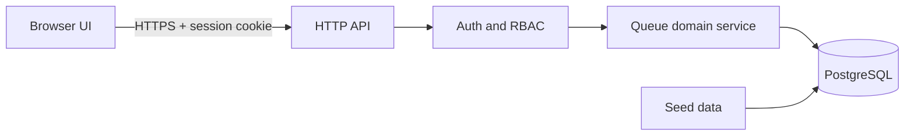

# System-Level Software Design Specification

## 1. Architecture Overview

The QMS architecture is a browser client, an HTTP API, a domain service layer, and a PostgreSQL-backed relational store. The browser is responsible for rendering user flows and sending API requests; the API is responsible for authentication, authorization, validation, and transaction execution; the database is responsible for persistence, uniqueness, and row-level concurrency control.

## 2. Request Flow and Security

The server enforces the following sequence for state-changing requests:
1. authenticate the session
2. validate the request payload and route parameters
3. authorize role and queue assignment
4. validate state and business rules
5. execute the transaction
6. commit the database change
7. return the typed success result

The application uses session-based authentication with secure HTTP-only cookies. Cookies are invalidated on logout and on session expiry. State-changing requests require CSRF protection; read-only requests are validated through the same session and authorization mechanism.

## 3. Data Model

### 3.1 User

| Field | Type | Constraints |
|---|---|---|
| id | UUID | primary key |
| email | varchar(254) | unique login identifier; normalized |
| passwordHash | varchar(255) | never exposed in the API |
| role | enum `CUSTOMER`,`OPERATOR` | required |
| accountStatus | enum `ACTIVE`,`DISABLED` | required |
| createdAt | timestamptz | server-generated |
| updatedAt | timestamptz | server-generated |

### 3.2 ServiceQueue

| Field | Type | Constraints |
|---|---|---|
| id | UUID | primary key |
| name | varchar(120) | required |
| description | varchar(500) | nullable |
| availability | enum `OPEN`,`CLOSED` | required |
| createdAt | timestamptz | server-generated |
| updatedAt | timestamptz | server-generated |

### 3.3 OperatorAssignment

| Field | Type | Constraints |
|---|---|---|
| operatorId | UUID | foreign key to User |
| serviceQueueId | UUID | foreign key to ServiceQueue |
| assignedAt | timestamptz | server-generated |

Composite primary key on `(operatorId, serviceQueueId)`; only OPERATOR users may be assigned.

### 3.4 QueueEntry

| Field | Type | Constraints |
|---|---|---|
| id | UUID | primary key |
| customerId | UUID | foreign key to User |
| serviceQueueId | UUID | foreign key to ServiceQueue |
| queueNumber | bigint | positive integer unique within queue |
| status | enum `WAITING`,`CALLED`,`SERVING`,`COMPLETED` | required |
| joinedAt | timestamptz | server-generated |
| calledAt | timestamptz | nullable |
| serviceStartedAt | timestamptz | nullable |
| completedAt | timestamptz | nullable |

Key invariants:
- a customer may have at most one active entry per queue
- the queue number unique constraint is enforced by the database
- completed entries remain in the table for historical review
- lifecycle timestamps are written when the status change is committed

## 4. Concurrency and Integrity Design

### 4.1 Queue-number allocation

Queue-number allocation is protected inside a transactional database update. The implementation must lock the target queue row before validation and allocation. The queue record is updated in the same transaction that inserts the new waiting entry. This ensures that serial requests cannot assign the same queue number to different customers.

### 4.2 Duplicate active-entry enforcement

The system must prevent a customer from having multiple active entries in the same queue. The implementation may rely on a partial unique index or a transactionally locked validation pattern, but it must not depend only on in-memory checks. The database is the final authority for this invariant.

### 4.3 Call-next behavior

The operator call-next operation selects the oldest eligible `WAITING` row in FIFO order, then updates it to `CALLED` in the same transaction. If no eligible row exists, the endpoint returns `204 No Content` without modifying any row.

## 5. API and UI Design Contracts

The API and UI contracts are maintained in the Sprint 1 engineering artifacts:
- [sprints/sprint-1/api-spec.md](./sprints/sprint-1/api-spec.md)
- [sprints/sprint-1/ui-spec.md](./sprints/sprint-1/ui-spec.md)
- [sprints/sprint-1/tests.md](./sprints/sprint-1/tests.md)

## 6. Security and Reliability

- login attempts are rate-limited and do not reveal whether an account exists
- session cookies are `HttpOnly`, `SameSite=Lax`, and `Secure` in production
- customer cross-owner lookups return `404 RESOURCE_NOT_FOUND` to avoid enumeration
- operator access to unassigned queues returns `403 FORBIDDEN`
- all successful mutations are committed before the API responds

## 7. Local Setup and Seed Data

This repository is specification-only for Sprint 1. The implementation branch is expected to include:
- database migrations and schema creation
- idempotent seed data for at least one OPEN queue, a sample customer, and an assigned operator
- local verification scripts for login, queue join, operator processing, and regression tests

This design intentionally delays deployment and Docker-level configuration to future lab work.